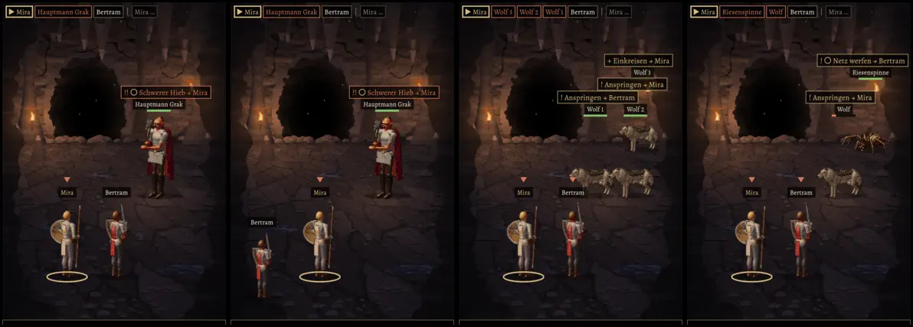

# 211 · MARS: zwei in einer Reihe nebeneinander auf gleicher Höhe, passt?
Jerry · 19.10., 20:48 · E Kampf · M (Anlass: Vorgangsarchiv 211.9 „Vor Build 37 Standbild in der Chefsache“)
Kurz: gebaut auf `claude/jerry-223-nachteil-hinten`; passt so für Build 37? (Empfehlung: ja)

Echte MARS-Proben, Vorschau `MARS211=grak|wolves|spider MARS211FORMAT=a56 [MARS211HINTEN=1]`.

**Gebaut:** beide Plätze einer Reihe auf einer Höhe, nebeneinander, beide Seiten; eine Figur allein steht mittig (211.7), vorn und hinten also auf einer Linie zum Gegner. Die Ansage des rechten von zwei Gegnern steht eine Zeile höher (sonst überdeckten sich „Anspringen“ der Wölfe), und keine Ansage ragt mehr über den rechten Rand (Bild 4, „Netz werfen → Bertram“).

**Frage:** Passt so, Build 37 nach Test 36?

**Empfehlung: ja.**

*Stärkstes Gegenargument:* Stehen zwei Gegner vorn und einer hinten (Wölfe), drängen sich oben rechts drei Ansagen übereinander; lesbar, aber eng. Auf dem kleinen Format rutschen sie bis unter die Zugleiste.

**Berührt:** 211, 223, 225, 219T.1.
