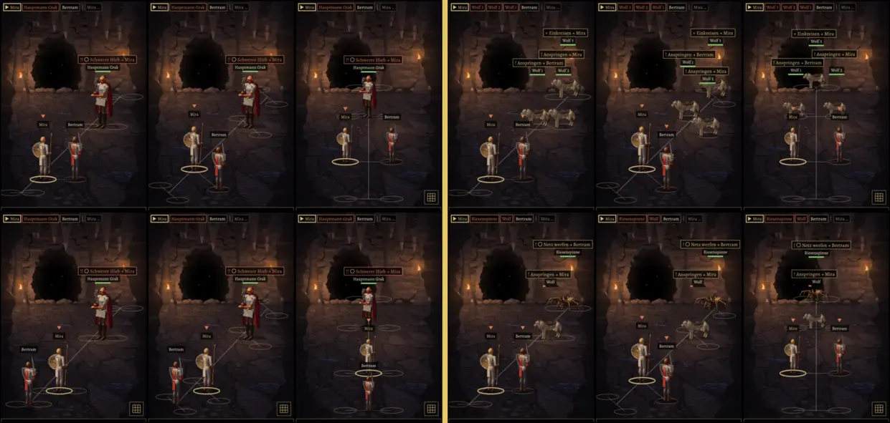
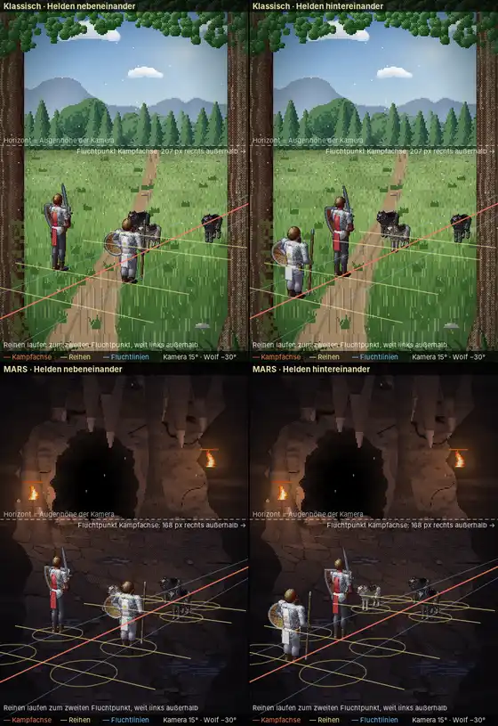
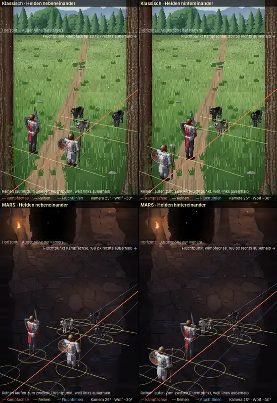
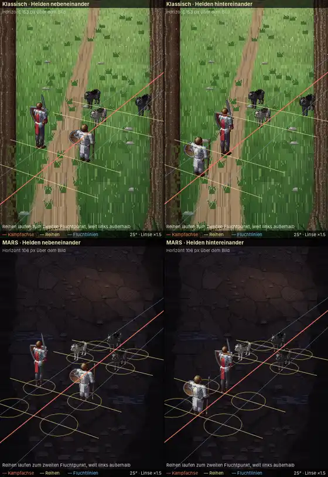
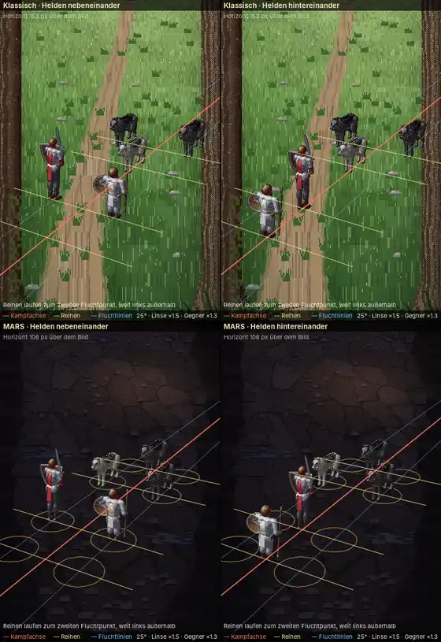
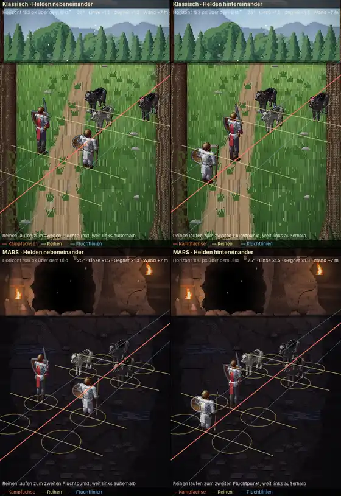

# 211 · MARS: Stellung im Kampfort, jetzt, Versatz oder gerade Achse?
Jerry · 19.10., 21:58 · E Kampf · M (Anlass: Vorgangsarchiv 211.10, Chef 21:08 „Bilder im Vergleich nebeneinander (gleiche Reihe)! wie jetzt und mit Versatz“; 21:39 „Diagonalperspektive aber nicht perspektivisch Höhleneingang. Das wirkt schräg.“)
Kurz: je Probe drei Bilder: jetzt, Versatz, gerade Achse; welche Fassung? (Empfehlung: gerade Achse, mit neuen Figurenbildern)

Echte MARS-Proben, gleiche Würfel. Dünne Linien nur in der Vorschau: Kampfachse und je Reihe die Linie ihrer zwei Plätze; goldene Umrisse am Boden: das Raster (229). Vorschau `MARS211=grak|wolves|spider MARS211FORMAT=a56 MARS211LINIEN=1 MARS211RASTER=1 [MARS211VERSATZ=1 | MARS211GERADE=1] [MARS211HINTEN=1]`.

**Jetzt:** schräge Achse (Helden unten links, Gegner oben rechts), zwei einer Reihe nebeneinander auf gleicher Höhe. **Versatz:** schräge Achse, die zwei einer Reihe quer zur Achse. **Gerade Achse:** Gegner mittig über den Helden, Reihen waagerecht, wie die Höhle von vorn gezeichnet ist; damit vier Reihen übereinander passen, alle Figuren ein Fünftel kleiner. In allen: hinten nie kleiner als vorn, eine Figur allein steht mittig.

**Was die Figurenbilder für die gerade Achse brauchen:** heute schauen Helden schräg nach rechts oben (Dreiviertel von hinten), Gegner schräg nach links unten. Helden sind als kleines 3D-Gerüst gebaut und lassen sich in jede Richtung drehen: von hinten mit Schlag nach oben ist eine neue Blickrichtung samt angepasster Schlagbewegung, kein neues Zeichnen. Gegner sind einzeln gezeichnet (Grak, Wolf, Spinne, Späher und alle weiteren) und bräuchten eine Ansicht von vorn für Stehen, Schlag, Treffer und Fallen; das ist der teure Teil. Ein eigener Vorgang, kein Teil von Build 37; bis dahin sähe die gerade Achse mit den schrägen Bildern aus wie im Bild.

**Frage:** Welche Fassung für Build 37: jetzt oder Versatz? Und die gerade Achse als eigenen Vorgang mit neuen Figurenbildern?

**Empfehlung:** Build 37 mit „jetzt“ (eindeutig: gleiche Höhe heißt gleiche Reihe); gerade Achse als eigener Vorgang nach dem Meilenstein, weil sie zur gezeichneten Höhle passt.

*Stärkstes Gegenargument:* Die gerade Achse passt erst mit neuen Figurenbildern; bis dahin bleibt der Bruch, den du bemängelt hast, und die Gegner von vorn kosten so viel wie ein ganzer Satz Gegnerbilder. Mit kleineren Figuren wird der Kampfort auf kleinen Handys eng (Namen über den Helden berühren die Füße der Gegner).

## Ansicht der Monster (Chef 21:42, 21:45, 21:47)

Vorschau `WOLFANSICHT=1`, `KAMPFWOLF=1`, `MARS211WOLFKAMERA=35[,-30]`. Im klassischen Kampf haben die Wölfe zufällige Felle, darum andere Farben.

**Befund (stimmt, Chef 21:47):** Die Kampfmonster sind 3D-Modelle wie auf der Gebietskarte; neu zeichnen muss man nichts. Im Kampf sieht die Kamera sie heute nur 15° von oben (Gebietskarte 38°) und um 60° seitlich gedreht; darum stehen die Beine wie im Profil. Beides sind Zahlen: 35° von oben zeigt den Rücken und die Beine schräg, die Drehung auf −30° stellt den Wolf in Dreiviertelansicht von vorn mit Blick zu den Helden. Das passt zur geraden Achse und zum klassischen Kampf (dort steht der Held unten links, die Gegner mittig darüber).

**Kosten (beide Systeme, `MonsterArt` ist gemeinsam):** Alle 18 Gegnerarten im Spiel (alle von Kapitel 1) sind 3D: Tiere (Wolf, Schreckenswolf, Keiler, Riesenratte), Ungeziefer (Spinne, Tausendfüßler, Fledermaus, Stirge, Schleim) und Gestalten auf dem Heldengerüst (Goblin, Bogenschütze, Skelett, Kobold, Zombie, Grottenschrat, Grak, Ghul, Schamane). (a) **Höhere Kamera** für alle Kampffiguren, Helden eingeschlossen: drei Stellen im Code, danach Füße, Schatten und Namenshöhe nachziehen und ein Standbild aller 18; etwa eine Sitzung, ein Build. (b) **Drehung zu den Helden** (Dreiviertel von vorn; Helden für die gerade Achse von hinten): dieselben Stellen, Angriffe laufen mit der Drehung mit, aber Sprünge und Stöße müssen je Art angesehen werden; etwa eine weitere Sitzung. Keine neuen Zeichnungen.

**Empfehlung:** (a) mit Build 37 oder gleich danach, weil es beide Systeme verbessert und nichts kostet außer Prüfen; (b) zusammen mit der geraden Achse als eigener Vorgang.

*Stärkstes Gegenargument:* Von oben gesehen wirken die Figuren kleiner und flacher; die Helden (Dreiviertel von hinten) und die Kampforte sind auf 15° abgestimmt und müssten mitgehen, sonst entsteht der nächste Bruch.

## Musterbild in richtiger Perspektive (211.11, Chef 22:05)

Vorschau `MUSTER211=1` (`MUSTER211PITCH=` für eine höhere Kamera). **So gebaut:** eine Bodenebene, eine Kamera; Horizont des Kampforts = Augenhöhe der Kamera; Mitte des Kampfs 15° von oben; jede Figur so groß, wie ihr Abstand sie macht, und aus ihrem eigenen Winkel gesehen. Wölfe −30° zu den Helden (wie festgelegt), Helden auf derselben Linie zurück (150°). Reihen 1,5 m hintereinander, die vorderen Reihen 2,8 m auseinander, zwei einer Reihe 1,8 m. Eingeblendet: Horizont, Kampfachse (rot), Reihen (gelb), Fluchtlinien längs der Achse (blau); MARS dazu die Plätze als Kreise am Boden.

**Was das Bild zeigt:** Weil die Achse 30° schräg in die Tiefe läuft, gibt es zwei Fluchtpunkte: den der Achse knapp rechts außerhalb des Bildes, den der Reihen weit links. Reihen laufen darum von links oben nach rechts unten, nicht waagerecht. Die Wölfe stehen fast hinter den Helden; bei 15° verdecken die Helden die vorderen Wölfe teilweise (MARS, nebeneinander), die Wölfe erscheinen etwa drei Viertel so groß. Der Weg im Wald-Kampfort läuft zu einem anderen Fluchtpunkt (Mitte); der Hintergrund müsste mitgehen.

### Vergleich 25° von oben (Chef 22:23)

`MUSTER211=1 MUSTER211PITCH=25`. Dieselbe Linse wie bei 15°, die Kamera steht höher und neigt sich stärker: Figuren in der Mitte gleich groß, der Horizont steigt (der Hintergrund des Kampforts geht mit, mehr Boden, weniger Himmel). Die Helden verdecken die Wölfe kaum noch; Reihen und Plätze sind klarer zu lesen; Rücken und Schultern der Figuren sind mehr zu sehen. Über dem Kampf bleibt viel leerer Boden, der Kampf rückt in die untere Hälfte.

### 25° mit längerer Linse (Zuruf 22:25 „Andere Perspektiven?“, Vorschlag Sokrates)

`MUSTER211=1 MUSTER211PITCH=25 MUSTER211LINSE=1.5 MUSTER211MITTE=0.58 [MUSTER211GEGNER=1.3]`. Längere Linse, Kamera so weit zurück, dass die Helden gleich groß bleiben; die Kamera zielt auf die Mitte des Kampfs (58 % der Höhe). Der Horizont liegt über dem Bild (kein Himmel mehr), die Tiefe wirkt flacher: hinten und vorn fast gleich groß, Reihen und Achse weniger steil. Darüber bleibt Boden, weil die Helden ihre Größe behalten. (b): die Wölfe 1,3-fach, näher an der Größe im Spiel; vorne verdecken sie nichts.

### (b) mit Rückwand (Sokrates 22:32)

`… MUSTER211GEGNER=1.3 MUSTER211WAND=7`. Die Rückwand steht 7 m hinter dem hintersten Wolf auf derselben Bodenebene, ihr Fuß im Bild (dunkle Fuge), so groß, wie der Abstand sie macht. Oben bleibt kein leerer Boden; der Kampfort behält Waldrand und Himmel bzw. Wand, Eingang und Fackeln. Für das Bild ist der Oberteil der heutigen Hintergründe nur versetzt und verkleinert; der Wald ist für die Ferne gezeichnet und wirkt darum aus der Nähe wie Buschwerk.

**Kosten neuer Hintergründe:** Beide Kampforte werden im Code gezeichnet (Wald: 6 Orte × 3 Lichter, Höhle: 5 Orte × 4 Lichter), keine fremden Bilder. Nötig: (1) Horizont aus der Kamera statt fester Anteil, Boden mit echter Tiefe (heute läuft die Bodentextur gleichmäßig); (2) Rückwand in endlicher Entfernung, für die Nähe gezeichnet (Wald: Stämme und Unterholz groß, Kronen angeschnitten; Höhle: Wand mit Eingang groß); (3) Kampfschirme rechnen Plätze und Größen aus derselben Kamera. Schätzung: Wald 1–2 Sitzungen, Höhle 1–2 Sitzungen, Kampfschirme 1 Sitzung, je Ort und Licht ein Standbild; zusammen 3–5 Sitzungen, ein bis zwei Builds.

**Frage:** Ist das das Muster (Bodenebene, Größe nach Abstand, Achse −30°)? Welche Kamera: 15°, 25°, 25° mit längerer Linse (a), (b) oder (b) mit Rückwand?

**Empfehlung:** (b) mit Rückwand: 25° mit längerer Linse, Gegner im Spielmaß, Rückwand in endlicher Entfernung; neue Hintergründe nach dem Meilenstein, bis dahin (b) mit versetztem Oberteil wie im Bild. Die Helden verdecken die Gegner nicht, Plätze und Reihen sind eindeutig, vorn und hinten fast gleich groß (nah an „hinten nie kleiner“, 211.10).

*Stärkstes Gegenargument:* 25° heißt alle Kampffiguren und beide Kampforte neu prüfen (Füße, Schatten, Namenshöhe, Hintergründe mit höherem Horizont); und Größe nach Abstand macht die Gegner kleiner, als sie heute sind (bisher „hinten nie kleiner“, 211.10); und jede Bewegung (Sprung, Schlag, Effekte) muss danach entlang der schrägen Achse laufen, also alle Kampfbewegungen nachziehen.

**Berührt:** 211, 229, 72u.1, 223, 225, 219T.1, 219.4.
