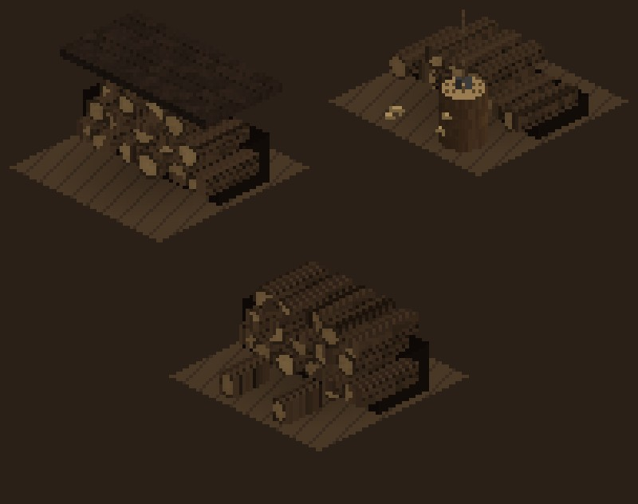

# 224 · Holzstapel niedriger und länger: passt es so?
Tom · 19.10., 20:54 · E Dorf · Zweig `claude/tom-224-holz-regal` (9765c29a) · Standbild vor dem Build (224.1, 228)
Kurz: Holzstapel neu (niedrig, lang): „passt“ → in Build 38

**Frage:** Passen die drei Looks so? Bei „passt“ kommt es in Build 38 (PR #126, Prüfpunkt 38.7), sonst ein Satz, was falsch aussieht.

**Was neu ist** (Vorgangsarchiv 224.1): Stapel über die ganze Feldbreite, gut halb so hoch wie vorher (vorher 84, jetzt 28–33, also etwa doppelt so lang wie hoch; zwei Hofkram-Felder nebeneinander an einer Wand ergeben einen durchgehenden Stapel), drei Reihen kleinerer Scheite. Oben links mit Brett als Dach, oben rechts mit Hackklotz und Axt davor (Klotz niedriger, steht jetzt vor dem Stapel statt neben ihm), unten mit zwei heruntergerollten Scheiten.

**Empfehlung:** „passt“.

**Stärkstes Gegenargument:** Am Gerät steht der Stapel teils hinter der Hauswand (er liegt quer zur Wand, nicht längs, wie bisher); ganz sichtbar wäre er nur, wenn er sich nach der Wand richtet. Das wäre ein eigener Umbau (Lage je Feld), nicht in Build 38.

Berührt: 224, 228, Build 38.
