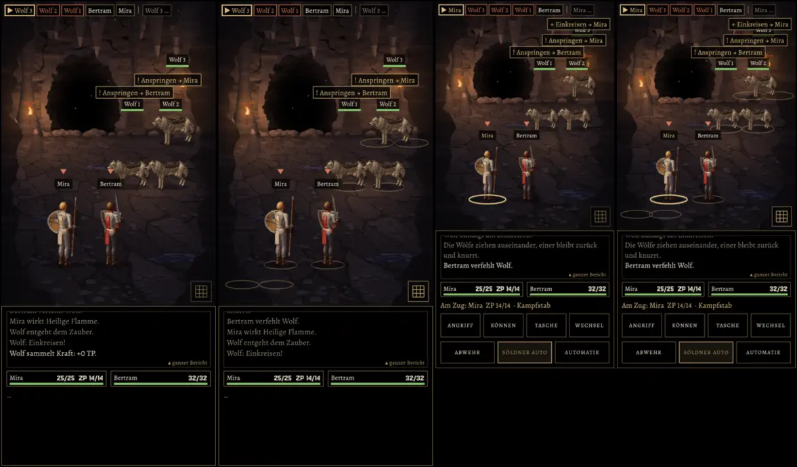

# 229 · MARS: Raster mit Gittersymbol rechts unten, passt so?
Jerry · 19.10., 21:34 · E Kampf · M (Anlass: Vorgangsarchiv 229.1 „erst als Standbild in die Chefsache, dann Build“)
Kurz: Gittersymbol rechts unten verdeckt nichts; passt so, Bau nach Build 37? (Empfehlung: ja, ohne Gegenvorschlag)

Echte MARS-Probe, Vorschau `MARS211=wolves MARS211FORMAT=a56|klein [MARS211RASTER=1]`.

**Gebaut** (auf `claude/jerry-223-nachteil-hinten`, im Spiel noch versteckt bis „passt“): Gittersymbol 40 dp rechts unten im Kampfort, halbtransparent; an heißt heller. Raster: vier goldene Umrisse je Seite am Boden; wer allein in seiner Reihe steht, steht zwischen seinen zwei Umrissen. Die Wahl bleibt gespeichert, Standard aus.

**Geprüft, was es verdeckt:** keine Figur, keinen Platz (auch nicht mit Versatz aus 211). Unten mittig stehen zwei Dinge, die breiter werden: der Hinweis „Tippen, wenn der große Ring …“ und die Erklärung nach langem Druck. Solange einer davon oder das Ringergebnis zu sehen ist, verschwindet das Symbol, so stiehlt es auch keinen Tipp auf den Ring. Darum kein Gegenvorschlag.

**Nebenbei behoben:** die hintere Reihe der Helden stand mit 211.9 zu weit links am Rand (Umriss abgeschnitten); jetzt etwas weiter innen.

**Frage:** Passt so, Bau nach Build 37?

**Empfehlung: ja.**

*Stärkstes Gegenargument:* Auf dem kleinen Format liegen die Umrisse der hinteren Reihe dicht am unteren Rand des Kampforts, und das Symbol ist nur 40 dp groß, ein Daumen trifft es knapp. Größer würde es mehr vom Boden verdecken.

**Berührt:** 229, 211, 211.10.
