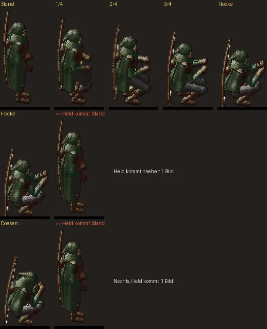

# 239 · Garrick am Feuer: Hinsetzen und Aufstehen ruckeln
Jerry (Übernahme von Tom) · 20.10., 12:10 · G Leute · M (Chef 20.10., 11:45: „Animationsübergang bei Garrick (sitzen/stehen) sehr unrund. Vielleicht grds mal schauen bei animationen, dass sie weich ineinander übergehen.“)

## Befund

Garrick hockt sich ab und zu ans Feuer. Nachgemessen, was dabei ruckelt:

1. **Hinsetzen und Aufstehen** dauern 0,9 s, aber in nur **4 Stufen**. Jedes Bild steht etwa eine Viertelsekunde, und die Hüfte sinkt je Bild um 10 cm (der Sprungtest erlaubt 6). Darum wirkt es stufig.
2. **Kommt der Held näher**, springt Garrick in **einem Bild** aus der Hocke (oder aus dem Dösen) in den Stand: 40 cm, fast das Siebenfache der Grenze. Geht der Held wieder weg, fällt er ebenso in einem Bild zurück in die Hocke, wenn sein Hocken noch andauert.
3. Der Sprungtest prüft Garricks Hocke bisher gar nicht.

Die anderen Haltungswechsel der Leute sind weich: Borin am Tisch (Trinken, Essen, Umsehen) bleibt unter der Grenze, ebenso Gewicht verlagern, Umsehen, Arme verschränken.

Zeile 1: Hinsetzen heute (Stand, drei Zwischenbilder, Hocke). Zeile 2 und 3: der Sprung, wenn der Held kommt (tags aus der Hocke, nachts aus dem Dösen).

## Vorschlag

1. Hinsetzen und Aufstehen in **8 Stufen** statt 4, gleiche Dauer: je Bild 5 cm, etwa so oft ein neues Bild wie beim Gehen.
2. **Kommt der Held**, steht Garrick zügig auf (0,45 s statt in einem Bild), aus dem Dösen hebt er erst den Kopf. Geht der Held, setzt er sich erst beim nächsten Mal wieder hin, mit Hinsetzen.
3. Der Sprungtest prüft künftig Garricks Hocke, damit es nicht wiederkommt.

**Empfehlung: alle drei.** *Stärkstes Gegenargument:* Das Hochschrecken in einem Bild war gewollt („er schreckt auf, wenn der Held kommt“, 10.10.); 0,45 s macht ihn ruhiger. Für 2 braucht es eine kleine Änderung in `WorldScreen.kt` (eine Stelle, mit Tom abgesprochen, bevor sie gebaut wird).

Danach Bildserie des neuen Hinsetzens hier, Build erst nach deinem „passt“ (228).

**Antwort:** „alle drei“, „1 und 3“ (Hochschrecken bleibt) oder „nein“.

**Berührt:** 239, 19e (Übergänge der Monster), Sprungtest 12a.
