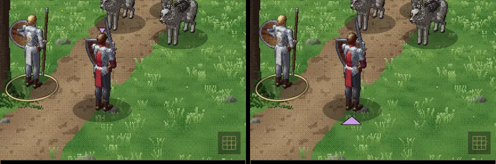
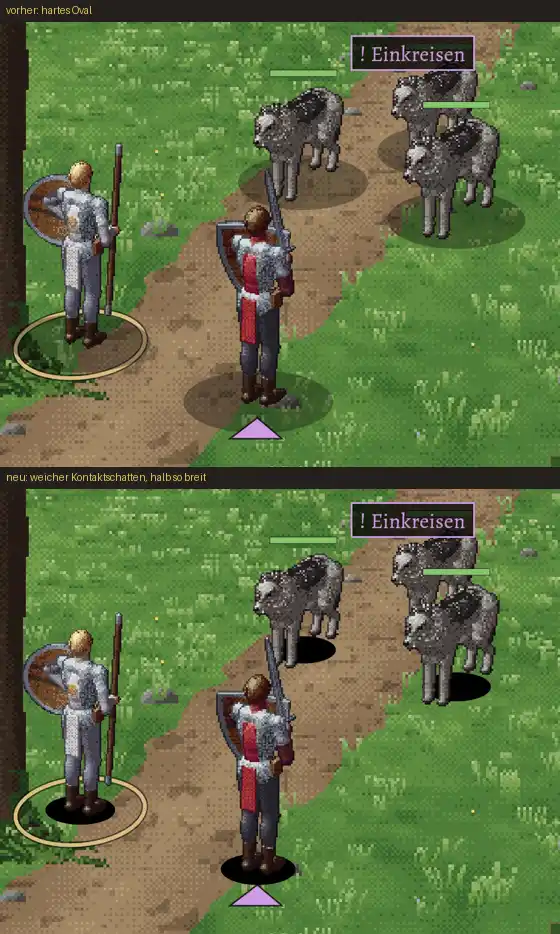

# 242 · MARS Wölfe: Einkreisen neben Anspringen; brauchen wir die Zieldreiecke?
Jerry · 20.10., 11:51 · E Kampf · M (Test B42, Chef 11:40: „Wie kann ein Wolf einkreisen und der andere anspringen? Das macht wenig Sinn, oder? Brauchen wir die Dreiecke über den Helden? Farbe im Kästchen und an der Schritfarbe zuordenbar, reicht das?“)

## 1. Einkreisen und Anspringen zugleich

**So ist die Regel** (`[210T.circle]`): Ein Wolf sagt „Einkreisen“ an und bleibt zurück. Wenn er an der Reihe ist, beißen **alle** Wölfe zugleich das Ziel in seiner Farbe (im Bild Bertram, lila). Bis dahin handeln die anderen Wölfe normal, springen also auch an. Ein Treffer auf den einkreisenden Wolf, auch ein leichter, sprengt den Kreis. Als Rudeljagd passt das: einer lauert, die anderen binden.

**Was nicht passte, schon behoben** (Zweig `claude/jerry-239-wolf-nummer`, nächster Build):
- Einkreisen trug das Zeichen „+“ für „Kraft sammeln“. Der einkreisende Wolf **heilte sich dabei um 2W10**. Das war ein Fehler, `[210T.circle]` sieht nur den Rudelbiss vor. Jetzt heilt er nicht mehr und trägt „!“ wie ein Angriff.

**Empfehlung:** Die Regel bleibt so. Neu ist nur, dass das Zeichen über dem Wolf den Rudelbiss als Angriff zeigt.

*Stärkstes Gegenargument:* Zwei Wölfe mit zwei Zielen und dazu ein Kreis bleiben für den Spieler viel auf einmal. Die Alternative: Solange ein Kreis angesagt ist, zielen alle Wölfe auf dasselbe Ziel. Das wäre leichter zu lesen, aber tödlicher und würde die Kette aus 231 verschärfen. Darum empfehle ich das nicht.

## 2. Zieldreiecke und Zugkreis

**Chef 11:55 entschieden** (Wortlaut im Vorrat Jerry „Zu 242“): Die Dreiecke bleiben und rücken näher an die Figur. **Chef 11:52:** Der Zugkreis soll perspektivisch richtig sein, und wo die Figur auf ihm steht, soll er unterbrochen sein.

**Standbild** (Vorschau, Probekampf Wölfe, Mira am Zug): Der goldene Kreis ist jetzt der Platzkreis, wie die Kamera ihn am Boden sieht, und liegt unter der Figur; die Beine verdecken den hinteren Bogen. Das Dreieck steht direkt über dem Kopf (über Bertram); während der Zielwahl, wenn die Namen erscheinen, steht es über dem Namen.

**Chef 11:58, Idee:** Dreieck unter den Füßen, im Ring; unten enden alle Figuren gleich, egal ob Halbling oder Riese. Vergleich: links über dem Kopf, rechts flach am Boden vor den Füßen, zur Figur zeigend (wie der Ring perspektivisch gezeichnet):

**Empfehlung: unten.** Gleich für jede Größe, kollidiert nie mit Namen, Lebensbalken und Absicht über den Köpfen und gehört zum Ring („diese Figur, dieser Platz“). *Stärkstes Gegenargument:* Der Blick geht bei Gefahr zum Gegner und zur Absicht oben; das Dreieck unten ist weiter von der Absicht weg, und ein Held ganz vorn kann es nahe am unteren Bildrand haben. Im Standbild bleibt es sichtbar.

Zweig `claude/jerry-242-ring`, fährt nach deinem „passt“ im nächsten Build mit.

## 3. Schatten unter den Figuren (Chef 12:05)

**Entschieden 12:01** (Wortlaut): „Dreieck unten, Zugkreis passt, Einkreisen so lassen“; das Dreieck liegt jetzt fest am Boden, die Kopf-Variante ist raus. Zum Archivieren an Sokrates.

**Chef 12:05:** „… dieser braune oder Schattenfleck … Sieht jetzt halt aus wie so eine … Figur von einem Brettspiel mit einem Standfuß fast.“ Neu: weicher Kontaktschatten, halb so breit, dunkel unter den Füßen, zum Rand ganz durchsichtig, ohne Rand; der Ring bleibt das einzige Zeichen am Boden. Oben vorher, unten neu (Vorschau Wölfe, a56):

*Stärkstes Gegenargument:* Ohne den breiten Fleck stehen die Figuren weniger fest auf dem Boden, bei hellem Grund (Wald am Tag) kann der kleine Schatten kaum zu sehen sein.

Zweig `claude/jerry-242-ring`; Build 43 (mit 237, 240, 241) nach deinem „passt“.

**Antwort:** Schatten „passt“ oder „wie vorher“.
