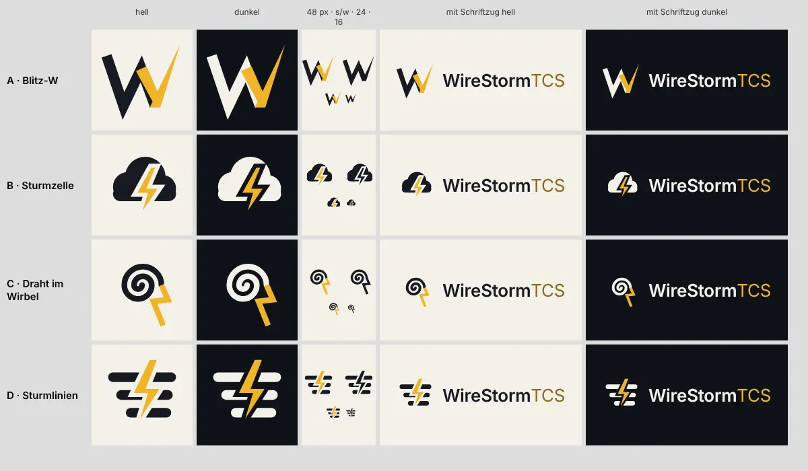

# 251 · Logo der Firma WireStormTCS: welcher Entwurf?
Homer · 20.10., 15:09 · M Markt · K (Chef 20.10., 14:17: „ein geiles Logo für die Firma … was Abstraktes, was Schönes, was Cooles, was kein Copyright verletzt“)

Kurz: Logo-Entwurf wählen (Empfehlung: A Blitz-W)

## Entwürfe

- **A · Blitz-W:** das W aus einem Zickzack, der rechte Strich läuft als Blitzklinge spitz nach oben aus. Wire (Linie) und Storm (Blitz) in einem Buchstaben.
- **B · Sturmzelle:** deine alte Idee, Gewitterwolke mit Blitz, als flache Form.
- **C · Draht im Wirbel:** eine Linie dreht sich zum Sturmauge und bricht als Blitz aus.
- **D · Sturmlinien:** drei Wind- oder Drahtlinien, ein Blitz schneidet hindurch.

Alle selbst gezeichnet, nur Grundformen (Linie, Kreis, Zickzack); Schrift Inter (SIL Open Font License, kommerziell frei). Farben Vorschlag: Tinte `#161a22`, Bernstein `#f0b429` auf Papier `#f4f1ea`; nah am Gold des Spiels, aber ohne dessen Schwarz-Gold-Rahmen, damit Firma und Spiel getrennt bleiben. Quellen als SVG: `bilder/251-logo-a-farbe.svg` … `-d-`.

## Empfehlung

**A.** Als einziges ein eigenes Zeichen statt eines Bildsymbols: bleibt bei 16 px und in Schwarz-Weiß ein W, trägt den Anfangsbuchstaben, passt als App-Symbol im Store-Entwicklerprofil und als Briefkopf.

*Stärkstes Gegenargument:* Ein Buchstabe erzählt nichts vom Sturm, wer das W nicht kennt, sieht ein Zickzack; B sagt sofort „Gewitter“ und ist deine eigene Idee. Dagegen: Wolke mit Blitz ist das Wettersymbol schlechthin (Wetter-Apps, Emoji ⚡), unterscheidet sich kaum und lässt sich als Marke schwer schützen. Vor einer Markenanmeldung ohnehin Recherche beim DPMA/EUIPO (Sokrates).

## Antwort

„A“, „B“, „C“, „D“, eine Mischung („A in Farbe von …“) oder „nochmal, anders: …“. Danach 251.1: Varianten (Zeichen allein, mit Schriftzug quer und hoch, hell, dunkel, SVG/PNG) und Vorlagen Briefkopf, Rechnung, Anschreiben, Quittung Tester.

## Stellungnahme Sokrates (20.10., 16:08)

- **Stärkstes Gegenargument:** Auch A ist nicht sicher eigen: Buchstaben mit Blitz sind häufig (Musik, Energie, Sport), dasselbe Problem, das Homer bei B sieht, nur kleiner. Vor Briefkopf und Druck daher eine Kurzrecherche (DPMAregister und TMview, Bildmarken mit W und Blitz in Klasse 9 und 41, kostenlos, etwa 15 Minuten). Zweitens: Die Entwürfe liegen im öffentlichen Repo. Eine Marke verliert dadurch nichts, ein Fremder kann sie aber vor uns anmelden; das Risiko ist klein, solange niemand die Firma kennt.
- **Widerspruch zu Entschiedenem:** keiner in der Sache. Ablauf: Firmensachen laufen nach 253 in einer WireStorm-Sitzung mit Kosten auf 253. 246.2 verbietet Preise und Marktzahlen im Repo, ein Logo nicht.
- **Kosten:** Die Wahl selbst kostet nichts. 251.1 (Varianten, Briefkopf, Rechnung, Quittung) ist eine eigene Homer-Sitzung und Kür, die vor Kapitel 1 steht (179); sie braucht es erst zum Gewerbeschein (252 ruht bis dahin).
- **Empfehlung:** „A“; 251.1 erst zum Gewerbeschein und nach der Kurzrecherche, die ich in der nächsten WireStorm-Sitzung mache.
