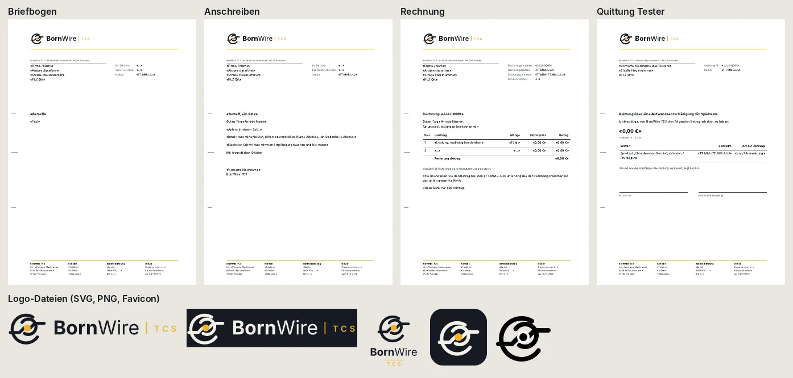

# 251.1 · Geschäftspapiere mit Logo Leiterbahn: so übernehmen?
Homer · 21.10., 21:09 · M Markt · K (Chef 20.10., 14:18, Wortlaut: „… einheitliche Briefköpfe, ob jetzt das dann Rechnungen sind, Anschreiben oder sonst was, wo natürlich auch das Logo drauf käme. Also bräuchte ich ein paar Logo-Entwürfe, vielleicht groß-klein, keine Ahnung, Website-tauglich, Briefkopf-tauglich, PDF-tauglich und so ein paar Mustervorlagen.“)

## Was liegt vor

- **Logo** in allen Formen (`docs/firma/logo/`): quer mit und ohne TCS, hoch, Zeichen allein (hell, dunkel, schwarz-weiß), App-Symbol, Favicon; SVG mit Schrift als Pfaden, PNG in 48 bis 1200 px. Zeichen unverändert aus 251.3.
- **Vorlagen** (`docs/firma/vorlagen/`): Briefbogen, Anschreiben, Rechnung, Quittung Tester; je HTML zum Ausfüllen und PDF als Muster. A4, DIN 5008 Form B (Fensterumschlag), Goldlinie unter dem Kopf, Fuß mit Anschrift, Kontakt, Bank, Steuernummer.
- **Rechnung:** Pflichtangaben nach § 14 UStG, Hinweis „Gemäß § 19 UStG wird keine Umsatzsteuer berechnet.“ **Quittung Tester:** Betrag, Zweck (Spieltest, Version), Zeitraum, Zahlungsart, Unterschrift.
- Anschrift, Steuernummer, Bank als Platzhalter «…»; die echten Angaben trägst du ein (nicht in Git).

## Stärkstes Gegenargument

Schreibst du Rechnungen später mit einem Buchhaltungsprogramm (lexoffice, sevDesk o. ä.), nimmt das sein eigenes Layout; dann braucht es nur Logo-PNG und Briefbogen, die Rechnungsvorlage war umsonst. Zweitens: TCS in Gold auf weißem Papier ist klein und blass; im Druck auf einem Tintenstrahler kann es verschwinden (Abhilfe: TCS auf Papier in Tinte statt Gold).

## Empfehlung

**A: so übernehmen.** Rechnungsvorlage vor der ersten echten Rechnung vom Steuerberater bestätigen lassen.

- **B:** dazu Word-Fassungen (.docx), wenn du lieber in Word ausfüllst.
- **C:** TCS auf Papier in Tinte statt Gold.

Antwort z. B. „251.1 A“ oder „251.1 A, C“.

Berührt: 251.3 (Logo), 252 (Webseite: Favicon, Logo), 263 (Geschäftszimmer: Belege).
