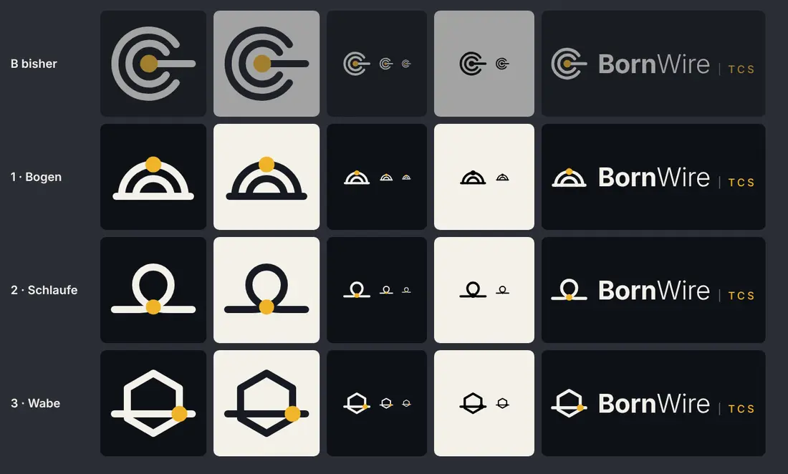

# 251.3 · Logo BornWire TCS: welche Abwandlung von B?
Homer · 21.10., 20:25 · M Markt · M (Chef 21.10., 20:03, an Sokrates: „drei Variationen neu bilden … dass es eben nicht mehr erinnert an die zwei deutschen Marken … das C per se … braucht man ja gar nicht.“)
Kurz: Logo B abgewandelt, drei Entwürfe (Empfehlung: 2 Schlaufe)

## Entwürfe

Aus B bleiben der Goldpunkt `#f0b429` auf Dunkel, der Draht als Linie und das abstrakte Zeichen. Weg sind die drei Merkmale, die an die Marken erinnern: das nach rechts offene C, der Punkt im Mittelpunkt von Bögen und der Strich aus der Mitte nach rechts. In allen drei Entwürfen läuft der Draht ganz durch.

- **1 · Brücke:** zwei Bögen nebeneinander auf dem Draht, wie eine Brücke über die Havel; der Goldknoten sitzt am Pfeiler, wo sich beide Bögen treffen. *Abstand:* Die Bögen sind nicht ineinander, sondern nebeneinander, und der Punkt liegt in keinem Mittelpunkt.
- **2 · Schlaufe:** ein einziger Draht mit einer Öse; der Goldknoten sitzt dort, wo der Draht sich kreuzt. Born (Quelle) ist der Ring, Wire der Draht, alles in einem Zug. *Abstand:* keine ineinanderliegenden Formen, keine Bögen um einen Punkt.
- **3 · Wabe:** ein geschlossenes Sechseck, der Draht läuft unter der Mitte hindurch, der Goldknoten sitzt rechts am Austritt. Wirkt technischer. *Abstand:* eckig statt rund, der Punkt sitzt am Rand.

Der Schriftzug bleibt wie entschieden: **Born** fett, **Wire** leicht, **TCS** klein, gesperrt, in Gold. Quellen: `bilder/251-3-bogen.svg`, `-schlaufe.svg`, `-wabe.svg`.

**Prüfung Sokrates** (21.10., 20:23, gegen microTEC und COGITANDA): Schlaufe passt und liegt am weitesten von beiden Marken weg. Wabe passt, ist aber schwach unterscheidbar, weil Sechsecke unter Tech-Marken häufig sind. Brücke: Der erste Entwurf (zwei Bögen ineinander) war zu nah, darum jetzt zwei Bögen nebeneinander, wie von ihm vorgeschlagen. Das ist keine Rechtsberatung. Vor dem Druck die gewählte Variante noch einmal per TMview-Bildsuche (Klassen 9/41/42) prüfen, über die Desktop-Sitzung des Chefs.

## Empfehlung

**2 · Schlaufe.** Sie liegt am weitesten von beiden Marken weg, erzählt Born und Wire in einem Strich, bleibt bei 16 px lesbar und wirkt freundlich.

*Stärkstes Gegenargument:* Eine Öse auf einer Linie ist ein bekanntes Bild (Schlaufe, Stecknadel, Ortsmarke) und darum weniger eigen. Die Brücke erzählt mehr von Bornim, wirkt klein aber wie ein „m“.

## Antwort

„1“, „2“, „3“ oder „nochmal, anders: …“. Danach kommt 251.1 (Varianten, Briefkopf, Rechnung, Anschreiben, Quittung Tester), und die alten Bilder `251-bornwire-*` werden gelöscht.
