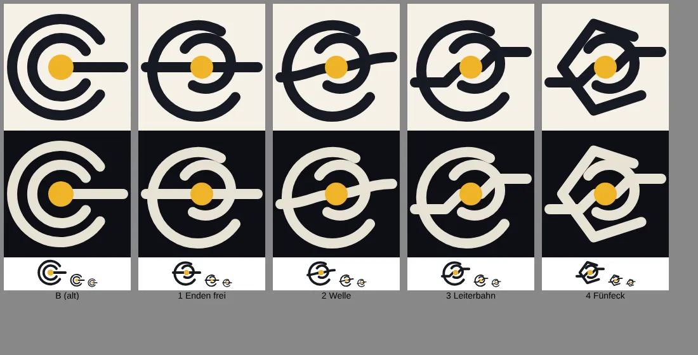

# 251.3 · Logo „Leiterbahn“: TMview-Bildsuche, dann endgültig?
Sokrates · 21.10., 20:43 · M Markt · M (Chef 21.10., 20:41: „Nimm mal die Leiterbahn 3.“)
Kurz: Leiterbahn gewählt; vor dem Druck Bildsuche in TMview über deine Desktop-Sitzung

## Stand

Aus B (Vorgangsarchiv 251) bleiben zwei Bögen, der Goldkern `#f0b429` und der Draht. Weg ist, was an microTEC (DPMA 3020130048733) und COGITANDA (DPMA 3020130039300) erinnert: kein nach rechts offenes C, keine Bögen um einen gemeinsamen Mittelpunkt, kein Strich aus der Mitte nach rechts. Die Bögen öffnen sich gegenläufig (Wirbel), ihre Enden liegen nicht auf dem Draht, und der Draht läuft als Leiterbahn mit zwei Knicken ganz durch. Quellen: `bilder/2513-leiterbahn.svg`, zum Hochladen `bilder/2513-leiterbahn.png`.

Abgleich Sokrates mit beiden Marken: kein gemeinsames Merkmal mehr außer „dunkle Bögen, gelber Punkt“. Das ist keine Registersuche und keine Rechtsberatung.

## Frage

Die Bildsuche geht nur aus einem Browser auf deinem Rechner (aus der Cloud antwortet TMview nicht). Startest du dafür eine Desktop-Sitzung mit dem Text unten? Ist nichts Ähnliches dabei, ist die Leiterbahn das Logo, und Homer baut die Geschäftspapiere (251.1).

**Text für die Desktop-Sitzung:**
> Sokrates, 251.3: Öffne TMview (tmdn.org/tmview), Bildsuche („Search by image“) mit `docs/chefsache/bilder/2513-leiterbahn.png` aus dem Repo (main). Filter: Nizza-Klassen 9, 41, 42; Gebiete DE, EU, WIPO. Die ersten 50 Treffer ansehen und je ähnlichem Treffer Inhaber, Nummer, Amt, Klassen und Status notieren, dazu ein Satz, was gleich ist. Ergebnis in diese Datei unter „Befund TMview“ schreiben, pushen, mir per Nachricht melden.

**Empfehlung Sokrates:** ja, jetzt. Das kostet eine kurze Sitzung, und danach sind Webseite und Papiere sicher.
*Stärkstes Gegenargument:* Die Bildsuche findet nur, was dem Bild ähnlich ist; eine Rechtssicherheit gibt erst eine bezahlte Recherche vor einer eigenen Markenanmeldung. Wer keine Marke anmeldet, könnte sich die Suche ganz sparen.

## Befund TMview

(offen)

**Berührt:** 251 (Logo), 251.1 (Geschäftspapiere, Homer), 252 (Webseite), 253.

## Antwort

„Desktop-Sitzung läuft“ oder „ohne Suche nehmen“.
