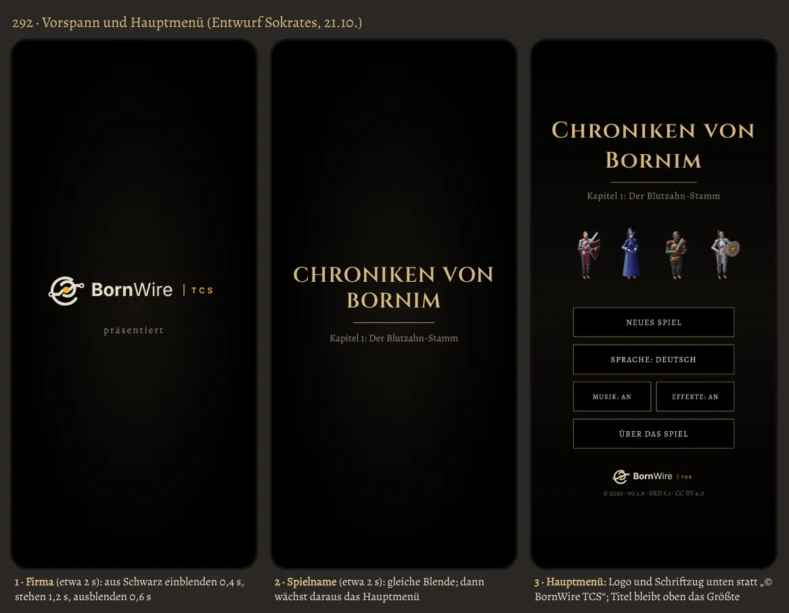

# 292 · Vorspann mit Firma und Spielname, Logo im Hauptmenü?
Sokrates · 21.10., 22:27 · E Oberfläche · M? (Chef 21.10., 22:17: „Und ich will unbedingt unser Logo und den Schriftzug auf dem Titelbild. Sollten wir den Schirm nicht Hauptmenü überall im Spiel nennen? Und davorgeschaltet ein Titelbild aus unserer Blende mit dem Spielnamen und unserem Firmennamen fade in and out. Dazu bitte zeitnah ein Bild als Vorschau. Ideen hierzu?“)
Kurz: Vorspann Firma, dann Spielname, dann Hauptmenü mit Logo unten; Empfehlung ja

## Vorschlag

1. **Name:** Der Schirm heißt überall **Hauptmenü**. Im Spiel steht der Name heute nur an einer Stelle: Knopf „Zum Titelbild“ im Menü → „Zum Hauptmenü“ („Main menu“).
2. **Vorspann** im Stil der Blende (schwarz, Vignette, Serifenschrift), nur beim Kaltstart der App:
   - Bild 1, Firma: Logo mit Schriftzug „BornWire | TCS“, darunter klein „präsentiert“; einblenden 0,4 s, stehen 1,2 s, ausblenden 0,6 s.
   - Bild 2, Spielname: „Chroniken von Bornim“ und Kapitelzeile, gleiche Blende; dann blenden die Figuren und Knöpfe des Hauptmenüs dazu ein, der Titel bleibt stehen (kein zweites Mal derselbe Text).
   - Antippen überspringt sofort; nach „Zum Hauptmenü“ aus dem Spiel kein Vorspann.
3. **Hauptmenü:** Logo mit Schriftzug unten statt der Zeile „© BornWire TCS 2026“, darunter klein Jahr, Version, Lizenz. Der Spieltitel bleibt das Größte.

## Ideen dazu

- **Klang:** zum Logo ein einzelner tiefer Harfen- oder Streicherton (Jerry), die Titelmusik setzt mit Bild 2 ein.
- **Logo lebt kurz:** der Goldkern glimmt beim Einblenden auf, oder der Draht „zieht“ sich von links nach rechts durch; einmal, ohne Schleife.
- **Ladezeit nutzen:** lädt die App im Hintergrund, verlängert der Vorspann nichts; er füllt Zeit, die ohnehin vergeht.
- **Android 12 und neuer** zeigt beim Start immer erst das App-Symbol (Systembild, nicht abschaltbar). Reihenfolge also: Systembild → Firma → Spielname → Hauptmenü. Das Systembild sollte schwarz mit unserem App-Symbol sein, damit es nahtlos in Bild 1 übergeht.

## Empfehlung

**Sokrates: ja, so bauen** (Tom, Technik der Blende); „präsentiert“ und englisch „presents“ über Homer.
*Stärkstes Gegenargument:* Jede Sekunde vor dem Menü nervt, wer oft startet (Tester bis zu zwanzigmal am Tag). Darum höchstens etwa 4 s zusammen, Antippen überspringt, und nur beim Kaltstart. Und bis Sa 24.10. vormittags gilt Glätten vor Neuem (284): das Bauen wäre Kür nach dem Durchspielen, außer du sagst „jetzt“.

**Berührt:** 251.4 (Logo), 267.1 (Blende beim Spielstart), 284 (bis Samstag Glätten).

## Antwort

„292 ja“, „292 ja, jetzt“, „292 ohne …“ oder „nochmal: …“.
