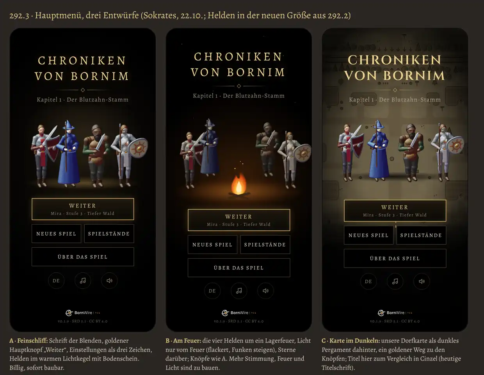

# 292.3 · Hauptmenü schöner: A, B oder C?
Sokrates · 22.10., 11:27 · G Stil · M? (Chef 22.10., 11:14, Wortlaut bei Sokrates „Zu 292.3“; 11:20: „Ansonsten gerne deine drei Entwürfe. A, B, C.“)

Entwürfe als Bild, kein Build. Die Helden sind echt aus dem Spiel gezeichnet, in der neuen Größe aus 292.2. Die Knöpfe sind in allen drei Entwürfen gleich.

## Gleich in allen drei

- **Schrift:** Titel und Knöpfe in der Schrift der Blenden (Alegreya in gesperrten Großbuchstaben); in C steht der Titel zum Vergleich in Cinzel, der heutigen Titelschrift.
- **Hauptknopf „Weiter“** golden, mit Held, Stufe und Ort darunter; darunter „Neues Spiel“ und „Spielstände“ nebeneinander, dann „Über das Spiel“.
- **Einstellungen** (Sprache, Musik, Effekte) als drei kleine Zeichen statt drei großer Kästen.

## Die drei Entwürfe

- **A Feinschliff:** schwarzer Grund, die Helden in einem warmen Lichtkegel mit Schein am Boden. Kosten: klein (Tom, eine Sitzung).
- **B Am Feuer:** die Helden um ein Lagerfeuer, Licht nur vom Feuer, Funken, Sterne. Kosten: mittel (Feuer und Licht auf den Helden sind zu bauen).
- **C Karte im Dunkeln:** die Dorfkarte als dunkles Pergament dahinter. Kosten: klein, aber die Karte lenkt von Titel und Knöpfen ab.

## Stärkstes Gegenargument

Das Menü ist erst seit 292 neu, und die oberste Direktive (Kapitel 1 fertig) geht vor. Jede Änderung braucht einen weiteren Build und deinen Test.

## Empfehlung

**A jetzt, B später als Kür.** A bringt das Meiste (einheitliche Schrift, klarer Hauptweg, Licht) für fast nichts. B ist das schönere Bild, aber Licht vom Feuer auf den Helden ist eine eigene Arbeit; nach dem Meilenstein. Titel in der Schrift der Blenden, nicht in Cinzel.

Berührt: 292 (Vorspann, Hauptmenü), 292.2 (Figuren im Hauptmenü), 60.4 (Menü im Look der Textbox).
