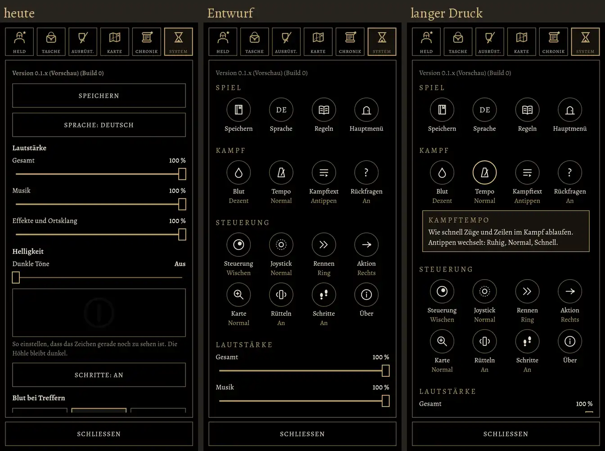
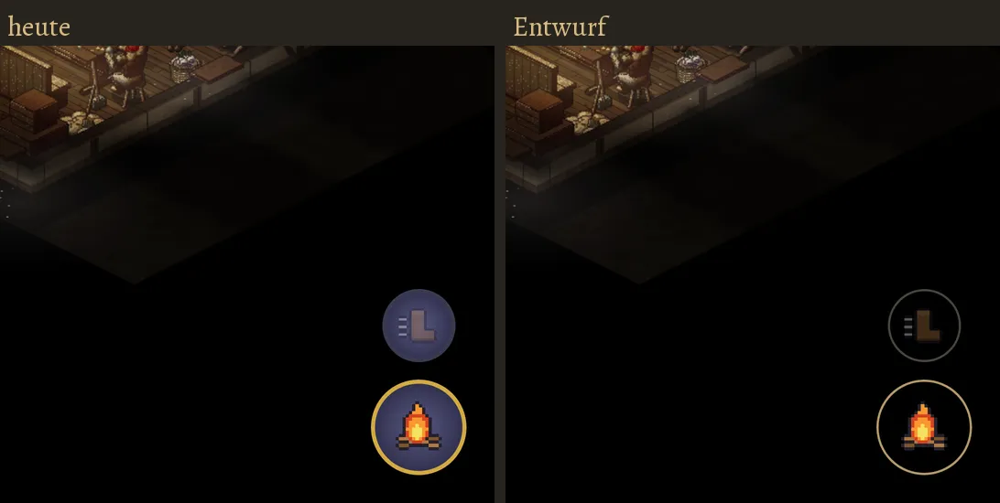
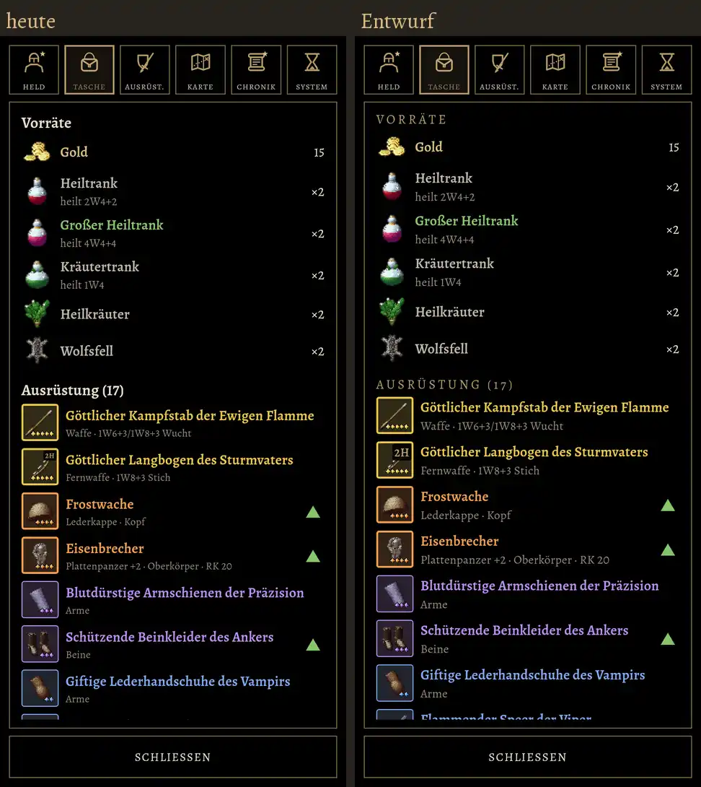

# 326 · Spielermenü im Stil des Hauptmenüs: Bilder · Homer · 23.10., 07:55
G Stil

**Frage** (Chef 00:03): Spielermenü und Aktionsknöpfe wirken neben dem Hauptmenü alt. **Richtung gebilligt** (07:29): Zeichen statt Textknöpfen, Erklärung bei langem Druck, Vorbild die Reiter. Hier die Bilder dazu, links heute, rechts Entwurf (gerechnet aus dem echten Spielcode, Zweig `claude/homer-326-entwurf`, nur Vorschau).

**1. System-Reiter.** 16 Zeichen in vier Gruppen statt 15 breiter Knöpfe; unter jedem Zeichen Name und Stand in Gold; Antippen schaltet weiter, langer Druck erklärt (rechts: „Tempo“). Die Regler für Lautstärke und Helligkeit bleiben, unter den Zeichen.

**2. Aktionsknöpfe.** Statt violett-blauer Kugel mit dickem Rand: schwarzer Grund, dünner Goldrand wie die Zeichen im Hauptmenü; das Bild bleibt farbig. Bekannt: der Stiefel im Rennknopf ist auf Schwarz zu dunkel, beim Bau heller.

**3. Überall im Menü (Beispiel Tasche).** Überschriften in goldenen Versalien, keine Schrift unter 13 sp. Wirkt leiser als 1 und 2, aber in allen Reitern gleich.

**Empfehlung:** alle drei so bauen (Team Tom), nach dem Meilenstein. Seltenheitsfarben und die Balken für Leben, Zauber, Erfahrung bleiben farbig.

**Stärkstes Gegenargument:** Zeichen muss man lernen; „Steuerung“ und „Joystick“ sind abstrakt, „Hauptmenü“ (Tor) mäßig. Darum stehen Name und Stand immer darunter, und langer Druck erklärt. Und: Kür; Kapitel 1 und Fehler gehen vor (Tom hat 8 Muss offen).

**Berührt:** 292.3 (Schriftregel), 312, 313; Tom (Bau, `WorldScreen.kt` für den Aktionsknopf), Jerry nicht.

**Stellungnahme Sokrates** (23.10., 08:05):
- *Stärkstes Gegenargument:* Bei 2 geht es um Bedienung, nicht nur ums Aussehen. Schwarze Knöpfe mit dünnem Goldrand können auf der nächtlichen Karte und im Wald untergehen. Bei 1 schaltet Antippen gleich weiter: Wer nur nachsehen will, verstellt dabei etwas. Langer Druck ist im Spiel sonst nirgends üblich, den findet keiner von allein.
- *Widerspruch zu Entschiedenem:* keiner; Schriftregel 292.3 und Signatur 302 (Gold als einziger Glanz) passen. Nach dem Meilenstein verträgt es sich mit der obersten Direktive.
- *Kosten:* Toms Schätzung fehlt. Der Umbau betrifft gemeinsame Bausteine und `WorldScreen.kt`, also mehr als einen Reiter.
- *Empfehlung:* „326 ja“, Bau nach dem Meilenstein. Bild 2 vorher auf dem Gerät bei Nacht und im Wald prüfen. Langer Druck einmal beim ersten Öffnen zeigen, als kurzer Hinweis.

**Was du sagen sollst:** „326 ja“ (Bau nach dem Meilenstein), „326 ja, jetzt“, oder je Bild „1 ja, 2 nein …“.
