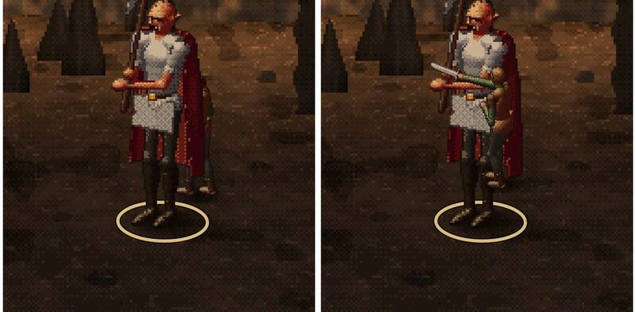

# 336a · Stich in Graks Rücken: wie soll man ihn sehen?
Team Jerry · 23.10., 16:25 · E Kampf · Kurz: Stich in den Rücken ist verdeckt: Flanke, Grak dreht sich oder verdeckt?

**Frage** (zu deinem Wort 13:54 „hinter Grak treten und von hinten stechen“): Grak schaut zur Kamera, weil er die Helden vor sich hat. Sein Rücken liegt also auf der abgewandten Seite. Steht der Schurke wirklich hinter ihm, verdeckt Grak ihn und den Stich (Bild links). Zeichne ich den Schurken im Stich vor Grak, sieht es aus, als stäche er ihm in den Bauch (Bild rechts; zwei fremde Prüfungen: „nicht als Stich in den Rücken lesbar“). Wie soll der Stich aussehen?

**Möglichkeiten:**
1. **Rückenflanke:** Der Schurke tritt schräg hinter Grak (etwa 45° hinter seiner Seite), Grak verdeckt ihm die Beine, die Klinge geht sichtbar in Graks Seite zum Rücken hin. Klein (Lage und Zeichenfolge), etwa zwei Stunden.
2. **Grak dreht sich nach:** Grak wendet beim Herumgehen den Kopf und halb den Körper zum Schurken, zeigt der Kamera dabei Seite und Rücken; der Stich ist frei zu sehen. Groß (gedrehte Grak-Bilder, für alle Gegner, die ein Schurke umgeht), etwa ein Tag.
3. **Verdeckt lassen:** Der Schurke verschwindet hinter Grak; den Stich zeigen nur Graks Zusammenzucken, Blut und die Zeile im Bericht. Klein, etwa eine Stunde.

**Empfehlung:** 1. Der Stich bleibt sichtbar und kommt klar von hinten, ohne neue Grak-Bilder; fertig für den nächsten Build.

**Stärkstes Gegenargument:** 1 ist nicht „hinter“ Grak, sondern halb neben ihm; du hast um 13:54 ausdrücklich „hinter Grak“ gesagt. Nur 2 zeigt wirklich einen Stich in den Rücken.

Daneben: Im Probelauf ging der Stich trotz Vorteil daneben (15 gegen RK 16). Das ist Würfelglück und regelgerecht; für die Bildserie nehme ich einen Lauf mit Treffer.
