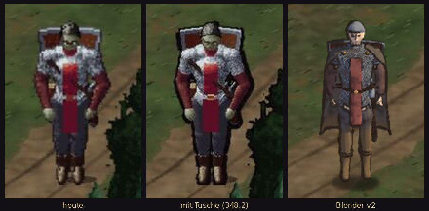
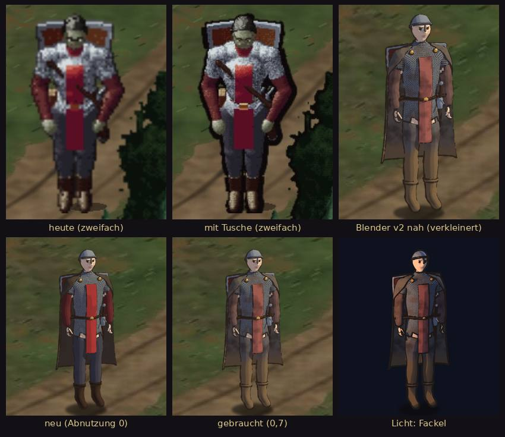
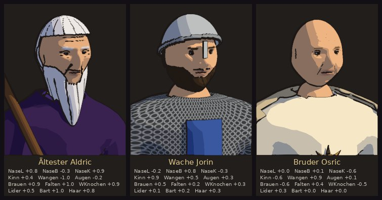
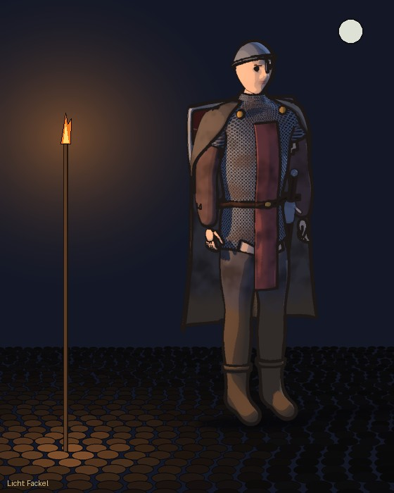
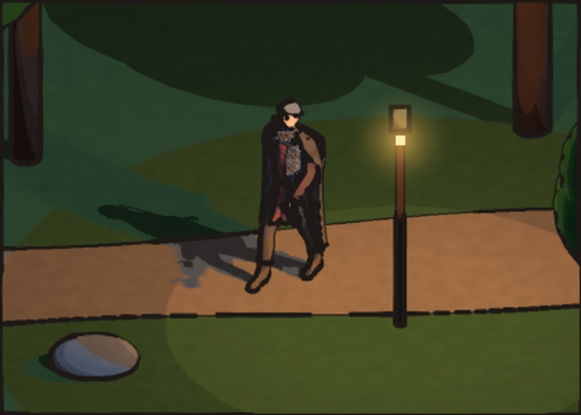
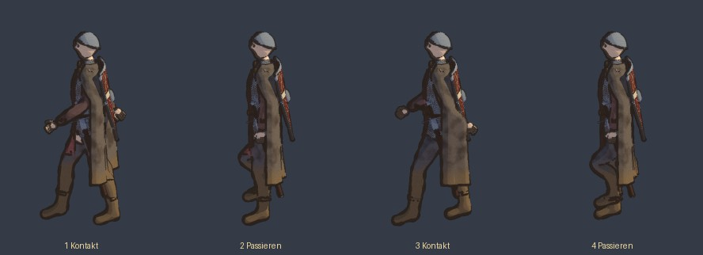
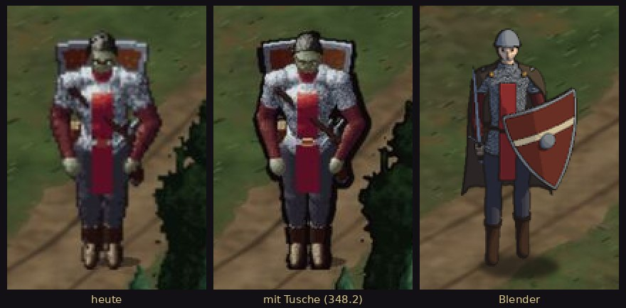
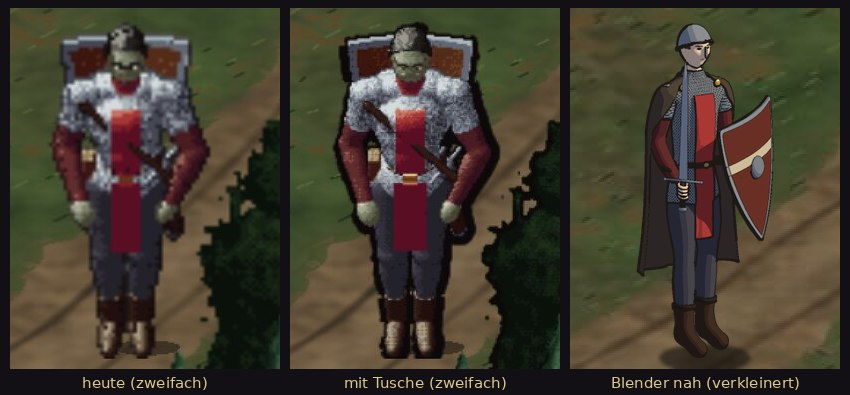

# 348 · Fertige Spiel-Engine statt Selbstbau? Erst messen
Sokrates · 24.10., 16:50 · E Technik · K (Chef 24.10., 16:43 und 16:46: eine KI empfahl „Claude Code und Godot“; „griffige Alternative zu Godot“? Einwand: selbst gebaut heißt viele Fehler, die eine fertige Engine nicht hätte.)
Kurz: Engine ja/nein: wartet auf die Probe 348.4, jetzt nichts zu entscheiden

**Stand 24.10., 21:42: jetzt nichts zu entscheiden.** Entschieden ist die Probe 348.4 (21:14): Held v2 geht auf einem kleinen Dorfstück, Tag und Nacht, als eigene Godot-App am Handy, Bildrate und Speicher gemessen. Sokrates baut sie. Liegt sie auf deinem Handy, kommt hier **eine** Frage: „Umstieg ja“ (Modelle und Engine, Umzug etwa 15–21 Sitzungen) oder „nein“ (weiter mit dem eigenen Zeichner). Bis dahin ruht die Grafikarbeit (18:16). Das Vergleichsbild 348.1/348.2 ist damit überholt: es fragte nur, ob der eigene Zeichner feiner werden soll.

Verlauf 16:50–21:14 (zum Nachlesen)

**Entschieden 18:16 („Dann ja zu 348“, Vorgangsarchiv): Grafik angehalten.** Anhalten bis zu deinem Urteil über das Blender-Bild: Schönheitsarbeit an Puppen und Zeichner, die ein Umstieg wegwerfen würde: 302.1, 302.3, 357, 292.4, 296.3, Kür-Teil von 211.14. Weiter: alles, was das Spielen stört oder den Umstieg überlebt (346 Speicher, 350, 352, 353, 354), dazu 348.2 (fast fertig, für den Vergleich). Wer: Perikles setzt die Zeilen auf „ruht“. *Gegenargument:* Gefällt das Blender-Bild nicht, sind ein, zwei Tage Grafik verloren; klein, weil jederzeit wieder aufnehmbar.

**Empfehlung 21:06 (Chef 21:04: v2 oder Schrittmodell?):** v2 mit Gehen; der Schrittzyklus hängt nicht am Stil. Nächster Schritt: v2 gehend als Echtzeitprobe in Godot am Handy, vor jedem Umbau. *Gegenargument:* Bilder nur vorgerendert, Handy ungeprüft; ein Stilwechsel kostet Zeit vor Kapitel 1.

**Chef 21:06:** v2 Kleidung, Licht, Fackel „genial“, Gehen gut; komisch: Hände; Gesicht zu wenig Details (Aldric-Köpfe gehen in die Richtung). Rückfrage Sokrates: 1 Richtung v2, 2 Hände nacharbeiten, 3 Aldric-Köpfe auf v2, dann Godot-Probe am Handy – richtig?

**Chef 21:10:** Wo geht er: im Nirgendwo oder auf der Dorfkarte, zu klein? Gleich ein Stück Dorf im neuen Stil mit, oder zu viel Aufwand? **Empfehlung 21:12:** Probe mit kleinem Dorfstück (Weg, zwei Häuser, Brunnen, Laterne), Held in Spielgröße, Tag und Nacht mit Fackel, per Fingertipp steuerbar, Nahstufe für Gesicht und Hände; in Godot als eigene Probe-App (nicht `de.bornim.game`), dazu Bildrate und Speicher gemessen. Schätzung etwa drei bis vier Sitzungen: Gehen mit Skelett, Hände, Kopf (1); Dorfstück (1–2); Godot-App und Messung (1, Android-Export hier ungeprüft). *Gegenargument:* Das ist der Anfang einer neuen Welt und kostet Tage vor Kapitel 1; nur der Held auf dem heutigen Dorfbild wäre billiger, zeigt aber nicht, ob der neue Stil als Ganzes trägt. **Sag:** „Dorfstück ja“ oder „nur Held“.

**Chef 21:13:** weiterverwendbar? **Antwort:** ja, wenn die Probe gleich so gebaut wird wie später (Bekannte Fehler: keine Probe nach anderer Methode): Modelle, Skelett, Gehen, Köpfe, Dorfstück als glTF für jede Engine; Look als Godot-Shader statt heutiger Nachbearbeitung am Rechner (numpy), die am Handy nicht läuft. Weg wäre nur das App-Gerüst, falls die Wahl auf „Kotlin mit vorgerenderten Bildern“ fällt; dann bleiben Modelle und Render-Weg.

## Entwürfe 24.10., 18:55 (Chef 18:42: „wirf mir ein paar Entwürfe zu“; Telegram 1/6–6/6)

**Sag:** welche Richtung: „v2“ (gemalt, Gesichter, Abnutzung), „stilisiert“ (wie das Intro: einfache Figuren, viel Licht und Tusche) oder „Modelle nein“.

- Befund Prüfer (zweite Runde): v2 fair, ohne grobe Fehler, Gesicht blass; bei Fackellicht dunkles Band über den Augen. Köpfe: drei Menschen erkennbar, Bart maskenhaft, Haar wie Kappe, Osric unten angeschnitten. Stilisiert nah schwächster Entwurf (Füße kaum am Boden, Schwert kaum sichtbar, Gesicht leer); Karte: Gesicht schwarzer Fleck, Schatten leicht abgelöst; Gehen steif (Skelett nicht gewichtet), Umhang verdeckt Beine.
- Nicht geprüft: ob eine Engine diesen Look in Echtzeit am Handy schafft (Bilder vorgerendert). Skripte: Zweig `claude/sokrates-348-blender`, `tools/blender348/`.

## Versuch Blender-Held (24.10., 18:28; Chef 18:05: „jetzt mal spannend zu sehen“)

(Erste Fassung, abgelöst durch die Entwürfe oben.)

- Blender-Held aus Code: Maße aus `Doll.kt`, Farben aus `Dress.kt`, Kettenhemd, Wappenrock, Umhang, Helm, Schild, Schwert; Licht in 3 Stufen, Tusche nach Licht. Rechenzeit am Rechner: Modell 1,3 s, Bild 1 bis 3 s.
- Gut: am saubersten und lesbarsten, Kettenhemd erkennbar, alle 8 Richtungen ohne Nacharbeit.
- Schwach: Gesicht fast leer (Schaufensterpuppe), Hände auf der Karte Klumpen, Kettenmuster auf Kartengröße Rauschen, schlanker als unsere Helden, wirkt glatt wie eine Vektorpuppe; Pose anders (Schild in der Hand statt auf dem Rücken); Licht nur angeglichen; Animation nicht versucht. Mit mehr Arbeit behebbar.
- Prüfer: Boden nur ähnlich, nicht gleich (unter dem alten Helden nicht freistellbar), Blender mit Schlagschatten; im Nahbild Blender verkleinert auf gleiche Figurhöhe.
- *Gegenargument:* Ein Blender-Held in der heutigen Welt fiele heraus; der Gewinn zeigt sich erst, wenn Welt, Gegner und Animationen mitziehen.

Alle Ergebnisse der Gespräche: [Grafikweg](../../LISTE-GRAFIKWEG.md).

## Fehlermessung Tom (348.3, 24.10., 18:36)

Bereich Leute, Dorf, Innenräume, Wald, Blende; Fehler, die du seit 10.10. gemeldet hast (Vorrat Tom, CHANGELOG, Rückläufer), ohne Wünsche, Gestaltungsvorgaben, Funde von Diogenes und Klang (Jerry). Frage: hätte Godot ihn verhindert?

**Ergebnis: 19 von 39 ja (49 %).** Davon 10 Tempo und Speicher (Bilder vorab auf dem Rechenkern gezeichnet), 9 Kollision, Tiefe, Wege. *Gegenargument:* Die 10 aus Tempo und Speicher verschwänden auch, wenn unsere App auf dem Grafikchip zeichnet (ohne Engine); dann blieben 9 von 39 (23 %). Auch Godot kann mit zu großen Bildern den Speicher sprengen (346). Bei Kollision liefert Godot Werkzeug (sichtbare Formen, Physik schiebt heraus), die Formen setzen müssten wir trotzdem. Neue Fehler eines Umzugs (Export, Android, neue Sprache) nicht gezählt.

| Nr. | Fehler | Godot | warum |
|---|---|---|---|
| 29 | Brett nicht antippbar | nein | Logik |
| 5la | nach Bram an der Brücke keine Bewegung | nein | Spielzustand |
| 60 | Menüreiter brechen Wörter um | nein | Layout |
| 82 | Held geht an verschlossener Tür hinter die Hauswand | ja | Kollision |
| 94 | Hühner flackern | ja | Bildspeicher |
| 129 | zwei Hühner auf einem Platz | nein | Logik |
| 92 | Anlaufen gegen Leute zählt nicht | nein | Logik |
| 151 | unsichtbares Hindernis am ersten Haus | ja | Kollision sichtbar |
| 152 | Garrick je nach Seite zu weit weg | ja | Kollisionsform |
| 153 | Überspringen-Kasten weiß | nein | Gestaltung |
| 170 | Hängen am Stein nach Wiederbeleben | ja | Physik |
| 180 | Fackel im Laden nicht kaufbar (2 Rückläufer) | nein | Spielstand |
| 198 | Gegner greifen nach Flucht sofort an | nein | Logik |
| 216.3 | Dinge sperren zu weit (Rückläufer Feuer schräg) | ja | Kollisionsform |
| 224 | Holz zugeschnitten, Regal gebrochen | nein | Zeichnung |
| 239.1 | Garrick springt beim ersten Hinhocken | ja | Vorabzeichnen |
| 254 | Hinweis von Lauftaste verdeckt | nein | Layout |
| 257 | Fackel im Stand starr | nein | Animation |
| 267 | ruckelt auf dem Tablet | ja | Grafikchip |
| 267.1 | Laufen-Knopf über der Blende (Rückläufer) | nein | Layout |
| 267.2 | Tiefer Wald ruckelt | ja | Grafikchip |
| 269 | Tempeldach und Turm falsch | nein | Zeichnung |
| 278 | Held steht in der Markise | ja | Tiefe |
| 283 | Grasbüschel vor den Füßen | nein | Gestaltung |
| 291 | Busch im Tiefen Wald sperrt | nein | Daten |
| 297 | Geste der Leute holprig | ja | Vorabzeichnen |
| 299.1 | Blende wartet 7,3 s, Ton ruckelt | ja | Vorabzeichnen |
| 306 | Leute beachten stehenden Helden ewig | nein | Logik |
| 322 | Fackel nur in manchen Blickrichtungen | nein | Zeichnung |
| 325 | Funken vor dem Helden | ja | Tiefe |
| 329 | „Speicher knapp“, Hänger 3,1 s | ja | Speicher |
| 330 | Leute rechtwinklig, „Moonwalk“ | ja | Wegfindung |
| 331 | Held halb im Felsen am Eingang | nein | Daten |
| 332 | Held erst nach 23,9 s, Rennen nur mit Gehen | ja | Vorabzeichnen |
| 334 | Knarzen nach dem Menü | nein | Logik |
| 343 | Fackel entzündet sich am Tag | nein | Logik |
| 345 | Fackel erst nach 2–3 s abgelegt | ja | Vorabzeichnen |
| 346 | Absturz Speicher im Wald | ja | Speicher |
| 353 | Hängen an Wegen im Tiefen Wald (Verdecken bleibt) | ja | Kollision |

**Umzugskosten Tom (Sitzungen, grob):** Regeln aus `core` nach GDScript mit Tests, mein Teil (Welt, Leute, Laufen, Story, Läden, Spielstand; etwa 5.000 von 11.000 Zeilen Regeln, dazu Tests; die übrigen 34.000 Zeilen in `core` sind Zeichner und Klang) 6–8. Welt: unser Zeichner bleibt am Rechner und liefert Bildbögen, Godot zeigt sie (Werkzeug 3–4; sechs Gebietskarten und Grundrisse mit Kollision und Tiefe je 1–2, zusammen 8–12; Leute und Tiere 4–6; Licht, Tag und Nacht, Fackel 3–4). Steuerung, Menüs, Blende, Hauptmenü, Spielstände 6–8. **Zusammen etwa 30–40 Sitzungen**, dazu ein ganzes Durchspielen von dir; währenddessen kein Fortschritt an Kapitel 1. *Gegenargument:* Schätzung ohne Probe; eine Karte zur Probe (2–3 Sitzungen) würde sie halbieren oder verdoppeln.

## Befund

- **Heute keine Engine:** Kotlin mit Jetpack Compose, Welt im Code gezeichnet (eine PNG, etwa 86.000 Zeilen Kotlin). Regeln in `core` getrennt von der Oberfläche.
- **Selbstbau kostet Fehler:** grob ausgezählt etwa 35 von 1.231 CHANGELOG-Zeilen sind typische Engine-Aufgaben (Flackern, Kollision, Ruckeln, Absturz); dazu eigener Bildspeicher (Held zeichnet beim ersten Start 24 s neu), Speicher (346).
- **Engines mit Code statt Editor:** libGDX (Kotlin/Java, `core` bleibt, seit 2009, viele Android-Spiele); KorGE (Kotlin, kleiner); Godot (GDScript/C#, Szenen als Text, aber Regeln neu); Defold (Lua); Unity (nicht für uns).

## Vorschlag

1. **Messung (etwa eine halbe Sitzung je Team):** Tom und Jerry ordnen die Fehler, die du in den letzten zwei Wochen gefunden hast, ein: hätte libGDX ihn verhindert, ja/nein; dazu Schätzung der Umzugskosten (nur Zeichnen, Bewegung, Steuerung; `core` bleibt).
2. **Danach:** Anteil über etwa ein Drittel → Wechsel zu libGDX als eigene Chefsache; darunter → Kapitel 1 fertig, Frage nach dem Meilenstein neu.

## Stärkstes Gegenargument

Die Messung kostet Zeit vor Kapitel 1, und schöne Grafik machen Bilder, nicht die Engine (eigene oder offen lizenzierte, dafür niemand). Antwort: Warten macht den Umzug jede Woche teurer; die Messung ist billig gegen einen falschen Entscheid in beide Richtungen.

## Empfehlung

**1 jetzt** (Kür neben dem Wochenziel), 2 nach dem Ergebnis.

Berührt: 346, 267, 302.1, Idee „Spiel-Engine“ in `LISTE-IDEEN.md`.

## Nachtrag 24.10., 17:30 (Chef 17:29 zu 348.1: „Ist schon ein Unterschied. Auch die Tuschstriche... Sind die nach Lichtquelle? Der Baum ebenfalls auch nach innen?“)

- Code `claude/tom-3481-vergleich`: **Bäume** nach Licht (Strich aus der Helligkeit des Baums, im Hellen dünn, im Schatten bis etwa dreimal dicker), aber **nur Außenumriss**, keine Linien nach innen (Krone gegen Stamm, Blattballen, Äste). **Held** nicht nach Licht, gleich dick (Tom selbst: „eher ein dunkler Hof“).
- Heute sind es 64, nicht 32 Bildpunkte je Kachel (Tom); neu = vierfacher Speicher.
- Vorschlag: zweites Bild mit Innenlinien an Bäumen und Heldentusche nach Licht, nach 21 Uhr (Guthaben), bevor du „neu gefällt“ sagst.

## Nachtrag 24.10., 16:55 (Chef 16:49: „Bringt uns die Engine was? Wird unsere Grafik dadurch besser? … vektorbasiert? … geil zoomen? … weg von Pixel … Tusche-Vorhaben … Vergleichsbild … einmal in neu und einmal in alt“)

- **Pixel-Look ist eigene Wahl:** Welt 32 Bildpunkte je Kachel (`WorldArt.T`), am Handy etwa fünffach ohne Glättung (`FilterQuality.None`); Figuren als 3D-Puppen (`Sdf.kt`) vorab auf dem Rechenkern in kleine Bilder (`MapFigure`, Dichte 2).
- **Engine ist nicht vektorbasiert:** Godot, libGDX zeichnen Bilder oder 3D; Kopie des Alten sieht gleich aus.
- **Schärfer macht höhere Auflösung desselben Zeichners** (z. B. 128 je Kachel); auf dem Rechenkern 16-facher Speicher und Zeit (heute schon 509 von 512 MB, 346). Nutzen einer Engine: Grafikchip zeichnet je Bild in voller Auflösung; Grafikchip ginge auch ohne Engine in der jetzigen App.
- **Tusche** geht überall (im Zeichner); erst bei höherer Auflösung sichtbar (302.1).
- *Gegenargument:* Schärfe zeigt Schwächen, die Pixel verdecken; dann Nachzeichnen als eigentliche Arbeit.

**Neue Empfehlung (ersetzt 1 oben als ersten Schritt):** **348.1 Vergleichsbild** von Tom am Rechner (`tools/preview`): ein Ausschnitt Gebietskarte mit Held, alt (32 je Kachel) neben neu (128 je Kachel, mit Tusche), eigener Zeichner, keine Engine. Gefällt „neu“: Weg aufs Handy prüfen (Engine oder Grafikchip in der App), dann die Fehlermessung.

## Fehlermessung Team Jerry (348.3, 24.10., 18:40): Monster, Höhle, MARS, Klang

Gezählt sind Fehler, die du seit 10.10. gefunden hast (Vorgänge „von Chef“ und Rückläufer im CHANGELOG), ohne Wünsche, Kür und Texte; eine Zeile kann mehrere Vorgänge bündeln. Spalte: **ja** = Godot verhindert ihn von sich aus; **mit Modellen** = nur, wenn wir dazu auf fertige Modelle mit Skelett (Blender) umsteigen; Godot allein, weiter mit Bildern aus Code, verhindert ihn nicht; **nein** = in jeder Engine unsere Arbeit.

| Fehler (Vorgang) | Godot verhindert? | Warum |
|---|---|---|
| App „reagiert nicht“ (257) | mit Modellen | heute Bilder auf dem Rechenkern gezeichnet |
| Ladebalken steht still oder ruckelt (Rückläufer) | mit Modellen | dasselbe: Vorzeichnen |
| Bildpausen nach Gebietswechsel, Kampf zeichnet vorab (267) | mit Modellen | dasselbe |
| Figur steht nicht auf dem Ring (242.1) | mit Modellen | Fußpunkt im Modell |
| Zauber nicht an Hand oder Stab (249) | mit Modellen | Hand am Knochen |
| Wölfe beißen in die Luft (217, 211.17) | mit Modellen | Maul am Knochen |
| Grak „robotet“, Gegner gleiten (337) | mit Modellen | Gehen als fertige Animation |
| Wölfe gleiten ohne Pfoten (19e) | mit Modellen | dasselbe |
| Goblin-Stich ohne Stoß (Rückläufer) | mit Modellen | dasselbe |
| Grak sagt „Schwerer Hieb“ an, Bild unverändert (310) | mit Modellen | dasselbe |
| Fuß verschwindet beim Abknien (Rückläufer) | mit Modellen | Skelett hält Glieder |
| Klang läuft ohne Fokus weiter (237) | nein | wenige Zeilen, in jeder Engine selbst |
| Frösche, Libellen außerhalb des Sichtkreises (248) | nein | Sichtregel ist unsere |
| Gefolge behält Hintergrundgröße, schrumpft zurück (200) | nein | Wert nicht zurückgesetzt |
| gefallener Held versinkt im Boden, liegt komisch (311, 328) | nein | Sterbepose nach Drehbuch |
| hinterer Held oder Gegner läuft durch den vorderen (Rückläufer zu 249, 19e) | nein | Kampfwege legen wir fest |
| Absturz beim Kampfstart (226) | nein | Fehler im eigenen Code |
| Schatten im Ring nicht erkennbar (242.2), weiße Wischstriche (323) | nein | Gestaltung |
| Pfeil des Spähers zu dick und hell (Rückläufer) | nein | Gestaltung |
| perfekter Ring ohne Angriff (336) | nein | Regel |
| Rudel verschwindet mit dem Führer (351) | nein | Regel |
| Automatik nicht abbrechbar, nimmt Söldner mit (241, 241.1, 241.2) | nein | Regel |
| Fackel bleibt bei zweihändiger Armbrust (268) | nein | Regel |
| Zauber ohne sichtbares Ziel tun nichts (183) | nein | Regel |
| Späher erzwingt endloses Abwarten (208) | nein | Regel |
| Betrunken kann nicht rennen (181) | nein | Regel |
| Gefährte fällt vor dem ersten Zug (231) | nein | Regel |
| Aufstellung „vorn/hinten“ passt nicht zum Bild (174) | nein | Zuordnung Platz zu Bild |
| Zielknöpfe ohne Nummer, Wölfe nicht zuzuordnen (240) | nein | Bedienung |
| lange Namen passen nicht (232), Zielmarke abgeschnitten (242.4) | nein | Gestaltung |
| Spalt zwischen Knopfzeilen, Rahmen in den Ecken (335) | nein | Gestaltung |
| Schenke ohne Blende, Ortsklang abgehackt (299), Musik an Blenden (319) | nein | Ablauf |

**Ergebnis:** 32 Zeilen. Godot allein: **0**. Godot mit Blender-Modellen: **11 von 32 (ein Drittel)**, darunter die drei schwersten (Hänger, Ruckeln, Bildpausen) und alle Gleit- und Zielfehler. Der Gewinn käme also von den Modellen, nicht von der Engine. Die übrigen 21 sind Regeln, Gestaltung und Abläufe, die wir überall selbst bauen. Godot hat dazu eigene Ruckler (Shader beim ersten Mal, Nachladen).

**Umzugskosten Godot, Bereich Jerry** (in Sitzungen, grob):

| Teil | heute | Sitzungen |
|---|---|---|
| MARS- und Kampfregeln nach GDScript (Godots Sprache), mit Tests | etwa 3.500 Zeilen Regeln | 3–4 |
| Kampfort: Szene, Kamera, Gegner, Ring, Blut, Effekte, Oberfläche | etwa 6.000 Zeilen Kampfbild, 5.700 Zeilen Oberfläche | 8–12, mit fertigen Modellen; ohne sie deutlich mehr |
| Höhle | etwa 3.300 Zeilen | 2–3 |
| Klang: Ortsklang, Mischung, Musik (Dateien bleiben) | etwa 2.700 Zeilen | 2 |
| **Summe** | | **etwa 15–21**, dazu Tom für Welt, Leute, Steuerung |

*Gegenargument:* Die Modelle gingen auch ohne Godot: mit libGDX (Engine für Kotlin, in Sokrates' Vorschlag oben) blieben Regeln und Tests, wie sie sind (0 statt 3–4 Sitzungen, die riskanteste Arbeit). Ein Umzug auf Godot bringt bei den Regeln keinen Fehler weniger, sondern neue.

