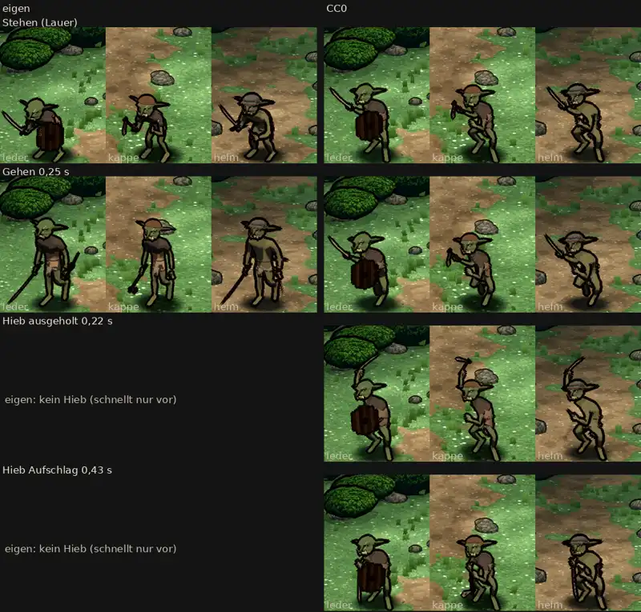

# 348.12 · Goblin: CC0-Gerüst oder eigener, obwohl der CC0-Hieb noch Fehler hat?

Jerry · 27.10., 01:34 · G Aussehen · M

Kurz: Goblin CC0 oder eigen? Der CC0-Hieb hat nach sechs Runden noch Fehler

**Frage:** Der Goblin auf dem CC0-Gerüst (rechte Hälfte) ist die zweite Runde nach deinem „cc0 nochmal“ vom 26.10., 16:21. Kommt er ins Spiel („CC0“), oder bleibt der eigene (linke Hälfte, „eigen“)? Bei „CC0“ folgen nach deinem Wort Grak, Kobold und Zombie aufs gleiche Gerüst.

**Votum Jerry: „CC0“**, Hieb und Ausrüstung bessere ich danach nach. Der fremde Prüfer hält CC0 für glaubwürdiger: Er bleibt im Stehen, Gehen und Hieb geduckt und hat einen echten Hieb. Der eigene hat keinen Hieb, er schnellt nur vor. Bitte den Film ansehen.

**Berührt:** 348.12 (Grak, Kobold, Zombie aufs CC0-Gerüst), 348.7 (Kampfort in Godot), 348.13 (Tusche).

## Begründung

Bei „eigen“ fehlt weiter ein Hieb, und der Goblin richtet sich im Gehen steif auf. Beim CC0-Goblin sind die Fehler Einzelheiten von Hieb und Ausrüstung. Sie lassen sich an einem Ort beheben und gelten dann für alle Figuren auf dem Gerüst.

## Sachverhalt

Die CC0-Bibliothek hat zum Schwert nur einen Stoß. Darum ist der Hieb selbst gebaut: Ausholen bis 0,20 s, kurz halten, Schlag bis zum Aufschlag bei 0,40 s, halten bis 0,46 s, zurück bis 0,80 s. Das Blatt zeigt Ausholen und Aufschlag jeweils mitten im Halten. Der fremde Prüfer hat Blatt und Film heute um 01:31 Bild für Bild angesehen. Nach drei Runden hätte ich vorlegen müssen (Regel 362), es wurden sechs.

- **Behoben:**
  - Im Schlag gibt es drei Zwischenbilder (vorher eines).
  - Der Aufschlag liest sich nicht mehr als Stoß.
  - Im Blatt ragt kein abgeschnittener Nachbar mehr in die Kachel.
- **Offen beim CC0-Goblin:**
  - **Aufschlag:** In der Zeile „Aufschlag“ ist kaum eine Waffe zu sehen, sie wirkt wie Stehen. Die Waffe ist an den Körper gezogen, die Spitze zeigt zum Boden, der Arm ist nicht gestreckt, die Schneide zeigt nicht zum Gegner. Bei Leder ist die Klinge im Film hinter Schild oder Gras unsichtbar. Bei Kappe und Helm liegt die Waffe vor Schritt und Beinen.
  - **Ausholen:** Die Klinge steht 0,17–0,2 s senkrecht. Der Arm geht zu wenig hoch, die Faust erreicht nur den Stirnrand (Leder, Kappe). Bei Helm sieht man keine Hand, die Klinge scheint aus dem Helm zu wachsen.
  - **Schlag:** Ein Einzelbild mitten im Schlag zeigt die Klinge waagrecht auf Kopfhöhe, für sich allein wirkt es wie ein Stich.
  - **Faust vor dem Mund:** in der Lauer (Leder, Helm) und beim Aufschlag (Leder).
  - **Ausrüstung:** Kappe und Helm tragen keinen Schild, nur Leder hat einen. Das Beil von Kappe ist sehr klein und wirkt wie ein Stock.
  - **Gehen:** auf der Stelle.
- **Offen beim eigenen Goblin:** Er springt beim Wechsel von Stehen zu Gehen aus der Hocke in eine steife, aufrechte Haltung und schleift das Schwert. Der Schild ist beim Gehen kaum zu erkennen. Bei Leder stößt die Schwertspitze im Stehen an den Bildrand.
- **Beide:**
  - In Spielgröße sind die Goblins winzig, auch im Blatt, und den Hieb sieht man am Handy kaum.
  - Im Film machen beide Helden kurz einen Schritt und springen zurück (0,1 s). Die Ursache kenne ich noch nicht.

## Auswertung

Stärkstes Gegenargument: Der CC0-Hieb hat nach sechs Runden noch rund zehn Fehler, und Grak, Kobold und Zombie erben sie. Dagegen: Der eigene Goblin hat gar keinen Hieb. Bei ihm müsste ich denselben Hieb erst bauen.

## Folgerungen

- **„CC0“:** Jerry bessert Aufschlag, Ausholen, Faust und Schilde nach und legt das Blatt erneut vor. Danach folgen Grak, Kobold und Zombie.
- **„eigen“:** Der eigene Goblin bleibt. Jerry baut ihm einen Hieb.
- **Ansage, eigene Frage, kein Votum:** Der Kampf sagt den Angriff der Goblins als „Stich“ an, wie im alten MARS. Die Bewegung ist ein Hieb. Soll die Ansage „Hieb“ heißen? Das ist eine Regel- und Textfrage. Die Entscheidung liegt bei dir, auf dein Wort hin fragt Jerry Homer.

Großbild und Film: Telegram 27.10., 01:35

Antwort:
