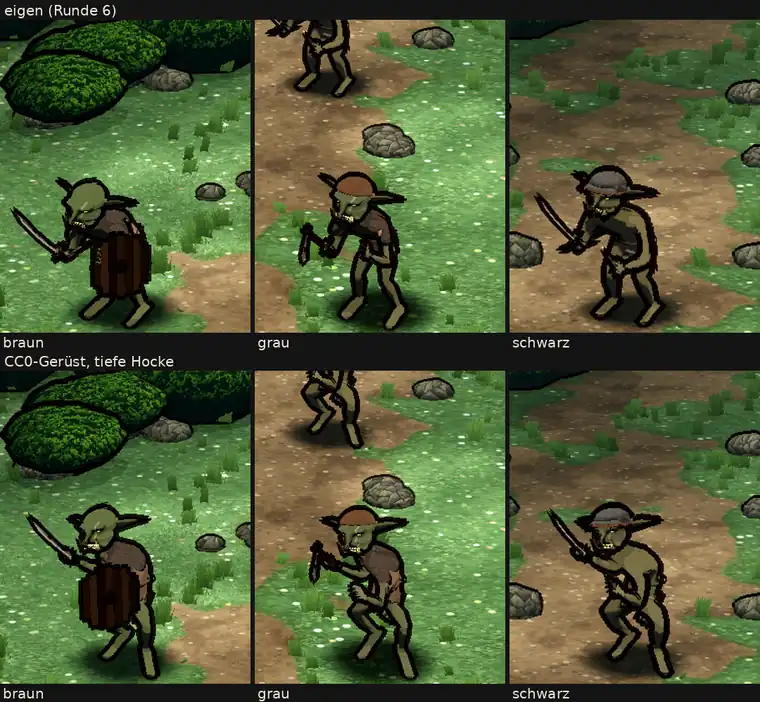

# 348.12 · Goblin auf dem CC0-Gerüst, Runde 2 (geduckt)

Jerry · 26.10., 19:08 · G Aussehen · M

**Frage:** Bleibt der Goblin auf dem eigenen Gerüst („eigen“, endgültig), oder noch eine Runde CC0 („cc0 Gehen nachbessern“)?

**Votum Jerry: „eigen“.** Dein Maßstab (heute 16:21, Archiv 348.12) war „mindestens so gut wie eigen“; im Stand ist CC0 besser, in der Bewegung schlechter. Alternative **„cc0 Gehen nachbessern“**: Runde 3, Gang geduckt wie der Stand, geschätzt eine Sitzung; misslingt sie, bleibt es bei eigen, ohne neue Frage.

**Berührt:** Goblin mit Späher und Schamane, Kobold, Grak, Zombie (wie 16:21); `LISTE-UMZUG-348.md` Modellregel 4, 5. Die Bewegungen auf dem CC0-Gerüst sind CC0 (Quaternius), gekauft ist nur die Pro-Fassung (348.12b).

## Sachverhalt

Oben unser Goblin auf dem eigenen Gerüst (`rig.py`, Runde 6, wie bei der ersten CC0-Probe), unten auf dem Quaternius-Gerüst (CC0) mit tiefer Hocke über dessen freien Bewegungen (Universal Animation Library Standard). Großbild und Kurzvideo (links eigen, rechts CC0): `bilder:pruefung/348.12-r2h.png`, `bilder:pruefung/348.12-r2h-1.mp4`.

## Auswertung (fremder Helfer heute 19:05, Bild und Film)

- **Stand: CC0 besser.** Unten echte Hocke, Waffe erhoben, lauernd; oben fast aufrecht, „eher krumm als lauernd“.
- **Gehen: CC0 schlechter.** Die Hocke fällt zusammen, die Goblins gehen gebückt wie alte Leute, die Klinge hängt wie ein Krückstock, der Schild rutscht ans Knie. Eigen geht aufrecht und ohne Bedrohung, aber flüssiger.
- **Silhouette unten:** rechts (schwarz) Arm oder Riemen vor dem Schritt, Knie eng; Mitte (grau) Klumpenhand, X-Knie; links (braun) verdeckt der Schild das Standbein, er schwebt ohne Arm. Oben rechts hängt ebenfalls ein dunkles Teil vor dem Schritt.
- **Ausrichtung unten:** Waffen steiler nach oben statt zum Gegner (schwarz fast senkrecht); braun blickt in die Kamera.
- **Größe:** unten 7 bis 15 % höher und 15 bis 20 % breiter als oben, trotz Hocke.
- **In beiden offen:** Schild ohne haltenden Arm, Schildkante treppig, Rumpf wirkt nackt, Goblins heben sich kaum vom Weg ab; Wechsel Stehen → Gehen springt ohne Überblendung.
- Helligkeit und Farbe (`vglmass.py`, von Jerry gemessen): oben und unten gleich, ohne Befund. Kleinteile (Hand, Schrittsilhouette) nur im Großbild erkennbar.

**Stärkstes Gegenargument:** Der Stand ist das, was man im Kampf am längsten sieht, und dort ist CC0 klar besser; das Gerüst bringt alle Bewegungen (Hieb, Treffer, Tod) für sechs Gegner mit, die wir sonst einzeln bauen. Der Gang ließe sich mit demselben Mittel ducken wie der Stand. Dagegen: Runde 2 brauchte acht Anläufe (2a–2h), jeder behob eines und öffnete ein anderes.

## Folgerungen

- „eigen“: Goblin mit Späher und Schamane, Kobold, Grak, Zombie bleiben auf `rig.py`; die in beiden Gerüsten offenen Punkte (Schild am Arm, Schrittsilhouette, Kontrast zum Weg) gehen in 348.7.
- „cc0 Gehen nachbessern“: eine Sitzung, dann Blatt und Film mit Stehen, Gehen, Hieb.
