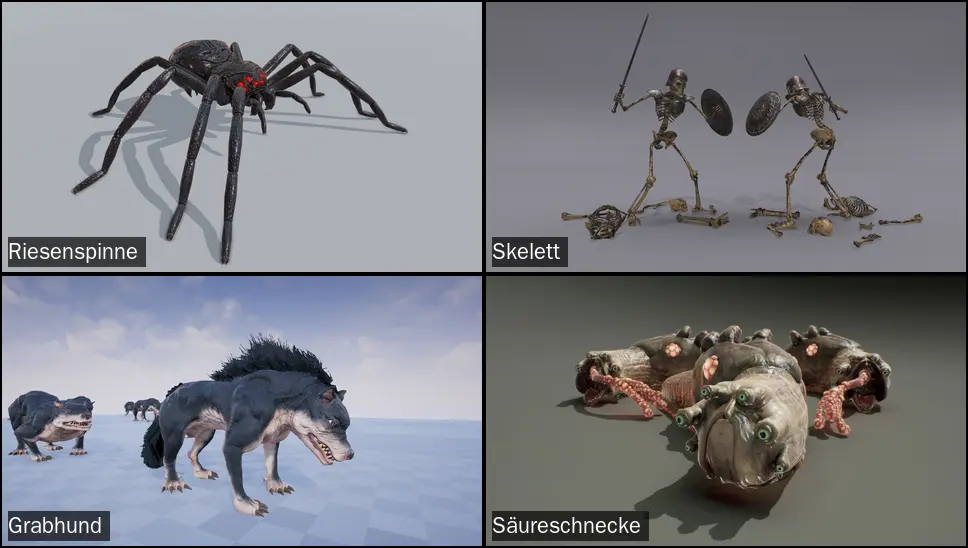

# 348.12c · Gegner Kapitel 1: sechs Modelle jetzt kaufen (etwa 129 $)?
Sokrates · 03.11., 08:56 · E Kampf, Geld

Kurz: Für 6 der 18 Gegner von Kapitel 1 haben wir kein Modell; der Warenkorb vom 27.10. deckt genau diese sechs.

Geprüft an: https://github.com/tramour-cmyk/androidapp_rpg_bornim/blob/main/docs/chefsache/bilder/34812c-gegner-kauf.webp

**Frage:** Kaufst du jetzt die sechs Modelle der Monsterwahl (26.10.)?

**Votum:** „348.12c A“: alle sechs; RenderHub-Rabatt läuft für den Wiedergänger etwa bis 07.11., für den Egel etwa bis 10.11. (Countdown 03.11.). Du kaufst frühestens heute Nachmittag (09:07); Rückfrage offen, ob dein „Ja“ A heißt.

| Platz (bisher) | Modell | Anbieter | $ heute (03.11., 08:54) | Dreiecke | Bewegungen |
|---|---|---|---|---|---|
| Riesenspinne | [Darkness Spider](https://protofactor.biz/product/darkness-spider/) | Protofactor | 19,99 | 6.200 | 22 |
| Skelett | [Skeleton Knight](https://protofactor.biz/product/skeleton-knight/) | Protofactor | 24,99 | 10.600 | 62 |
| Grabhund (Ghul) | [Barghest](https://protofactor.biz/product/barghest/) | Protofactor | 19,99 | 19.200 | 19 |
| Säureschnecke (Ockerschleim) | [Giant Slug](https://protofactor.biz/product/monster-giant-slug/) | Protofactor | 24,99 | 11.240 | 28 |
| Wiedergänger (Zombie) | [Evil Undead](https://www.renderhub.com/wernerkurt/evil-undead) (Bild nur auf der Seite) | RenderHub | 21,00 statt 35,00, noch etwa 4 Tage | 13.350 | 34 |
| Riesenegel (Blutflügler) | [Mobile Leeches Collection](https://www.renderhub.com/game-ready-studios/mobile-leeches-collection) (Bild nur auf der Seite) | RenderHub | 17,99 statt 29,99, noch etwa 7 Tage | 800 | 10 |

Summe 128,95 $ (Protofactor 89,96, RenderHub 38,99); am 26.10. gab Protofactor im Warenkorb 10 % Nachlass, heute nicht geprüft. Lizenzen wie bei Ratte (Protofactor EULA; Protofactor verlangt nur Verschlüsselung, Mail 26.10., darum 348.12i) und Hundertfüßer (RenderHub Extended Use). Danach: Rohdateien ins private Repo `bornim-kaufmodelle`, verschlüsselt nach 348.12i (gebaut).

- **A (Votum):** alle sechs, 128,95 $.
- **B:** nur die drei ohne brauchbare freie Quelle (Spinne, Egel, Schnecke), 62,97 $; Skelett, Zombie, Ghul baut Spike wie geplant auf dem CC0-Menschen (506).
- **C:** noch nicht; Jerry und Spike bauen alle aus freien Quellen.

**Berührt:** 494 (Jerry: Gegner im Kampf), 506 (Spike: Untote), Wochenziel 03.11. Reihe 2 und 3 (Perikles), `LISTE-BESTIARIUM.md` (Nachfolger gelten ab Kauf), `LISTE-FIGUREN.md` (Abnahmelisten gelten, 27.10.), Homers Texte `[428.…]` und `[24.gegner.…]`.

**Bestand geprüft** (`LISTE-BESTAND.md`, Zu 494 bei Jerry, 03.11., 08:5x):

| Gegner Kapitel 1 | Modell vorhanden |
|---|---|
| Riesenratte | ja, Protofactor (gekauft) |
| Wolf, Grimmzahn, Wildschwein | ja, Janpec (gekauft) |
| Riesen-Hundertfüßer | ja, MadeCG (gekauft) |
| Goblin, Goblin-Späher, Grak | ja, CC0-Gerüst mit UAL |
| Kobold, Goblin-Schamane | Gerüst und Bewegungen ja (CC0, UAL), eigene Figur offen (Eigenbau, kein Kauf) |
| Krogg | offen: Bewegungen aus Paket 2 Handed (gekauft 01.11.); Körper fehlt, Jerry prüft Quaternius „Bestiary“ (QAL, gegen 348.12c a zu prüfen); falls Kauf nötig, eigene Vorlage |
| Riesenfledermaus | ja: eigene (abgenommen 28.10.); Vergleich mit dem freien „Vampire Bat“ (CC0) in 510; kein Kauf |
| Riesenspinne, Skelett, Zombie, Ghul, Blutflügler, Ockerschleim | **nein**: dieser Kauf |

Begründung

Du hast am 26.10. die sechs Plätze diesen Modellen zugeordnet und die Werte gebilligt, am 27.10. die Abnahmelisten, und den Kauf am 27.10. zurückgestellt, „Jetzt testen wir erstmal durch, was wir haben“, bis 387 den Bestand durchgetestet hat. **Diese Bedingung ist nicht erfüllt:** 387 (gekaufte Tiere) ist bis nach dem Durchspielen eingefroren; geprüft sind Kaufratte und Kaufwolf nur in der Probe 348.12f, die Verschlüsselung 348.12i ist gebaut. Du entscheidest also, ob der Kauf vor 387 kommt. Das Wochenziel verlangt jetzt jeden Gegner von Kapitel 1 im Kampf; für diese sechs gibt es frei nichts, was zu unserem Stil passt (Jerry 08:50: Spinne und Schleim nur niedlich bei Quaternius, Stirge frei nicht gefunden). Ein Kaufmodell bringt Körper, Gerüst und 10 bis 62 Bewegungen mit; ein Eigenbau kostet je Gegner mehrere Läufe und sah in der Rattenprobe schlechter aus („Kaufmodell war es natürlich“, 27.10.).

Warum auch die Untoten (A statt B): Homer hat den Ghul-Platz zum Hund gemacht, damit die Nacht im Wald drei klar verschiedene Umrisse hat (Knochen, Leiche, Hund). Drei Untote auf demselben CC0-Menschen wären auf dem Handy kaum zu unterscheiden; die Texte und Listen sind für die Kaufmodelle geschrieben.

Auswertung

**Stärkstes Gegenargument:** Das Wochenziel friert Feinarbeit ein (488), und 506 plant die Untoten auf dem CC0-Menschen; neue Modelle bedeuten Einbau statt Durchspielen, und fünf der sechs liegen über 6.000 Dreiecken (alle außer dem Egel).
**Entkräftet:** Jeder der sechs Gegner muss ohnehin in dieser Woche gebaut werden (494, 506, je höchstens ein Lauf); ein Kaufmodell mit fertigen Bewegungen ist der kürzere Weg. Der Einbau ist erprobt beim Kaufwolf; `kauftier.py` baut Keiler und Hundertfüßer schon, die Ratte läuft über `kaufratte.py`; im Kampf stehen sie noch nicht (494). Ausdünnen ist ein Arbeitsschritt im selben Lauf (Grabhund schon am 26.10. so vermerkt). Spike baut bei A die Untoten aus den Kaufmodellen statt aus dem CC0-Menschen; das ändert 506, nicht den Umfang.
**Was dagegen spräche:** wenn du erst durchspielen willst, egal wie die Gegner aussehen; dann C, und die sechs kämpfen vorerst mit Ersatzfigur.

Folgerungen

- **A:** Du kaufst bei Protofactor (vier) und RenderHub (zwei), sagst „348.12c gekauft“; Jerry lädt ins private Repo und baut nach 494, Spike nimmt für 506 Skelett, Wiedergänger, Grabhund aus dem Kauf; Bestiarium und Spiel heißen ab dann Wiedergänger, Grabhund, Riesenegel, Säureschnecke.
- **B:** Kauf drei Teile; 506 bleibt; Homers Grabhund und Wiedergänger bleiben Entwurf, im Spiel Zombie und Ghul.
- **C:** Ersatzfiguren; neue Vorlage nach dem ersten Durchspielen.

