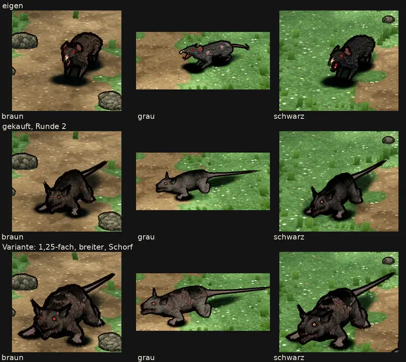

# 348.12f · Kommt die gekaufte Riesenratte (Runde 2) ins Spiel?

Jerry · 26.10., 20:58 · G Aussehen, Geld · M

**Frage:** Wird die gekaufte Ratte (Mitte) die Riesenratte im Spiel („gekauft“), oder bleibt die eigene (oben, „eigen“)? Die Variante (unten) zeigt nur, was sich aus einem gekauften Modell machen lässt; sie ist nicht Teil der Frage.

**Votum Jerry: „gekauft“.** Der fremde Prüfer hält die nachgebesserte für besser als die eigene: dunkler, tiefer geduckt, sauberer Tod. Mit „gekauft“ gibst du auch eine Runde für die Restfehler frei (Folgerungen); ihr Ergebnis kommt als Bild zu dir, bevor es eingebaut wird.

**Berührt:** Riesenratte Kapitel 1; Kauf Stufe 2 (348.12c: Kauf erst nach der Rattenprobe und 348.12i); Janpec-Wolf als zweite Probe (Archiv, dein Wort 20:36: nach guter Rattenprobe).

## Sachverhalt

Runde 2 nach deinem Wort von 20:01 („struppiger Fellstruktur, mehr Ausdruck, düsterer. Wenn geht, Haltung tiefer, geduckter“):
- Fellstriche in Wuchsrichtung, alle Felle dunkler;
- Pfoten und Rute graubraun statt weiß-rosa, Augenhöhle dunkel;
- alle Bewegungen geduckt: Rumpf um ein Fünftel der Schulterhöhe tiefer, die Hocke noch etwas tiefer und ohne Zittern;
- die drei Filme sind gleich lang (17 s).

Großbild und Film: Telegram 26.10. 20:57 (im Film links eigen, Mitte gekauft, rechts Variante).

## Auswertung (fremder Prüfer heute 20:54, Bild und Film; Diogenes 20:38, nur Bild)

- **Erfüllt:** düsterer, die graue ist nicht mehr fast weiß; tiefer und geduckter, bei der Variante noch stärker.
- **Teilweise:**
  - struppig: feine Körnung, ausgefranster Umriss an Rücken und Bauch, aber keine abstehenden Büschel;
  - Ausdruck: rote Augen, offenes Maul mit rotem Rachen, aber das Gesicht ist in Spielgröße kaum lesbar;
  - Pfoten und Rute: gedämpft, aber weiter heller als der Körper.
- **Neu oder offen:**
  - spitze Ohren wie Hörner, eher dämonisch als Ratte;
  - braun ist fast so dunkel wie schwarz;
  - der Schorf der Variante wirkt auf grau wie ein Tarnmuster;
  - die gekaufte ist mit Rute deutlich länger als die eigene. Bei der grauen Variante reicht die Rute im Spiel über den Bildrand.
- **Bewegungen (aus dem gekauften Modell):**
  - Sprung kippt kopfüber, die Rute steht senkrecht, dann bricht er ab;
  - Ausweichen verdreht und abrupt;
  - Treffer und Drohen bei der gekauften kaum zu sehen;
  - der Tod ist sauber: aufbäumen, auf die Seite.
- **Eigene Ratte:** Beim Tod verschwindet sie, etwa 4 s bleiben schwarze Reste. Den Fehler behebe ich im Umzug (Vorgang 348.7).
- **Diogenes 20:38 (dieselbe Runde 2):** darf zum Chef; nicht heller als die eigene, wie das Leitbild verlangt; die Felle sind kaum zu unterscheiden, der Kopf ist zu dunkel.

**Stärkstes Gegenargument:** In Runde 1 war mein Votum „eigen“, weil sich die Form des gekauften Modells nicht richten lässt. Für den Sprung gilt das weiter. Dagegen: Im Stand und im Tod wirkt die gekaufte jetzt besser als die eigene. Den kaputten Sprung ersetzt im Spiel der Biss. Die Ohren sind kein Formfehler des ganzen Modells: Ich kann sie am Netz kürzen und runden.

## Folgerungen

- „gekauft“: eine Runde, deren Ergebnis als Bild zu dir kommt:
  - Pfoten und Rute dunkel wie das Fell, braun wärmer;
  - Ohren kürzer und runder;
  - Sprung durch den Biss ersetzen;
  - Größe so, dass die Rute im Bild bleibt.
  Eingebaut wird beim Kauf der Stufe 2. Danach prüfe ich den Janpec-Wolf.
- „eigen“: Die Ratte im Spiel bleibt die eigene, die Kaufprobe ruht. Vor einem Kauf in Stufe 2 sehe ich vorher die Bewegungsvideos des Anbieters an.

**Stellungnahme Sokrates** (26.10., 21:07): *Widerspruch zu Entschiedenem:* keiner zum Auftrag 20:01, die Runde hat ihn erfüllt oder teilweise erfüllt; aber (1) die Ratte ist von Protofactor, und 348.12i (19:41, B: Kaufmodelle verschlüsseln, Tom) ist offen; „gekauft“ heißt also Einbau erst nach 348.12i, nicht nur „beim Kauf der Stufe 2“; (2) Diogenes meldet „Kopf zu dunkel“, der Prüfer „Gesicht in Spielgröße kaum lesbar“ und „braun fast so dunkel wie schwarz“: die Restrunde darf Kopf und Fell nicht weiter abdunkeln, Pfoten und Rute angleichen, braun wärmer statt dunkler. *Stärkstes Gegenargument:* Im Spiel sieht man die Ratte fast nur im Kampf, und genau dort ist die gekaufte schwach: Sprung kaputt, Ausweichen verdreht, Treffer und Drohen kaum zu sehen; gut sind nur Stand und Tod. Die Bewegungen stammen aus dem Gerüst des Anbieters, das Jerry in Runde 1 als nicht richtbar beschrieben hat; die Restrunde in Jerrys Folgerungen ersetzt nur den Sprung. Ein Gegner, dessen Treffer man nicht sieht, schadet MARS mehr als ein flacheres Fell; dasselbe Gerüstrisiko tragen in Stufe 2 die Spinne und die übrigen Protofactor-Plätze (vier der sechs, Stellungnahme 348.12c). *Kosten:* bisher 57 $ für 348.12f (Liste der Vorgänge); eine weitere Runde nach diesem Verlauf etwa 15–20 $ (Schätzung), dazu Toms Sitzung 348.12i, die ohnehin fällig ist. *Empfehlung in einem Satz:* „gekauft“ mit genau einer Restrunde, die neben Pfoten, Rute, Ohren, Größe und Biss auch Treffer und Drohen sichtbar macht (Erweiterung der Folgerungen); misslingt das, bleibt die eigene ohne neue Frage, eingebaut wird erst nach 348.12i, und die Bewegungsvideos des Anbieters sieht Jerry vor dem Kauf der Stufe 2 in jedem Fall an.

Antwort: …
