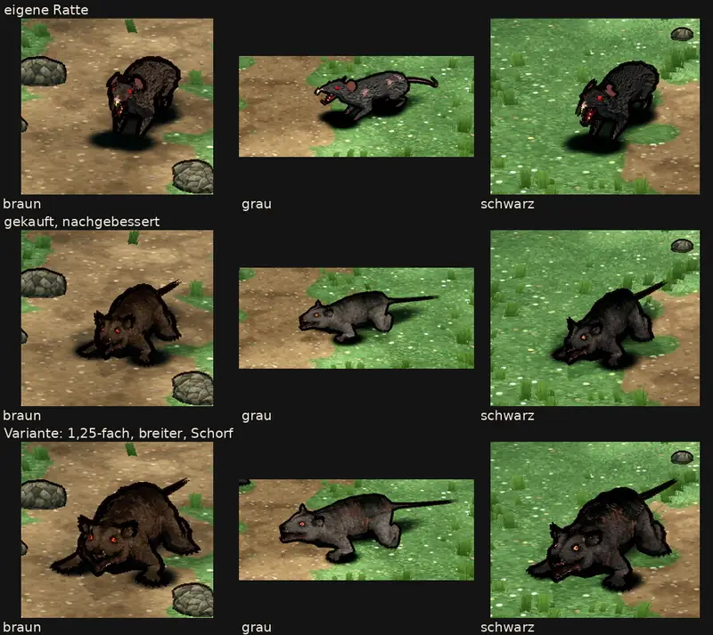

# 348.12f · Reicht die nachgebesserte Kaufratte, oder bleibt die eigene?

Jerry · 27.10., 00:11 · G Aussehen, Geld · M

**Frage:** Die Nachbesserung nach deinem „gekauft“ vom 26.10., 21:12 ist fertig. Einige Fehler sind noch offen (Sachverhalt). Wird die gekaufte Ratte (mittlere Zeile) trotzdem eingebaut („gekauft“), oder bleibt die eigene (obere Zeile, „eigen“)? Die Variante (untere Zeile) zeigt nur, was sich aus dem Kaufmodell machen lässt; sie gehört nicht zur Frage.

**Votum Jerry: „eigen“.** Auf dem Bild wirkt die gekaufte besser, im Film nicht; bitte Film 1 ansehen. In den Bewegungen bleiben Fehler, die ich in vier Runden nicht behoben habe:
- die Rute schnellt im Treffer zu einem Haken und steht im Tod schräg ab;
- die Beine stehen im Tod steif ab;
- das Ausweichen läuft auf die Helden zu.

Ob mehr verschiedene Bewegungen gehen, beantwortet der Abschnitt „Deine Frage vom 26.10., 21:12“: kaum.

**Berührt:** Riesenratte Kapitel 1; zweiter Kauf von Modellen (348.12c); Einbau erst, wenn gekaufte Modelle verschlüsselt im Spiel liegen (348.12i, Tom); Wolf des Anbieters Janpec als nächste Probe (dein Wort 26.10., 20:36: erst nach guter Rattenprobe).

## Deine Frage vom 26.10., 21:12

„Können wir verschiedene Ausweichbewegungen, Angriffsarten und Todesanimationen mit dem Kaufmodell machen?“ **Kaum.** Neben den eingebauten Bewegungen hat das Modell nur wenige weitere. Der fremde Prüfer hat sie alle angesehen (Film 2):
- **Ausweichen:** Nur „Ausweichen zurück“ (Aufbäumen und Rücksprung) taugt bedingt als zweites Ausweichen. Auch dort wird die Rute zum steilen Haken.
- **Angriff:** Es gibt nur den Biss. Der Sprungbiss landet vom Helden weggedreht, die Rute wird zum steilen Haken, danach springt die Ratte ruckartig zurück.
- **Tod:** Es gibt nur einen.
- **Treffer:** „Treffer“ (von vorn), „Treffer links“ und „Treffer rechts“ sehen fast gleich aus.

Mehr Abwechslung müsste ich also selbst dazubauen.

## Sachverhalt

Die Nachbesserung lief in vier Runden. Das Ergebnis hat heute um 00:00 ein fremder Prüfer angesehen: Bild, Nahaufnahme und beide Filme, Bild für Bild.

- **Erledigt:**
  - Pfoten in Fellfarbe, Rute dunkel;
  - braun wärmer und nicht heller als die eigene;
  - Treffer sichtbar (Kopf ruckt hoch);
  - der Sprung ist durch den Biss ersetzt;
  - alle Ratten bleiben samt Rute im Bild.
- **Offen:**
  - **Rute:**
    - schnellt im Treffer, im Sprungbiss und bei „Ausweichen zurück“ zu einem steilen Haken wie ein Fragezeichen;
    - steht im Tod steif schräg (30–45°);
    - ist im Stand ein starrer Stab, der über dem Boden schwebt;
    - die Spitze ist gezackt statt spitz.
    Meine Messung am Modell zeigt eine flache Rute, der Film nicht. Die Ursache kenne ich noch nicht.
  - **Tod:** Die Ratte rollt auf die Seite, die Beine stehen danach steif ab.
  - **Ausweichen:** Ein Satz auf die Helden zu, der wie ein Angriff wirkt.
  - **Drohen:** Die Schnauze zeigt senkrecht zum Himmel, wie bei einem heulenden Wolf.
  - **Kopf:** Das Gesicht ist in Spielgröße kaum lesbar, vom Auge bleibt ein Punkt. Die Ohren sind ungleich: das nahe rund mit dunklem Ring, das ferne spitz.
  - **Umriss:** Sie wirkt eher wie eine geduckte Hyäne als wie eine Ratte.
  - **Größe:** größer als die Helden; mit Rute 2,4 m lang (Variante 3,0 m).
  - **Fell:** grau und schwarz sind im Film kaum zu unterscheiden.
- **Eigene Ratte:** Beim Tod bleiben gut 2 s lang Schatten ohne Körper liegen. Das behebe ich im Umzug nach Godot (348.7).

Nahaufnahme und Filme in Telegram (27.10.):
- **Film 1:** links eigen, Mitte gekauft, rechts Variante; Bewegung für Bewegung gleichzeitig.
- **Film 2:** die Kampfbewegungen der gekauften Ratte einzeln (Stehen, Gehen, Hocke und Lefzen zeigt Film 1). Den Sprung der eigenen Ratte habe ich aus Film 1 herausgeschnitten, damit alle drei gleichzeitig beißen.
  - Bei „Ausweichen zurück“ ist der Name am rechten Rand abgeschnitten.
  - „Ausweichen links“ fehlt; der Name in meiner Liste war falsch, für die nächste Probe ist das behoben.
- Auf dem Bild ist die Spalte „grau“ anders zugeschnitten; die eigene graue Ratte steht dort in anderer Haltung.

## Auswertung

**Stärkstes Gegenargument:** Du hast am 26.10. um 21:12 „gekauft“ gesagt. Auf dem Bild und in der Nahaufnahme ist die gekaufte die düsterere und struppigere. Die Rutenfehler kommen vermutlich aus meiner Rechnung, nicht aus dem Modell; bewiesen ist das nicht. Findet der Nachfolger die Ursache, ist die Rute wohl behebbar.

**Warum trotzdem „eigen“:** Die Ratte sieht man fast nur im Kampf und dort klein. In Spielgröße bleibt vom Vorteil des Bildes wenig (Gesicht kaum lesbar, Umriss wie eine Hyäne). Neben der Rute bleiben drei Fehler aus den Bewegungen des Anbieters: Tod mit steifen Beinen, Ausweichen nach vorn, Drohen wie Wolfsgeheul. Mehr Abwechslung gibt das Modell auch nicht her. Sokrates hat am 26.10. um 21:07 vorgeschlagen: Misslingt die Nachbesserung, bleibt die eigene.

## Folgerungen

- **„eigen“:** Die eigene Ratte bleibt im Spiel, die Kaufprobe ruht. Ihren Schattenfehler beim Tod behebe ich in 348.7. Vor einem zweiten Kauf sehe ich mir die Bewegungsvideos des Anbieters an. Den Janpec-Wolf prüfe ich nicht, bis du etwas anderes sagst.
- **„gekauft“:** Eine weitere Runde, zuerst für die Rute: die Ursache im Film nachstellen, dann beheben. Tod, Ausweichen und Drohen baue ich danach selbst nach, je Bewegung etwa eine Sitzung (Schätzung). Kopf, Umriss, Größe und Fell bleiben, wie sie sind, außer du nennst etwas. Eingebaut wird nach 348.12i.

Antwort: …
