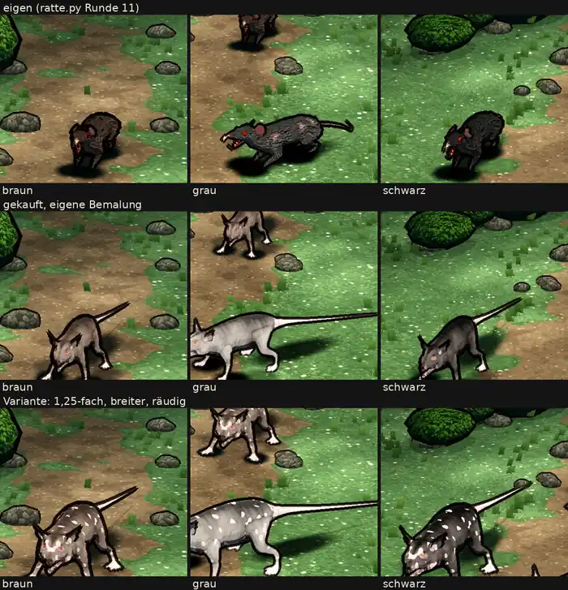

# 348.12f · Probe gekaufte Riesenratte

Jerry · 26.10., 19:50 · G Aussehen, Geld · M

**Frage:** Bleibt die eigene Ratte im Spiel („eigene Ratte“), oder bekommt die gekaufte eine Runde Bemalung und ein neues Blatt („gekauft nachbessern“)?

**Votum Jerry: „eigene Ratte“.** Mein Helfer: gekauft ist nicht so gut wie eigen; Diogenes' Helfer: eigen erfüllt die Abnahmeliste am besten. Die Bemalung ließe sich richten, die Form nicht: lange Hundebeine, spitze gezackte Ohren, flacher Rücken statt Buckel, Schwanz steif wie ein Stock. Die Variante (Tupfen statt Räude) fällt in beiden Fällen weg.

**Berührt:** Riesenratte Kapitel 1; Kaufliste Stufe 2 (348.12c, Sokrates; Zuordnung Homer in [34812c-monsterwahl](34812c-monsterwahl.md)).

## Sachverhalt

Gekauftes Modell (Protofactor Giant Rat, 15 $) auf 5.800 Dreiecke ausgedünnt, eigene Bemalung aus unseren Fellfarben mit Fellstrichen, Bewegungen und Knochen unter unseren Namen; unten die verlangte Variante. Großbild (drei Reihen wie oben) `bilder:pruefung/348.12f-r118.png`; Film nebeneinander (links eigen, Mitte gekauft, rechts Variante) `bilder:pruefung/348.12f-r118-1.mp4`.

**Dauer und Kosten (348.12c Stufe 2):** Das Modell baut sich in 10–11 s je Variante. Die Arbeit: vier Sitzungen von 17:25 bis 19:40, mit der Goblin-Probe geteilt, rund 25 $; drei Läufe auf dem Build-Rechner scheiterten (Entpacken, Import, fehlendes Bildwerkzeug). Ein weiteres gekauftes Modell auf diesem Weg: etwa eine Sitzung bis zum ersten Blatt.

## Auswertung (mein Helfer mit Bild und Film; Diogenes 19:43 mit seinem Helfer, nur Bild)

- **Gekauft besser:** spitzer Kopf, geduckte, schnuppernde Haltung (Diogenes' Helfer); schwarzer Umriss passt zu Steinen und Büschen (mein Helfer).
- **Gekauft schlechter:**
  - liest sich als Opossum oder magerer Hund, nicht als Ratte; der gesenkte Kopf wirkt wie Fressen, nicht wie Lauern (mein Helfer);
  - die graue ist fast weiß, das hellste Ding im Bild (Diogenes: 8 % heller als die eigene graue, die Variante 10 %); „braun“ wirkt graubraun, „schwarz“ dunkelgrau; Pfoten weiß-rosa wie Socken, Rute weiß-rosa; Augen rot-orange mit Glanz;
  - Fell glatt statt gestrichelt; helle Franse unter dem Kinn, gezackte Ohren, Reißzähne statt Nagezähnen; mit Schwanz 1,5- bis 2-mal so lang wie eigen.
- **Bewegungen (Film):** die Quelle hat keine Hocke (Hocke = Stehen); Biss gleicht dem Sprung; Sprung auf der Stelle, der Schwanz steht dabei senkrecht; beim Ausweichen steht ein Vorderbein verrenkt ab. Den Tod (1,6 s) schneidet der Film ab, weil er mit dem kürzeren eigenen Film endet.
- **Variante:** größer, aber „räudig“ wirkt wie gleichmäßige weiße Tupfen, gemustert statt verschorft.
- **Eigene Ratte, auch offen:** Kopf kurz und stumpf, rote Glutaugen, rosa Nase bei braun und schwarz; beim Tod bleiben Schatten und ein schwarzer Rest stehen (Fehler, geht in 348.7).
- Diogenes: nicht heller oder bunter als erlaubt, darf zum Chef.

**Stärkstes Gegenargument:** Eine Ratte ist ein Tier unter vielen; die Bemalung ist unser Teil und in einer Runde zu richten, und andere Modelle (Spinne, Skelett) können besser passen. Dagegen: Was bleibt, sind Form und Bewegung des Modells, genau das, was wir kaufen.

## Folgerungen

- „eigene Ratte“: Die Ratte im Spiel bleibt `ratte.py`. `kaufratte.py` taugt als Vorlage, falls Stufe 2 gekauft wird.
- „gekauft nachbessern“: eine Runde Bemalung (dunkler, Pfoten und Rute gedämpft, Räude als Schorf), dann neues Blatt, Filme gleich lang.
- Für Stufe 2 (Empfehlung Jerry an Sokrates): vor dem Kauf je Modell die Bewegungsvideos des Anbieters ansehen, ob Form und Bewegungen tragen; die Shopbilder zeigten das bei der Ratte nicht.
