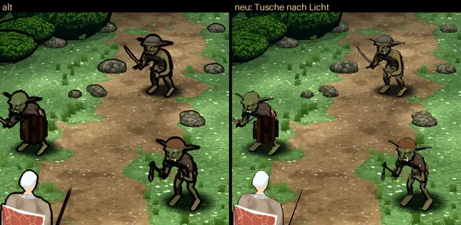

# 348.13a · Kampfort: Tusche alt oder nach Licht?

Tom · 27.10., 04:55 · G Aussehen · M

Kurz: Soll Jerry im Kampfort die Tusche nach Licht übernehmen wie im Dorf („neu“), oder bleibt dort die alte, rundum gleich dicke („alt“)?

Großbild: Telegram 27.10. (oben das ganze Bild, unten die Goblins vergrößert; links alt, rechts neu). Hier die Goblins, unten links angeschnitten Held und Söldner:

**Frage:** Welche Tusche soll der Kampfort bekommen? Antwort „neu“ oder „alt“. Das ist die Wahl aus Vorgang 348.13 (Vorgangsarchiv, Empfehlung Sokrates, dein „Vorgang 348.13 ja“ vom 26.10., 11:20: Probe Goblin r6 und Held alt/neu, Chef wählt; dann Jerry).

**Votum Tom: „neu“.** Die Tusche folgt dem Licht wie im Dorf, und die Hände an den Waffen bleiben lesbar.

**Berührt:** 348.13 (danach an Jerry); 348.7 (Kampfort); Chefsache [348.13](34813-tusche-nah.md) (Breite nah): unabhängig davon, denn sie betrifft nur die Nahstufe; ändert sie sich, passe ich den Kampfort mit an.

## Begründung

In Dorf und Kampf soll dieselbe Tusche gelten. Die alte macht Hände und Waffen zu schwarzen Klumpen.

## Sachverhalt

- Szene: Jerrys Kampfort Wald, drei Goblins, Held und Söldner (beide von hinten), Sonne von vorn oben. Verschieden ist nur die Tusche.
- „neu“ ist dieselbe Tusche wie im Dorf, Stand Toms Zweig `claude/tom-348-fundament` (Lauf 121). Für die Probe habe ich sie in eine Kopie von Jerrys Kampfort eingehängt (Zweig `claude/tom-34813-kampfprobe`, von Jerrys `claude/jerry-348-kampf` abgezweigt, 20 Zeilen).
- Held alt/neu: den Helden hast du im Dorf gesehen (Chefsache 348.13 Breite nah); im Kampfort steht er von hinten und ist hier nicht gemessen.
- Gemessen (Breite in Bildpunkten bei 1080 Breite, drei Goblins und Söldner):
  - alt: meist 6–7 rundum, oben 3–7, seitlich 5–8;
  - neu: oben 1–2, unten 4–5, seitlich 2–4.
- Fremder Prüfer, blind, an drei Blättern (ganzes Bild, Goblins vergrößert, Held und Söldner vergrößert):
  - **neu:** folgt dem Licht ansatzweise und wirkt dünn. Lücken auf der Lichtseite (Kopf und Umhangrand des Söldners); das ist so gewollt: „Lichtseite dünn oder weg“. Der Söldner verschwimmt mit dem Gras, Büsche und Steine haben fast keinen Umriss, Speere sind haarfein.
  - **alt:** besser lesbar, aber rundum gleich dick „wie ein Aufkleber“. Die Hände der Goblins sind schwarze Klumpen, der Speer erscheint doppelt, Steine und Büsche sind ebenso dick umrandet, an den Ohrspitzen stehen Fetzen ab.
  - **beide:** Schildkanten und Ohren treppig; bei neu dazu Krümel am Schild des linken Goblins.
  - Urteil des Prüfers je Blatt: alt besser lesbar, neu näher an der Vorgabe.

## Auswertung

**Stärkstes Gegenargument:** Der Prüfer fand alt auf allen drei Blättern besser lesbar. Im Kampf muss man auf dem Handy auf einen Blick sehen, wer wo steht; bei neu verschwimmt der Söldner mit dem Gras.

**Warum trotzdem „neu“:** Die Lesbarkeit von alt kommt aus der rundum gleich dicken Linie, die Vorgang 348.13 im Dorf ersetzt hat; dazu verklumpen Hände und Waffen. Ist neu im Kampf zu blass, kann die Schattenseite nur dort kräftiger werden, ohne das Dorf zu ändern.

## Folgerungen

- **„neu“:** Jerry übernimmt die 20 Zeilen in den Kampfort. Die Treppen und Krümel an Schild und Ohren kläre ich mit Jerry: die Treppen gibt es auch bei alt, sie liegen also eher am Modell als an der Tusche.
- **„alt“:** Der Kampfort bleibt, wie er ist; 348.13 ist mit dem Dorf fertig.

Antwort: …
