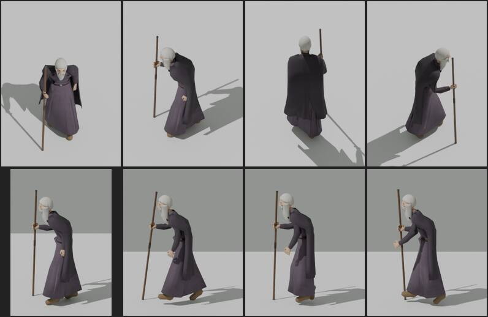

# 348.6 · Aldrics Stab: langer Stab vor dem Gesicht lassen oder kürzerer Wanderstock?
Tom · 26.10., 07:02 · Grafik · Kurz: Aldrics Stab, Länge oder Haltung

**Frage:** Der lange Stab kommt dem gebeugten Aldric von der Seite immer nah ans Gesicht. Soll er so bleiben (A), einen kürzeren Wanderstock bekommen (B) oder weniger gebeugt stehen (C)?

**Votum:** „B: Wanderstock“. Der Wanderstock reicht bis zur Schulter, etwa 1,35 m statt 1,7 m. Jerry baut ihn in `waffen.py`, Tom stellt die Haltung darauf ein.

**Berührt:** 348.6 (Aldric, `rig.py`, `leute.gd`), Waffen von Team Jerry.

**Zum Bild:** Oben die Spielansicht von schräg oben: vorn, rechts, hinten, links. Unten flach von der Seite: Stehen und drei Bilder vom Gehen.

**Sachverhalt:**
- Vorher stand der Stab auf Kopfhöhe 13 bis 17 cm neben der Kopfmitte. Von der Seite kreuzte er den Kopf, der Helfer sah einen „Spieß im Rücken“.
- Jetzt hält Aldric ihn wie einen Wanderer:
  - Die Faust ist geballt und sitzt vorn außen, 23 cm unter der Schulter. Wegen der Beugung erscheint sie im Bild von der Seite neben dem Bart.
  - Der Stab steht fast senkrecht und wird etwa jeden Schritt neu aufgesetzt.
  - Er bleibt im Raum mindestens 27 cm von der Kopfmitte weg, davon 19 bis 27 cm seitlich. Flach von der Seite sieht man diesen seitlichen Abstand nicht, darum wirkt er dort dicht vor dem Gesicht.
- Der fremde Helfer hat vier Runden geprüft.
  - Behoben: Der Stab kreuzt den Kopf nicht mehr, sticht nicht durch den Umhang und steht auf dem Boden. Im Gehen wird er glaubwürdig aufgesetzt. Von vorn ist die Haltung gut.
  - Offen, stark: Flach von der Seite steht der Stab dicht vor Nase und Bart, und der Arm greift fast waagrecht nach vorn.
  - Offen, mittel: Von hinten sieht man nur das obere Stück neben dem Kopf, den Rest verdeckt der gebeugte Rücken. In zwei Seitenansichten wirken die Finger einzeln und offen (im Bild kaum zu sehen).
  - Offen, gering: Ein Umhangknopf sticht durch den Bart (im Bild kaum zu sehen), und die freie linke Hand tastet im Gehen nach vorn.

**Auswertung:**
- Der Kopf steht wegen der Beugung von 26° 19 cm vor den Füßen. Ein Stab, der über den Kopf hinausreicht, steht deshalb entweder dicht vor dem Gesicht oder neben bzw. hinter dem Kopf. Bleibt er davon frei, muss der Arm weit nach vorn greifen. Mehr Abstand bringt nur eine andere Länge oder eine andere Haltung des Körpers, keine andere Zahl.
- **A** behält das Bild des Ältesten mit langem Stab. Der starke Befund von der Seite bleibt.
- **B** löst rechnerisch die starken Befunde: Die Spitze endet bei etwa 1,35 m, knapp unter dem Kinn und 19 cm oder mehr seitlich davon, also nie vor dem Gesicht. Die Faust kann tiefer sitzen, der Arm greift nicht mehr weit vor. Gebaut und geprüft ist das noch nicht.
- **C** behält den langen Stab, nimmt Aldric aber das Alter. Wie weit der Kopf dann noch vorsteht, ist noch nicht gemessen. Der Helfer hatte ihn früher schon „von schräg oben nicht gebeugt“ genannt.
- **Stärkstes Gegenargument gegen B:** Ein langer Stab ist das Zeichen des Ältesten, und im alten Spiel trug Aldric einen langen Stab auf der Schulter. Ein Wanderstock macht ihn gebrechlicher und weniger würdig.

**Folgerungen:**
- Bei B: ein Vorgang an Jerry für den Wanderstock; Tom passt die Haltung an und legt neu vor.
- Bei A: Der starke Befund bleibt; Tom behebt nur die mittleren und geringen.
- Bei C: Tom setzt die Beugung auf etwa 12° und prüft Morwen mit (die andere gebeugte Alte, 30°).

Antwort: …
