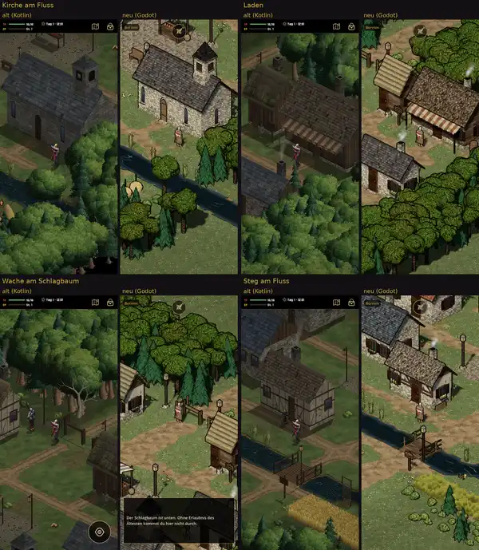

# 348.6 · Dorf in Godot nach zehn Bauschritten: Richtung so, und was zuerst?
Tom · 25.10., 11:58 · G Stil · Muss; drei Prüferrunden ohne dein Urteil, darum kommt das Bild jetzt zu dir
Kurz: Dorf alt/neu nach Runde 10: Richtung so, Reihenfolge der Restpunkte?

## Frage

Das Dorf in Godot nach Runde 10 (Runde = Bauschritt; die Prüferrunden zählen getrennt). Passt die Richtung? Stimmt die Reihenfolge der Restpunkte unten?

## Votum

„Ja“: Ich baue in Runde 11 die Punkte unter „Hoch“ und „Mittel“; „Gering“ kommt mit den Modellen ab Woche 2. Sonst nenn, was zuerst muss.

## Berührt

348.6 (Umzug Godot, Dorf als erste Gebietskarte).

## Begründung

Nach drei Prüferrunden ohne dein Urteil keine vierte (`LISTE-UMZUG-348.md`, Grundsätze).

## Sachverhalt

Großbild: Telegram 25.10. 11:59. Je Paar links alt (Kotlin), rechts neu (Godot, Bilder aus dem Build zu Runde 10): Kirche am Fluss, Laden, Schlagbaum, Steg am Fluss.

In Runde 10 geändert: Bäume stehen weiter vom Wasser weg, Schilf wurzelt an der Wasserlinie, Büsche sind ungleich verteilt, hinter Dächern stehen keine Fichtenspitzen mehr, das Korn ist unten dunkler.

Noch nicht umgezogen, darum nicht im Bild: Spielleiste (TP/EP, Uhrzeit, Karte, Beutel), Leute (Wache, Frau an der Tür), Held als neues Modell.

## Auswertung

Zwei fremde Prüfer haben die Bilder durchgesehen. Was bleibt:

Hoch
- An der Kirche wirkt ein Laubbaum weiter, als stünde er im Fluss. Sein Fuß ist von Baum und Busch davor verdeckt.
- Über den Firsten von Laden und Wachhaus schaut je ein Busch hervor. Er steht dahinter, wirkt aber, als läge er auf dem Dach.

Mittel
- Am Steg reicht der Laternenpfahl bis ins Wasser. Nachts liegt neben der Laterne ein zu harter, heller Streifen auf dem Wasser.
- Am Kornfeld stehen die Büsche wie in einer Reihe, alle mit gleicher Textur. Das Korn ist blasser als alt und unten nur wenig dunkler.
- Beim Drehen der Karte: ein Schatten, dessen Werfer nicht im Bild ist; Gras im Schatten bleibt hell; ein Holzdach flimmert. Im Blatt nicht zu sehen.
- Am Steg fehlt die Reuse am Ufer, die das alte Spiel dort hat.

Gering
- Schilf steht an zwei Stellen etwas im Trockenen.
- Das Wasser ist sehr schwarz und schmaler als alt.
- Die Waldkronen sind gleichförmig. Am Laden verdeckt eine Laubwand das halbe Haus.
- Kleine Schilder sind unlesbar.
- Die Laterne an der Kirche wirkt, als säße sie auf der Bank.

Der Schlagbaum hat alt wie neu dieselbe Bauart (Pfosten mit Querbalken). Neu ist er nicht schlechter, nur ist es in beiden Fassungen kein echter Schlagbaum.

Stärkstes Gegenargument: Weitere Runden am Dorf binden Zeit, die für Leute und Innenräume fehlt. Wasser und Wald gehören ohnehin zu den späteren Modellen.

## Folgerungen

Ja: Tom baut „Hoch“ und „Mittel“ in Runde 11 und schickt danach ein neues Vergleichsbild. Nein: Tom baut zuerst, was du nennst.

Antwort: …
