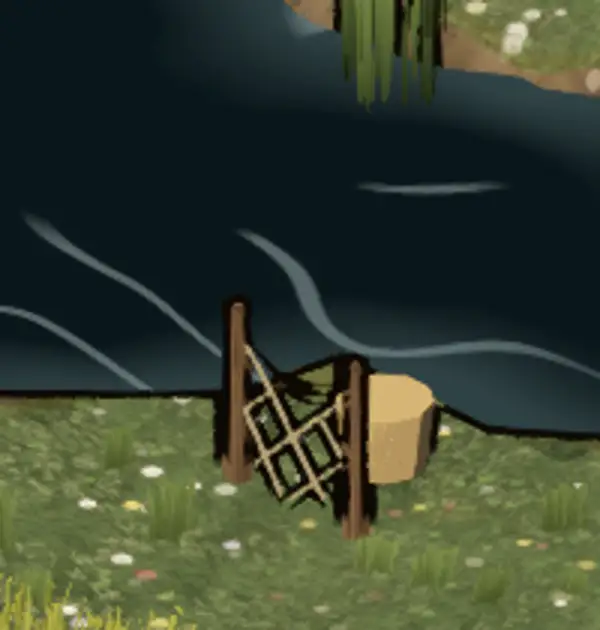

# 348.6 · Trockennetz am Fluss: ersetzen oder lassen?
Tom · 25.10., 10:49 · G Stil · M

## Frage

Am Fluss soll ein Fischernetz zum Trocknen hängen. Im Hof an Kachel 22/27 ist der trockene Platz am Ufer aber nur etwa 50 cm breit, und das Netz ist dort auch nach vier Runden nicht lesbar. Das zweite Netz (7/24) hat 84 cm Platz und bleibt. Was soll an diese Stelle?
1. ein anderes Ding: Eimer oder Handkarre (Holzstapel gibt es schon zweimal, ein dritter gleicher verstieße gegen „drei Varianten“),
2. ein Netz, das über einem niedrigen Bock liegt,
3. das Netz darf in die Wiese daneben reichen; dann wird diese Kachel gesperrt, sonst liefe der Held hindurch.

## Empfehlung

1: ein anderes Ding. Das geht am schnellsten und ist am sichersten zu lesen.

## Berührt

348.6 (Umzug Godot, Dorf; Hof am Ufer, Kachel 22/27).

## Begründung

Das alte Spiel hatte dort ein aufrechtes Netz. In Godot liest es sich als Gatter, als Spalier oder als Leiter.

## Sachverhalt

- Runden 5, 7, 8 und 9: Masche, Schnur, Höhe, Seil und Korb wurden geändert. Bei 45 Bildpunkten Breite (Handybild 1080 breit) sieht der Prüfer zuletzt einen „umgefallenen Zaun“ und daneben einen Korb, der wie ein Klotz wirkt.
- Die Lage ist eng: Westlich liegt Wasser, die Kachel östlich ist Wiese, über die man gehen kann.

## Auswertung

Stärkstes Gegenargument: Das Netz erzählt vom Fischerdorf, ein Holzstapel nicht. Variante 2 würde das bewahren, kostet aber eine weitere Runde ohne Gewähr.

## Folgerungen

1 oder 2: eine Runde, dann Bild an dich. 3: eine Runde; die Wiesenkachel ist danach nicht mehr begehbar.
