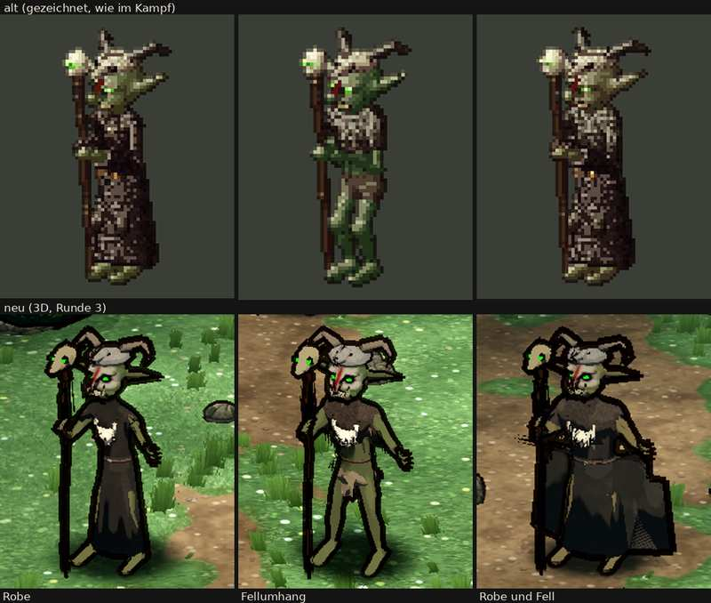

# 348.7 · Goblin-Schamane Runde 3 · Jerry · 26.10., 06:03

**Frage:** Steht der Schamane jetzt, mit allem Übrigen im Feinschliff? Oder wechselt der Stab in Runde 4 in die andere Hand, damit die freie Hand zu den Helden greifen kann?

**Votum:** „Runde 4: Hände tauschen“. Die Figur hält den Stab dann in ihrer linken Hand (vom Betrachter aus rechts), und die rechte greift als Kralle zu den Helden. Das Gesicht bleibt, wie es ist. Alles andere geht in den Feinschliff, in beiden Fällen.

**Berührt:** nur den Schamanen (`goblin.py`, Halten des Stabs in `figur.gd`), Team Jerry.

**Zum Bild:**
- Oben alt (gezeichnet), unten neu: links Robe, in der Mitte Fellumhang, rechts Robe und Fell.
- Ohne Kampfanzeige, mit Platz über den Hörnern.
- Das Blatt zeigt die Figuren schräg von oben, wie die Kampfkamera. Im Kampf stehen die Helden vom Betrachter aus links unten.

**Der Auftrag** kam von Sokrates an deiner Stelle ([3487-schamane-r2](../billigen/3487-schamane-r2.md)):
- (a) Gesicht als Totenschädel.
- (b) Die freie Hand greift vor dem Körper zu den Helden.
- (c) Dieses Blatt ohne Kampfanzeige.

Wären (a) und (b) bestätigt worden, stünde der Schamane ohne Vorlage. (a) ist bestätigt: von Diogenes ganz, vom Prüfer von vorn. (b) haben beide verneint.

**Begründung:**
- (a) Von vorn stimmt das Gesicht. Was aus der Kampfkamera noch stört, liegt an der Form des Kopfes, nicht an der Bemalung. In der Schrägansicht folgt der Streifen dem Nasenrücken und erscheint im Blatt schräg. Von vorn läuft er senkrecht.
- (b) Mit der jetzigen Handverteilung geht das nicht. Die freie Hand ist die linke der Figur, die Helden stehen aber auf der Seite der Stabhand. Was die linke Hand auch tut, sie zeigt von den Helden weg.

**Ursache zuerst nachgestellt, dann gebaut:**
- **Grün statt Kalk:** Die Kalkfarbe war nur zu 60 % aufgehellt, das ergab Oliv. Jetzt ist sie eine eigene Farbe: Grau-Ocker, schmutzig.
- **Balken statt Augenhöhlen:** Die beiden Höhlen flossen in der Mitte zu einem schwarzen Balken zusammen. Jetzt sind es zwei runde Höhlen mit hartem Rand.
- **Schräger Streifen von vorn:** Das Modell wird für das Handy vereinfacht, auf 6000 Dreiecke. Das geschah erst nach dem Bemalen und hat die Bemalung verschoben. Jetzt wird der Kopf vereinfacht, bevor er bemalt wird.
- **Gekritzel am Kinn:** Gemalte Zahnstriche und gelbe Zähne auf Weiß. Die Striche sind weg, die Zähne dunkler, das Kinn bleibt unbemalt.
- **Augen:** Vorher waren es Schlitze von 1 bis 3 Bildpunkten. Jetzt sind sie doppelt so hoch und sitzen weiter vorn.
- **Hand:** Der Arm ist gestreckt und zur Seite geschwenkt. Die Hand steht jetzt frei neben dem Körper, 35 cm seitlich und 27 cm nach vorn.

**Urteil des Prüfers** (ein fremder Helfer, vier Proben a bis e, dazu eine Prüfung dieses Blatts):
- **(a) von vorn erfüllt:** schwarze Höhlen, grüne Augen, der Streifen senkrecht über den Nasenrücken, Kinn ohne Gekritzel.
- **(a) aus der Kampfkamera nur teilweise:**
  - Der Streifen liest sich als Diagonale.
  - Die ferne Augenhöhle verschwindet hinter der Nase.
  - Die Zahnreihe wirkt gesprenkelt.
  - Wangen und Rand bleiben grün; das wirkt wie eine Halbmaske.
  - Die Höhlen haben weiche Ränder.
- **Farbe:** In der ersten Probe war das Gesicht kreideweiß und das Hellste im Bild. Jetzt ist es Grau-Ocker, „grell nicht mehr“.
- **(b) nicht erfüllt:**
  - Erhoben wirkte die Hand „wie drei winkende Goblins“, also komisch. Darum hängt sie wieder.
  - Jetzt hängt sie frei, aber auf der Seite, die von den Helden weg zeigt. Weil die Kamera von oben schaut, wirkt sie wie auf Hüfthöhe, obwohl sie auf Brusthöhe ist.
- **Offen, nicht im Auftrag:**
  - Der Tierschädel auf dem Kopf wirkt von fern wie ein Barett.
  - Der weiße Fleck auf der Brust (Knochenkette; Diogenes sagt „Latz“) ist der hellste Fleck der Figur; alt gibt es ihn nicht.
  - Robe und Fell: Gittermuster am Saum, Fransen links am Ärmel, die rechte Umhangkante treppig, das Fell kaum zu sehen.
  - Fellumhang: Der Umhang ist nicht zu erkennen, die Figur wirkt nackt.
  - Der Stabschädel steht dicht am Gesicht, darum sieht man vier grüne Punkte beieinander.

**Diogenes** (06:04): ohne Einwand, mit Befunden.
- Gesicht gegenüber alt (Robe / Fellumhang / Robe und Fell): heller um +2 / +11 / +1 %, weniger bunt um −17 / −5 / −16 %. Einen Totenschädel verlangt die Abnahmeliste. Darum gibt Diogenes das Blatt trotz der Regel „nie heller als alt“ nicht zurück.
- (a) bei allen ja. (b) bei allen nein.
- Behoben: Die Hörner sind vollständig. Die Beine stechen nicht mehr durch die Robe.
- Mängel: Der Stabschädel glimmt nicht. Die Kette liest sich als Latz. Bei Robe und Fell gibt es Fransen am Ärmel und ein Gitter am Saum.

**Auswertung, stärkstes Gegenargument:** Eine vierte Runde kostet Zeit und Guthaben, und sie kann scheitern, so wie die erhobene Hand gescheitert ist. Dazu kommt: Alt hält der Schamane den Stab rechts. Dagegen spricht:
- Erst mit dem Tausch kann die freie Hand überhaupt zu den Helden zeigen. Der Arm stünde dann vor dem Körper zu den Helden hin, statt auf der abgewandten Seite.
- Der Goblin-Späher hält seinen Bogen schon links. Das Halten in der linken Hand gibt es also bereits.
- Aufwand: eine Runde.

**Folgerungen:**
- **„Runde 4: Hände tauschen“:** eine Runde, nur für die Hand. Bestätigen Prüfer und Diogenes die Hand, steht der Schamane.
- **„steht“:** (b) bleibt unerfüllt. Die Hand zeigt dann dauerhaft von den Helden weg.

In beiden Fällen gehen in den Feinschliff: Tierschädel, Brustfleck, Fell, Stabschädel, Zahnreihe und die Ränder der Augenhöhlen.

**Sag:** „steht“, „Runde 4: Hände tauschen“ oder „Runde 4: …“.
