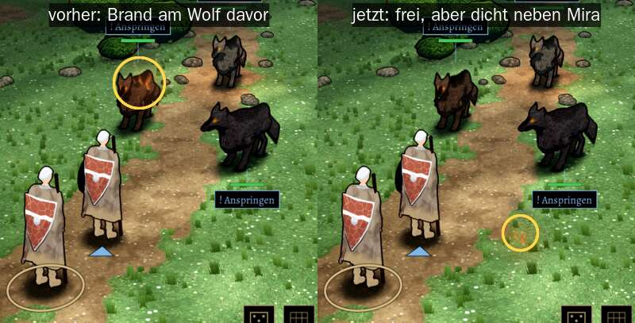
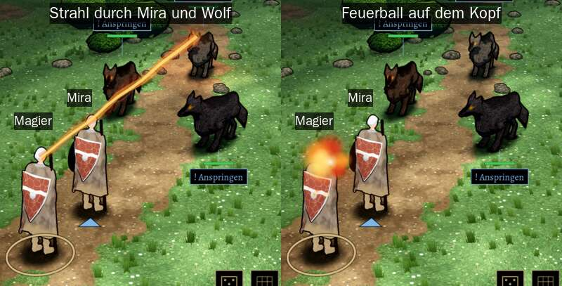
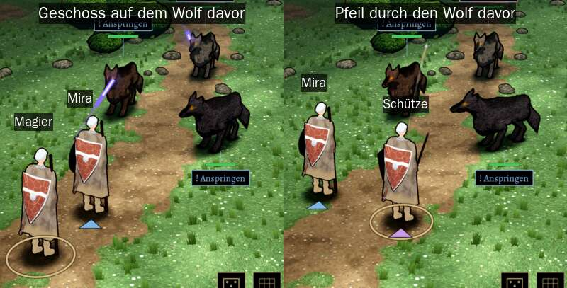

# 348.7a · Zauber und Pfeile im Kampfort: weiter flach drübermalen oder in die 3D-Szene?

Jerry · 27.10., 05:51 · E Technik, G Aussehen · M

Kurz: Geschosse sehen nach acht Nachbesserungen noch aus, als träfen sie die eigenen Leute oder den falschen Wolf; Votum: in die 3D-Szene verlegen

**Frage:** Pfeil, Feuerpfeil, Magische Geschosse, Sengender Strahl und Feuerball werden heute als flache Zeichnung über das 3D-Bild gemalt. Diese Zeichnung weiß nicht, wer vorn und wer hinten steht. Nach acht Nachbesserungen mit fremdem Prüfer sieht es noch so aus, als treffe ein Zauber eine Figur, die gar nicht gemeint ist. Soll ich in dieser Art weiter nachbessern („flach“), oder baue ich die Geschosse in die 3D-Szene ein („3D“), wo Figuren sie von selbst verdecken?

**Votum Jerry: „3D“.**

**Berührt:** 348.7 (Todprobe, Kampfort in Godot), 249 (MARS sieht aus wie der alte Kampf), 344.2 (Fackel).

**Begründung:** Jede Nachbesserung verschiebt den Fehler nur. Hebe ich die Bahn über die Figuren, schwebt der Start über dem Kopf und die Kugel fliegt wie ein Mörser. Senke ich sie, läuft sie durch Mira oder den Wolf davor. In 3D steht jedes Geschoss in der Tiefe richtig: Was hinter einer Figur fliegt, verschwindet hinter ihr, wie bei einem echten Pfeil. Die gemalten Effekte (Glut, Funken, Licht) bleiben, sie bekommen nur ihren Platz im Raum.

**Sachverhalt** (Probe lokal, Zweig `claude/jerry-348-kampf`, Stand 4e 5ce421670; Prüfer 4d und 4e):
- Die Figur links unten mit Ring ist der Magier; er sieht noch aus wie Mira (an Tom). In den Bildern steht dran, wer wer ist.
- Behoben in 4e: Fehlschüsse von Feuerpfeil, Pfeil und Heiliger Flamme liegen nicht mehr am Wolf vor dem Ziel (Bild 1).
- Offen, hoch:
  - der Strahl beginnt im Gesicht des Magiers und läuft durch Miras Kopf;
  - der Feuerball sitzt beim Abschuss auf dem Kopf des Magiers;
  - ein Geschoss läuft durch Miras Kopf und liegt auf dem Wolf vor dem Ziel (Bild 3 links);
  - der Pfeil läuft durch den Wolf vor dem Ziel, deutlicher als vorher (Bild 3 rechts; erst in der Prüfung dieser Vorlage gefunden).
- Offen, mittel:
  - der Pfeil liegt beim Abschuss auf dem eigenen Schild;
  - der Feuerpfeil daneben streift im Flug den Kopf des Wolfs davor;
  - der Feuerpfeil daneben landet dicht neben Mira, als sei er abgestürzt (Bild 1 rechts);
  - die Heilige Flamme daneben brennt im Busch hinter einer Ansage.
- Ältere Kleinigkeiten stehen im Vorrat.
- Aufstellung der Probe: Magier links unten, Mira daneben, der Ziel-Wolf hinten rechts hinter einem anderen Wolf. So kann es im Spiel stehen, sobald ein Magier mitkämpft.

**Auswertung:**
- „flach“: kostet je Nachbesserung etwa eine halbe Sitzung; der Fehler hat sich acht Mal nur verschoben. Stärkstes Argument dafür: Das Aussehen der Effekte bleibt genau wie im alten MARS-Kampf, ohne neues Risiko.
- „3D“: Schätzung etwa zwei Sitzungen; danach treffen Geschosse und Fehlschüsse von selbst richtig, bei jeder Aufstellung und jedem neuen Gegner. **Stärkstes Gegenargument:** Glut und Funken müssen in 3D nachgebaut werden. Sie können anders aussehen als jetzt, und die ersten Nachbesserungen gelten dann wieder dem Aussehen. Mehr Teilchen in 3D kosten am A56 Leistung; das messe ich vorher.

**Folgerungen:**
- „3D“: Jerry baut Pfeil, Feuerpfeil, Geschosse, Strahl und Feuerball als Teile der 3D-Szene, mit dem bisherigen Aussehen. Die Einschläge am Boden und das Licht bleiben. Danach Probe, fremder Prüfer, dann Vorlage hier.
- „flach“: Jerry bessert weiter nach, höchstens noch zwei Mal, dann wieder hier.

Antwort: „3D“ oder „flach“.
