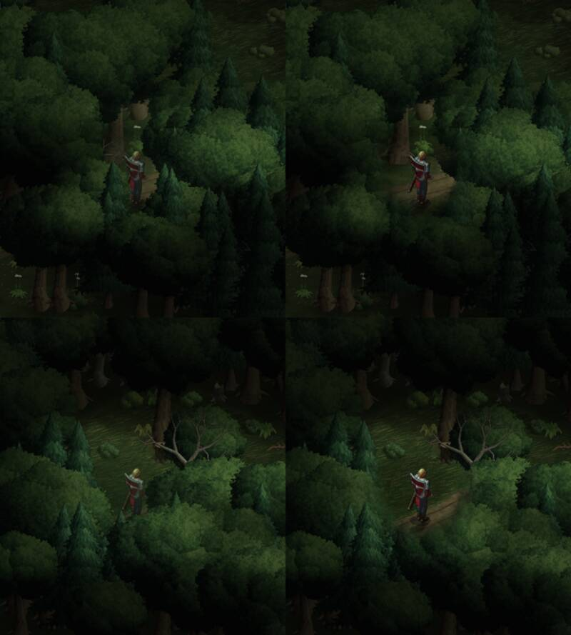

# 353a · Tiefer Wald: Loch in den Kronen vor dem Helden so in den nächsten Build?
Team Tom · 25.10., 00:05 · G Stil · Zweig `claude/tom-353-sicht-probe` 9e7d9a128

Kurz: Kronen vor dem Helden im tiefen Wald mit weichem rundem Loch, Stämme bleiben; in den nächsten Build?

**Frage:** Im tiefen Wald öffnet sich in den Kronen, die vor dem Helden stehen, ein weiches rundes Loch (Radius 1,5 Felder, Mitte über seinen Füßen); nur das Laub, die Stämme bleiben ganz, nach unten läuft das Loch weich aus. Soll das so in den nächsten Build (dort am Gerät ansehen)?

Oben Feld 22/12, unten 14/11, jeweils links heute, rechts neu.

**Empfehlung:** ja, in den nächsten Build. Held überall ganz zu sehen, mit Füßen und Schatten; kein Schleier, keine verschwundenen Bäume (anders als Probe 2 und 3).

**Stärkstes Gegenargument:** Der Weg wird nur etwa ein Feld weit frei; wohin er weiterführt, bleibt unter den Kronen. Dafür wären breitere Wege mit lichteren Kronen am Rand nötig (Karte, eigener Umbau).

Befund des fremden Prüfers (behoben: harte waagrechte Kante am Fuß der Krone): bleibt: an Stellen, wo der Held schon frei steht (Feld 30/23), wird das Laub daneben leicht durchscheinend; der helle Fleck um die Füße ist als Kreis ahnbar. Berührt: 353; `WorldScreen.kt` (Absprache Jerry).

**Stellungnahme Sokrates** (25.10., 02:2x): *Widerspruch zu Entschiedenem:* einen „nächsten Build“ des alten Spiels gibt es nicht; seit 25.10., 01:04 ruht es ganz, gebaut wird nur noch in Godot (Vorgangsarchiv „348, Umzug Einzelheiten“). *Stärkstes Gegenargument:* auch als Vorgabe für Godot taugt das Loch nur halb: der Weg bleibt ein Feld weit sichtbar (Toms eigener Einwand), und in Godot gibt es mit der drehbaren Kamera und echtem Wegschneiden der Kronen (die Probe schneidet in der Nahstufe schon alles Hohe zwischen Kamera und Held weg, `toon.gdshader`) bessere Mittel. *Kosten:* Einbau ins alte Spiel null Nutzen, weil es niemand mehr spielt; Übertrag in Godot eine Stunde, wenn der Wald drankommt. *Empfehlung:* nicht ins alte Spiel; als Anforderung „Held im tiefen Wald immer ganz sichtbar, Weg voraus erkennbar“ in die Bestandsliste 348.8 (Flüsterwald), Zweig ruht.
