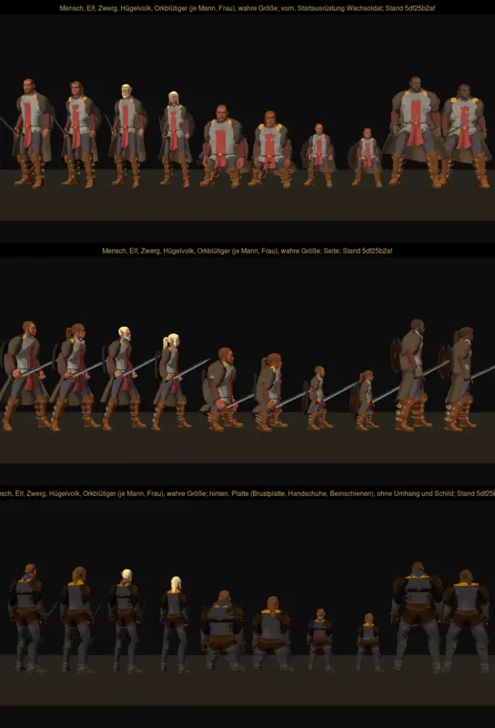
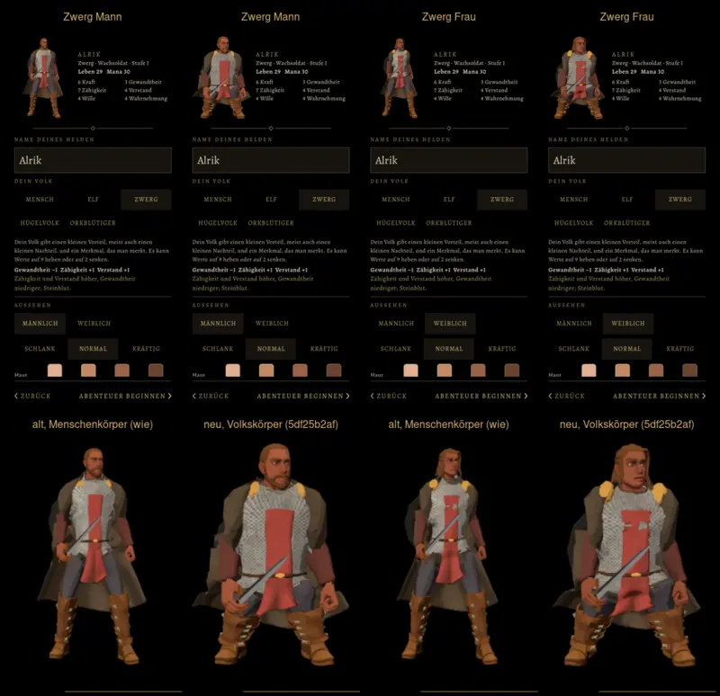
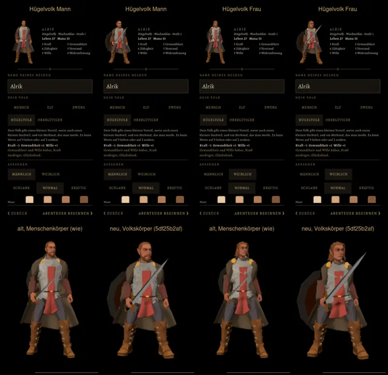

# 431 · Völkerkörper so billigen, die App 100 MB größer hinnehmen und in der Erschaffung jedes Volk in wahrer Größe zeigen?
Sokrates · 24.11., 18:15 · E Figuren · 2. Nein des Prüfers 18:06 (Laufbremse); dein Wort 10:26 („App-Größe … zu groß → steckt fest“)
Kurz: Jedes Volk hat jetzt seinen eigenen Körper; offen sind die Größe in der Erschaffung, 100 MB mehr App und zwei Bärte.
Beim Chef, weil: Aussehen; Obergrenze B

Geprüft an: Beleglauf 45422069657, Commit 5df25b2af (Zweig claude/wiebke-431-volkskoerper); Prüfer 18:06

**Frage:** Bisher trug jedes Volk den Menschenkörper. Jetzt hat jedes Volk seinen eigenen (Bild 1, wahre Größe): Zwerg breit und gedrungen, Hügelvolk klein, Orkblütiger massig, Elf schlank. Drei Dinge brauchen dein Wort: (1) In der Erschaffung (Bild 2, 3) zeigt die Vorschau jedes Volk gleich hoch, Zwerg und Hügelvolk wirken dort so groß wie ein Mensch. Soll die Vorschau die wahre Größe zeigen? (2) Die App wächst um etwa 100 MB auf 792 MB. Ist das in Ordnung? (3) Billigst du die Körper, wie Bild 1 sie zeigt?

**Votum:** „431 A“: Körper billigen; Erschaffung zeigt die wahre Größe; 100 MB hinnehmen; Nachbesserung bis 30 $, dann Testbuild für dich.

**Berührt:** 1297 (Schildgröße je Körper), 1174 (Körperregler je Volk), 1519 (Helden im Hauptmenü); Erschaffung, Gebiet, Kampf.

**Begründung:** Ziel von 431: das Volk „am Umriss ohne Ausrüstung erkennbar“ in Erschaffung, Gebiet und Kampf. In Bild 1 gelingt das, in der Erschaffung nicht, weil die Vorschau die Größe angleicht.

**Sachverhalt:**
- Prüfung 100 Fälle (5 Völker × 2 Geschlechter × 8 Herkünfte, dazu Platte und Umhang), 0 falsch; Größen wie `LISTE-FIGUREN.md` (Elf 1,72/1,60 m, Zwerg 1,35/1,26, Hügelvolk 1,05/0,98, Orkblütiger 1,85/1,72); Mensch Frau 1,76 statt 1,63 m wie heute schon auf main.
- App: 40 Volksmodelle gepackt 170 → 95 MB; App 691 → 792 MB. Die Menschenmodelle ließen sich ebenso packen (etwa 21 MB weniger).
- Abweichungen von `LISTE-FIGUREN.md`, ohne deine Entscheidung zu beheben: Elf Mann trägt weißen Vollbart (Liste: „nie Bart“), Zwerg Mann nur Stoppeln (Liste: „voller Bart über Kinn und Brust“). Beim Hügelvolk ragt der Rundschild links weit hinter dem Körper heraus (Bild 3).
- Rückansicht mit Umhang fehlt im Bild, wie du um 10:26 entschieden hast.
- Kosten 431 bisher etwa 155 $; Deckel 90 $ ab 10:26 reicht bis etwa 216 $.

**Auswertung:**
- **A (Empfehlung):** billigen; eine Nachbesserung (wahre Größe in der Erschaffung, Bärte nach Liste, Hügelvolk-Schild, Menschenmodelle packen) bis 30 $, ein Beleglauf, dann Testbuild.
- **B:** billigen, Erschaffung bleibt gleich hoch; nur Bärte und Schild nachbessern.
- **C:** App-Zuwachs nicht hinnehmen; erst weiter verkleinern, dann wieder vorlegen.
- **Stärkstes Gegenargument gegen A:** In wahrer Größe ist das Hügelvolk in der Vorschau nur gut halb so hoch wie der Mensch; Gesicht und Ausrüstung sind auf dem Handy schlechter zu sehen.
- **Entkräftet durch:** Die Vorschau kann die Kamera für kleine Völker näher holen, solange ein Maßstab (zum Beispiel ein Mensch daneben oder eine Größenlinie) den Unterschied zeigt; das bleibt Teil der Nachbesserung und kommt mit Bild zurück.

**Folgerungen:** A: Arbeitsplaner schreibt die Nachbesserung, Disponent startet Figur, danach Testbuild über Disponent; nach deinem Test mische ich nach main. B: dasselbe ohne Erschaffung. C: 431 zurück an Figur mit Ziel App-Größe.

Antwort: …
