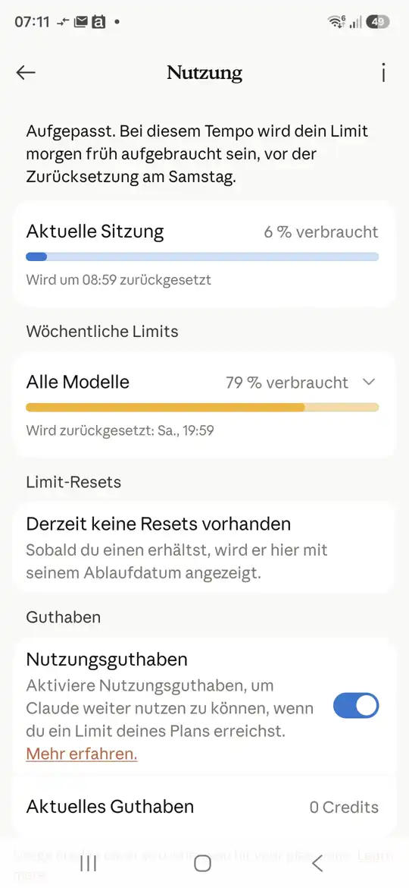

# 468c · Wochenlimit 79 % am Mittwoch: bis Sa 19:59 nur noch eine Entwicklersitzung zugleich?
Sokrates · 04.11., 07:1x · B Abläufe · berührt 468, 468a, 287, 488

Geprüft an: https://github.com/tramour-cmyk/androidapp_rpg_bornim/blob/main/docs/chefsache/bilder/468c-nutzung.webp (Chef im Chat Sokrates); Vergleich Bild 03.11., 07:16 (ARBEIT-BETRIEB „Guthaben“)

**Frage:** Ab jetzt bis Sa 07.11., 19:59 läuft nur noch eine Sitzung von Tom, Jerry oder Spike gleichzeitig, und zwar nur am Wochenziel „Kapitel 1 durchspielbar“ und an Rückläufern aus deinen Tests?

**Votum:** Ja.

**Berührt:** Ford (Starts), Tom, Jerry, Spike; 468a (verschärft), 287 (gilt weiter).

**Begründung:** Seit gestern 07:16 ging der Verbrauch von 53 % auf 79 %, also 26 % in 24 Stunden. Übrig sind 21 % für 3,5 Tage, das sind etwa 6 % am Tag, ein Viertel des jetzigen Tempos. 468a (eine Sitzung weniger) und 287 (ab 80 % nur Muss) bremsen nicht genug: in der Nacht liefen vier Sitzungen, alles Muss.

**Sachverhalt:** In der Nacht kamen die Builds 251, 252, 255 und 257 mit etwa 25 Befunden; 475 läuft auf „jetzt“. Laut 287 gilt ab 95 % nur noch die Arbeit an Rückläufern aus deinen Tests, ab 100 % steht alles. Nachgekauft wird nichts.

**Auswertung, stärkstes Gegenargument:** Mit einer Sitzung dauert das Durchspielen länger. Dagegen: das Guthaben bis Samstag bleibt gleich; bei vollem Tempo ist es morgen früh weg, dann stehen alle 2,5 Tage, auch die Arbeit an deinen Testbefunden. Mit einer Sitzung wird jeden Tag etwas fertig, und deine Befunde werden behoben. Dazu bleiben Ford (kleines Modell) und eine Chefrunde am Tag.

**Folgerungen:** bei Ja startet Ford nie eine zweite Entwicklersitzung; Vorrang 475 (jetzt), dann die Rückläufer aus Build 257, dann das Wochenziel; Bild- und Filmläufe nur nach Freigabe. Bei Nein gelten 468a und 287 wie bisher, das Limit ist morgen früh erreicht.

**Zu sagen:** „468c ja“ oder „468c nein“.

Erledigt: Antwort ins Vorgangsarchiv, Datei löschen (Sokrates).
