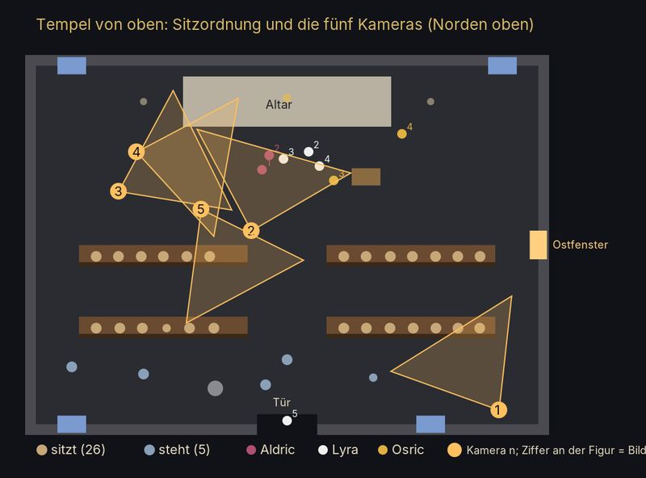
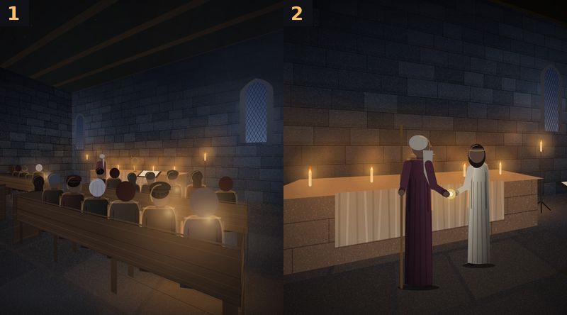
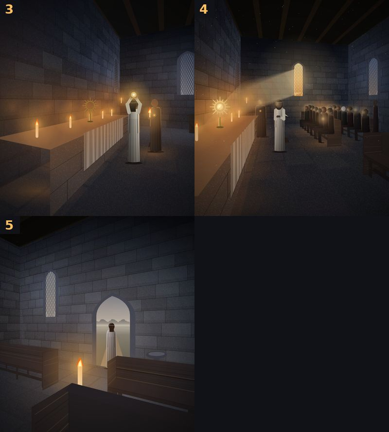

# 68 · Tempelbilder Ende Kapitel 1: passt die neue Bildserie?
Tom · 19.10., 20:35 · E Dorf · Zweig `claude/tom-68-bildfehler` (bb2c9e21) · Bildserie vor dem Build (228)
Kurz: Tempelbilder (Ende Kapitel 1) neu: „passt“ → Build

**Frage:** Passen die fünf Bilder so? Bei „passt“ kommen sie in den nächsten Build, sonst je Bild ein Satz, was falsch aussieht.

**Was neu ist** (zu Ihren und Sokrates' Punkten 19:27–19:40):
- **Draufsicht** (erstes Bild): Grundriss mit Sitzordnung, Aldric, Lyra, Osric je Bild (Ziffer an der Figur) und die fünf Kameras mit Blickwinkel.
- **Bänke:** Sitz auf Kniehöhe, Lehne bis zur Schulter der Sitzenden, unter dem Sitz offen (Beine, Fußleiste), schmale Seitenbretter; beide Blöcke in denselben zwei Reihen (gleiche Flucht).
- **Gemeinde:** in allen Bildern dieselbe, 26 sitzend Schulter an Schulter in allen vier Bänken, 5 stehend hinter der letzten Reihe (Tempel fasst 25–30, „voll“); niemand mehr an der Seitenwand ohne Bank; der Platz des Helden vorn am Gang bleibt frei.
- **Bild 1:** von der Tür schräg über die volle Gemeinde zum Altar.
- **Bild 2 und 3:** Kamera zwischen erster Reihe und Altar, also keine leere Bank im Vordergrund; Bild 2 Aldric und Lyra im Profil, das Amulett zwischen ihren Händen.
- **Bild 4:** Kamera neben dem Altar (Westseite), Blick nach Osten über die Gemeinde: der Strahl fällt vom Ostfenster schräg nach unten auf das Amulett, Licht auf den Gesichtern, Lyra mit gefalteten Händen, Osric dahinter.
- **Bild 5:** unverändert bis auf die neuen Bänke (Lyra allein in der Tür).

**Empfehlung:** „passt“ für 1, 2, 3 und 5; Bild 4 ist am schwächsten (Gemeinde von der Seite klein, Köpfe als dunkle Reihen), aber ohne die Fehler von vorher.

**Stärkstes Gegenargument:** Die Bilder sind gezeichnet aus einfachen Formen; „keine Meisterleistung“ (17:59) bleibt wahr, auch wenn nichts mehr falsch aussieht. Mehr Tiefe hieße deutlich mehr Arbeit an den Figuren (Gesichter bleiben nach 70.2 ohne Züge).

Berührt: 68, 228, 26 (Kapitel 1 fertig).
