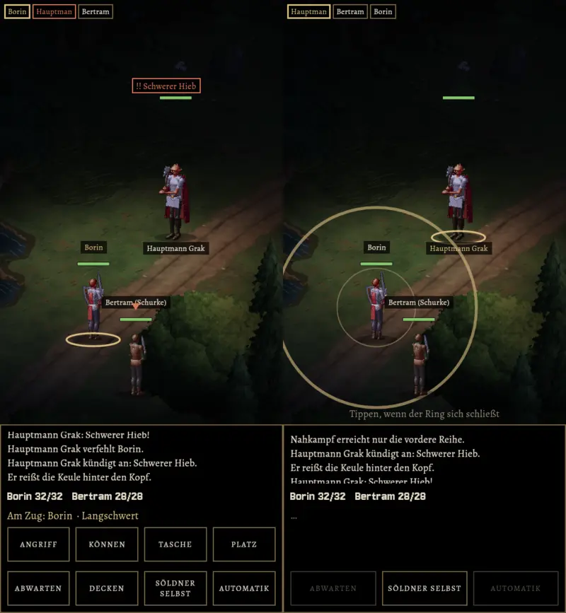

# 72u.1 · Kampfort aus der Karte: zweites Standbild, Bau so freigeben?
Jerry · 19.10., 17:24 · E Kampf · K, nach dem Meilenstein (Anlass: Vorgangsarchiv 72u „vor dem Bau ein zweites Standbild“)
Kurz: Standbild 2 (Nacht, Söldner, Menü, Absicht, Ring) liegt vor; Bau nach dem Meilenstein freigeben? (Empfehlung: ja, mit freiem Boden unter allen Plätzen)

Echte MARS-Probe (heutiger Stand von `main`) durch die Oberfläche, Hintergrund ist der Wald an der Stelle (6, 12) um 22 Uhr, Zoom 8, Figuren 27 % kleiner, im Licht, das die Karte dort hat. Vorschau `KAMPFORT=forest:6:12:8:22 KAMPFORTMARS=1`, Zweig `claude/jerry-72u-standbild-2` (kein Build).

**Selbst angesehen:**
- Lesbar: Menü, Absicht über Grak („!! Schwerer Hieb“), Zielmarke über dem Söldner, Namen, Lebensbalken, Ring und „Tippen, wenn der Ring sich schließt“ stehen klar auf der dunklen Karte.
- Nacht: der Platz ist heller als die Ränder (Licht der Karte an dieser Stelle); düster, aber lesbar.
- Schwäche: der Söldner hinten steht am Rand eines Buschs. Im Bau rückt der Kampfort die Kamera so, dass alle vier Plätze auf freiem Boden stehen (Weg, Lichtung).

**Frage:** 72u.1 nach dem Meilenstein so bauen?

**Empfehlung: ja.** Mit dem Bau: Kamera auf freien Boden, Karte läuft lebendig weiter (Wind, Wasser), Ortsklang halb so laut (D3a), für MARS und klassisch gemeinsam (212). Verträgt sich mit 211 (Kampfort 10 % niedriger).

*Stärkstes Gegenargument:* Karte und Kampf gleichzeitig zeichnen kostet Leistung; vor dem Bau am A56 messen (Grundsatz 12), sonst ein ruhendes Kartenbild als Hintergrund.

**Berührt:** 72u, 72u.1, 79, 211, 212, D3a.
