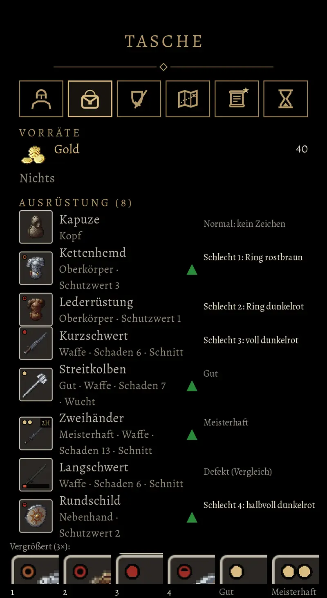

# 756.1 · Welches Zeichen bekommt ein schlechtes Stück: Ring rostbraun, Ring dunkelrot, voller Punkt oder halbvoller Punkt?
Team Tom · 13.11., 13:29 · E Oberfläche · aus deinem Wort 12.11., 20:14 bis 20:23; neu nach Muster nach deiner Ablehnung 13.11., 13:09 und 13:21
Kurz: Zeichen für die Güte „Schlecht“ am Bild eines Stücks: vier Varianten, Empfehlung halbvoller Punkt

Geprüft an: https://github.com/tramour-cmyk/androidapp_rpg_bornim/commit/fc26a112a (Test `schlecht_bild_756`, Bild unten)

Bestand geprüft: alte Fassung (`app/`, `core/`), Güte am Bild fehlt im Bestand.

**Frage:** Jedes Stück hat eine Güte: Schlecht, Normal, Gut oder Meisterhaft. Gut und Meisterhaft zeigen oben links am Bild einen oder zwei Goldpunkte, Normal zeigt nichts. Das hast du am 12.11. abgenommen. Für Schlecht fehlt noch das Zeichen. Du wolltest vier Varianten sehen und dann entscheiden. Im Bild trägt jedes schlechte Stück eine andere: 1 Ring rostbraun (Kettenhemd), 2 Ring dunkelrot (Lederrüstung), 3 voller Punkt dunkelrot (Kurzschwert), 4 halbvoller Punkt dunkelrot (Rundschild). Die Beschriftung rechts und die Vergrößerung unten gehören nicht zum Spiel. Es ist dasselbe Bild wie vorher; neu ist nur die Form dieser Vorlage. Welche Variante soll es sein?

**Votum:** „756.1, 4“: der halbvolle Punkt.

**Berührt:** Vorgang 756 (Merkmale am Bild; Gut, Meisterhaft und die Sperre „Erst ab Heldenstufe“ bleiben, wie abgenommen), Rezeptbuch 976 (damit kommen schlechte Stücke ins Spiel), Abnutzung nach unserem Regelwerk (die rote Leiste unten am Bild).

**Begründung:** Dein Wort 12.11., 20:14: „So ein hohler wäre schlecht. Einer wäre gut und 2 wären dann das Beste.“ 20:17 hast du selbst eingewandt, man käme auf die Idee, „der leere Kringel erstmal so ein bisschen besser und der volle Kringel hat dann noch ein bisschen besser“, und als Abhilfe genannt: „entweder machen wir den halben Kringel rot, dass er auch eine andere Farbe hat und sich abhebt“. Variante 4 ist genau dieser halbe Kringel in Rot. Ein halb gefüllter Punkt liest sich als „weniger als voll“ und nicht als Stufe über nichts. Die Farbe trennt ihn von den Goldpunkten.

**Sachverhalt:**
- Alle Zeichen sind so groß wie ein Goldpunkt: im Bild 8 von 82 Bildpunkten des Kastens, auf dem Handy mit schwarzem Hof knapp 1 mm. Sie sitzen im dunklen Rand des Kastens, nicht auf der Zeichnung des Stücks (`godot/skripte/menue.gd`, Abschnitt „Merkmale am Bild“).
- Kontrast auf Schwarz, wie gut sich eine Farbe abhebt (ab 3 gilt ein Zeichen als gut erkennbar): Dunkelrot 2,8, Rostbraun 3,7, Rot der Leiste für kaputte Stücke 4,6.
- Die Leiste für kaputte Stücke ist ein Balken unten am Bild, das Zeichen ein Kreis oben links (Langschwert im Bild).
- Im Spiel siehst du schlechte Stücke erst mit dem Rezeptbuch (976).

**Auswertung:**
- **4, halbvoller Punkt dunkelrot (Empfehlung):** dein Vorschlag von 20:17, liest sich als „halb“, passt zu Schlecht. Kosten: eine Einstellung im Code, die drei anderen Varianten werden entfernt; fährt im nächsten Build.
- **3, voller Punkt dunkelrot:** am besten zu sehen, weil die meiste Farbe. Er sieht aber aus wie ein Goldpunkt in anderer Farbe, also wie eine Stufe. Kosten wie 4.
- **2, Ring dunkelrot:** deine erste Form („so ein hohler“), aber genau der Ring, den du 20:17 als „ein bisschen besser“ gelesen hast; wenig Farbfläche. Kosten wie 4.
- **1, Ring rostbraun:** hebt sich besser ab als Dunkelrot, steht aber dem Gold nahe und wirkt dann wie eine kleine Auszeichnung. Kosten wie 4.
- **Stärkstes Gegenargument gegen 4:** Dunkelrot hebt sich mit 2,8 schlecht vom Schwarz ab, und in knapp 1 mm ist der halbe Punkt kaum vom vollen zu unterscheiden. Wer rot schlecht sieht, erkennt ihn kaum. Abhilfe ohne neue Vorlage: das Rot heller stellen, etwa wie die Leiste (4,6), das ist eine Zahl im Code; der Kreis oben links bleibt vom Balken unten zu unterscheiden.

**Folgerungen:** Nach deiner Antwort stelle ich die gewählte Variante ein und entferne die anderen drei (Team Tom, Vorgang 756). Sie fährt im nächsten Build mit; im Spiel siehst du sie, sobald das Rezeptbuch (976) schlechte Stücke bringt. Sagst du „heller“, stelle ich das Rot heller und lege nichts neu vor.

Antwort: …
