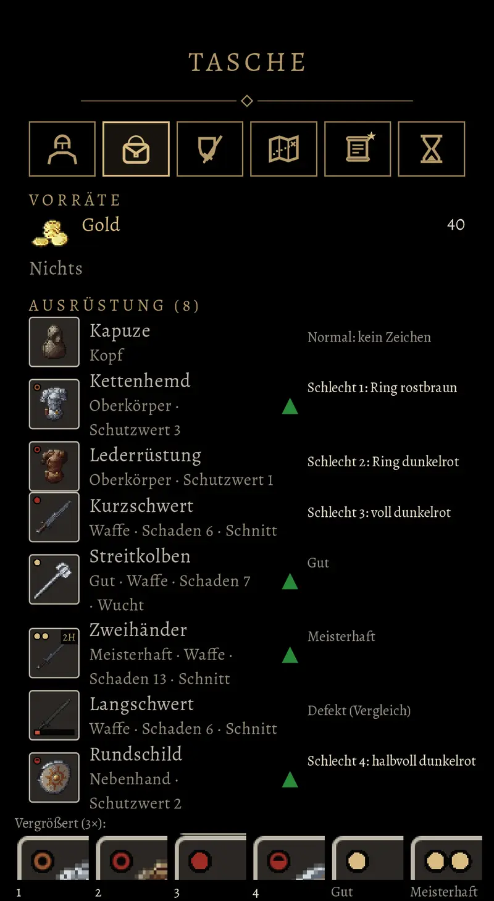

# 756.1a · Was war an der Vorlage für das Zeichen „Schlecht“ nicht vernünftig, und soll die neue so aussehen wie in A?
Team Tom · 13.11., 13:17 · E Oberfläche · aus deinem Wort an Ford 13:09
Kurz: Zeichen für Schlecht: was an der Vorlage falsch war; neue Vorlage als vier Bilder derselben Tasche mit größeren Zeichen

Geprüft an: https://github.com/tramour-cmyk/androidapp_rpg_bornim/commit/fc26a112a (abgelehnte Vorlage, Test `schlecht_bild_756`, Bild unten)

**Frage:** Du hast die Vorlage abgelehnt (13:09: „756 ist keine vernünftige Vorlage. Kümmere dich.“), ohne zu sagen, woran es lag. Liegt es an den Mängeln, die ich unten aufzähle, oder an etwas anderem? Je Vorgang zum Aussehen machen wir nur ein Probebild, bevor du entscheidest. Dieses Probebild ist verbraucht. Mit deiner Antwort gibst du das neue frei.

**Votum:** „756.1a A“, oder sag in einem Satz, was dich gestört hat.

**Berührt:** Vorgang 756 (Merkmale am Bild eines Stücks; Gut und Meisterhaft hast du abgenommen, sie bleiben), 756.1 (neue Vorlage), Rezeptbuch 976 (damit kommen schlechte Stücke ins Spiel).

**Begründung:** Gewünscht war (12.11., 20:23): „Mit rostbraun oder dunkelrot oder halbvoll oder voll oder Ring … Vorlage angucken, dann entscheiden … entweder auf dem Ausrüstungsschirm … oder aus der Tasche.“ Ich sehe in der Vorlage vier Mängel, die dir das Entscheiden schwer machen.

**Sachverhalt** (am Bild oben gemessen, es ist 800 Bildpunkte breit):
- **Zu klein:** Jedes Zeichen ist 8 Bildpunkte breit, der Kasten des Stücks 82, also etwa ein Zehntel. Auf dem Handy ist das ungefähr 1 mm. Ohne die Vergrößerung unten erkennt man die Form kaum. Die Goldpunkte für Gut und Meisterhaft sind genauso klein.
- **1 und 2 kaum zu unterscheiden:** Beides ist ein Ring, nur einmal rostbraun und einmal dunkelrot. In dieser Größe sieht man den Unterschied kaum.
- **Nicht wie im Spiel:** Die Beschriftung rechts steht im Schirm selbst. Sie nimmt den Namen der Stücke Platz weg, die Zeilen brechen um, und die Kästen von Lederrüstung und Kurzschwert stoßen ohne Abstand aneinander. In der Vergrößerung unten sind die Kästen abgeschnitten. Nicht zur Frage gehören das Langschwert mit dem roten Balken (so sieht ein kaputtes Stück aus, zum Vergleich) und die grünen Dreiecke (das Stück ist besser als das getragene).
- **Vier Varianten durcheinander:** Jede Variante steht an einem anderen Stück. Wie die Tasche aussieht, wenn es nur eine Variante gibt, zeigt das Bild nicht, und genau das ist die Entscheidung.

**Auswertung:**
- **A (Empfehlung):** vier Bilder derselben Tasche nebeneinander, in jedem nur eine Variante, immer an denselben drei Stücken (Kettenhemd, Kurzschwert, Rundschild). Dazu in jedem Bild ein normales, ein gutes und ein meisterhaftes Stück. Alle Zeichen doppelt so groß, die Goldpunkte auch. Im Spielbild steht keine Beschriftung, die Namen der Varianten stehen nur unter den Bildern. Mein Vorschlag, der nicht in deinem Wunsch stand: Variante 2 wird statt des zweiten Rings ein dunkelrotes Kreuz, damit sich die vier Varianten deutlich unterscheiden. Kosten: ein neues Probebild aus der Vorschau am Rechner und etwa eine Stunde Arbeit.
- **B:** kein Zeichen für Schlecht am Bild. In der Zeile unter dem Namen steht in Rostbraun das Wort „Schlecht“, so wie dort heute schon „Gut“ und „Meisterhaft“ stehen. Am Bild bleiben nur die Goldpunkte. Dafür reicht ein Bild der Tasche, also etwas weniger Arbeit als bei A.
- **C:** Du sagst, was dich gestört hat, und ich baue danach.
- **Stärkstes Gegenargument gegen A:** Ein doppelt so großes Zeichen ist ein Fünftel so breit wie das Bild des Stücks und verdeckt dessen Ecke oben links. B verdeckt nichts. Dafür sieht man bei B auf dem Ausrüstungsschirm, wo unter dem Bild kein Text steht, nicht, dass ein Stück schlecht ist.

**Folgerungen:** Nach deiner Antwort baue ich die neue Vorlage (Vorgang 756.1) und lege sie dir unter „Anzusehen“ vor. Wenn du dort eine Variante gewählt hast, baue ich nur diese ein. Im Spiel ändert sich vorher nichts, denn schlechte Stücke gibt es erst mit dem Rezeptbuch (976).

Antwort: …
