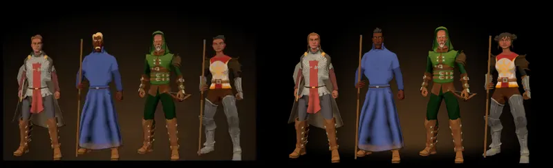

# 867 · Hauptmenü: passen die vier Helden jetzt mit deinen Nachträgen und dem neuen Licht?
Tom · 12.11., 21:16 · G Stil · aus deinem Wort 20:01 („eine neue Vorlage und das dann gleich mit einem vernünftigen. Licht“)
Kurz: Neue Vorlage der vier Helden im Hauptmenü: Frisur der Herkunft, Zauberlehrling schwarzhaarig, Blond entgelbt, Schein weich ins Schwarz, Gesichter im Licht. Passt das?

Geprüft an: [Lauf 400](https://github.com/tramour-cmyk/androidapp_rpg_bornim/actions/runs/43289694128), [Commit 6b9ddfc](https://github.com/tramour-cmyk/androidapp_rpg_bornim/commit/6b9ddfce5cb8de37098480a5f24ef153751bf9c1) (Zweig `claude/tom-867-vorlage2`), Hauptmenü am Bauserver mit den gekauften Figuren wie im Spiel

**Frage:** Du wolltest um 20:01 deine Nachträge von 18:25 und 18:27 eingebaut und eine neue Vorlage mit vernünftigem Licht. Passt das Bild rechts so, dass ich es ins Hauptmenü einbaue?

**Votum:** „867 A“: passt; ich baue es ins Hauptmenü ein, fährt im nächsten Build.

**Berührt:** Erschaffung (Zauberlehrling startet schwarzhaarig, Blond aller Menschen und des Hügelvolks weniger gelb); 431 (Körperbau je Volk, nach dem Umzug); 870.13 (Fußzeile „SRD 5.1 · CC BY 4.0“, Umzug).

**Begründung:** Deine Worte: 18:23 „schauen wieder aus von der Gesichtsform wie Brüder“, 18:25 „Hauttyp dunkelbraun und gelb als Haar- und Bartfarbe. Geht nicht“, 18:28 „Schwarz, und das Blond auch entgelben“, 20:01 „mit einem vernünftigen. Licht. Wie sich das gehört“.

**Sachverhalt:**
- Frisur: Jeder Held trägt jetzt Frisur, Bart, Haar- und Hautfarbe seiner Herkunft wie in der Erschaffung; vorher bekamen alle Männer dieselbe erste Frisur. Von links: Wachsoldatin mit Zopf, Zauberlehrling mit zurückgekämmtem schwarzem Haar und Schnurrbart, Jägerkind (Zwerg) unter der Kapuze mit grauem Bart, Klosterschülerin (Elf) mit Haarknoten.
- Haarfarbe: Der Zauberlehrling ist schwarzhaarig, in der Erschaffung genauso. Blond ist jetzt #AB9673 statt #B8975E: gleicher Ton, halb so kräftig (Wachsoldatin links). Die Leute im Dorf haben ihr Blond behalten.
- Licht: Der Schein ist eine Ellipse um die Füße und läuft nach allen Seiten weich ins Schwarz; die harte Kante unten und an den Seiten ist weg. Eine Lampe vorn oben hellt die Gesichter auf, auch das dunkle des Zauberlehrlings.
- **Mir ist aufgefallen:**
  - Der Zwerg ist so groß wie die Menschen, die Elfe sieht aus wie ein Mensch: alle Völker haben noch denselben Körper; das kommt mit 431 nach dem Umzug.
  - Der Rundschild der Wachsoldatin hängt auf dem Rücken und ist von vorn nicht zu sehen.
  - Im selben Lauf war ein Prüfschritt rot, der nichts mit dem Menü zu tun hat: Die Ziege tauschte einmal mit dem Helden den Platz (`ziege_4162`); auf dem Build 280 war derselbe Schritt grün. Ich gehe dem eigens nach.

**Auswertung:**
- **A (Empfehlung):** passt, Einbau ins Hauptmenü (eine Zeile, im nächsten Sammelbuild).
- **B:** du sagst, was anders sein soll (je Held oder am Licht); neue Vorlage.
- **Stärkstes Gegenargument gegen A:** Zwerg und Elfe sind auf dem ersten Schirm, den jeder sieht, nicht als Zwerg und Elfe zu erkennen. Antwort: Das kommt mit 431 ohne zweiten Bau, denn das Menü zeigt die Figuren des Spiels selbst.

**Folgerungen:** A: Tom baut ein, fährt im nächsten Build, 867 wird im Build getestet. B: Tom baut um und legt neu vor.

**Stellungnahme Sokrates (12.11., 21:24):**
- **Stärkstes Gegenargument gegen A:** Das Jägerkind ist jetzt ein Greis mit weißem Bart. Ursache im Code (Zweig `claude/tom-867-vorlage2`, `heldfigur.gd`): die Vorgabe nennt die Haarfarbe als Nummer im Volk; Jägerkind, Herumtreiber und Kräutersammler haben Nummer 3, das ist beim Menschen Rot, beim Zwerg Grau, bei der Elfe Weißgrau. Das trifft nicht nur das Menü, sondern jeden Spieler, der in der Erschaffung einen Zwerg oder Elf mit diesen drei Herkünften wählt. Es ist dieselbe Art wie der blonde Zauberlehrling von 18:25: die Farbe hängt an einer Nummer, nicht an ihrem Namen.
- **Einmalige Lösung statt Einzelfall:** die Vorgabe nennt die Farbe beim Namen (etwa „Rot“, fehlt sie im Volk, die nächste dunkle), dazu ein Prüfschritt: keine Herkunftsvorgabe ergibt bei irgendeinem Volk Grau oder Weißgrau.
- **Für A sonst:** Frisuren unterscheiden die Helden jetzt (kein „Brüder“ mehr), der Zauberlehrling ist schwarzhaarig, der Schein läuft weich aus, die Gesichter sind hell genug. Zwerg und Elfe kommen mit 431 ohne zweiten Bau.
- **Offen aus meiner Stellungnahme von 18:00:** der Schild der Wachsoldatin ist weiter nicht zu sehen (Tom nennt es selbst); eine Drehung, kein Umbau.
- **Kosten:** Farbe beim Namen und Prüfschritt klein, im selben Zweig, kein Lauf extra; keine neue Vorlage nötig, nur das Jägerkind ändert sich.
- **Empfehlung:** „867 A, Jägerkind dunkelhaarig“: Tom baut ein, stellt die Haarfarbe der Vorgaben auf Namen um (gilt auch für die Erschaffung) und dreht die Wachsoldatin so, dass der Schild zu sehen ist; geprüft im Build.

Antwort: …
