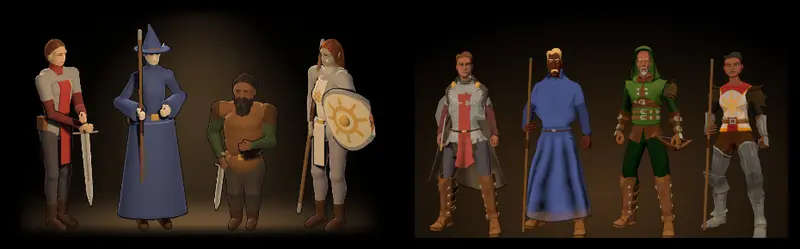

# 867 · Hauptmenü: diese vier Helden des Spiels statt der vier Kotlin-Figuren?
Tom · 12.11., 17:20 · G Stil · Zweig `claude/tom-867-menuehelden`, eine Probe (621 A)
Kurz: Das Hauptmenü zeigt die Figuren des Spiels selbst: Wachsoldatin (Mensch), Zauberlehrling (Mensch), Jägerkind (Zwerg), Klosterschülerin (Elf). Sind es diese vier?

Geprüft an: [Lauf 43246874141](https://github.com/tramour-cmyk/androidapp_rpg_bornim/actions/runs/43246874141), [Commit 2a5ae20](https://github.com/tramour-cmyk/androidapp_rpg_bornim/commit/2a5ae20a9e41a08ce489c9d696dc3e2dd30f1601), Hauptmenü am Bauserver mit den gekauften Figuren wie im Spiel

**Frage:** Du hast gesagt (10.11., 13:48): „die 4 Figuren, die ich da sehe, sind ja noch aus Kotlin. Gehört überarbeitet. Da müssen aktuell die Helden hin, die wir haben.“ Sind es diese vier (Herkunft, Volk, Geschlecht), oder andere?

**Votum:** „867 A“: diese vier; ich baue sie ins Hauptmenü ein und mache dabei den Schein dahinter weich (unten), ohne weiteres Probebild; du siehst es im nächsten Build.

**Berührt:** 431 (Völker als Modelle, Körperbau je Volk, ruht), 870.13 (Hinweis „SRD 5.1 · CC BY 4.0“ aus der Fußzeile, Umzug)

**Begründung:** Das alte Bild zeigt Figuren, die es im Spiel nicht mehr gibt. Die neuen sind die Helden, die man in der Erschaffung wählt, in derselben Aufstellung (Schwert, Zauber, Zwerg, Heilerin) und mit ihrer Startausrüstung; sie bleiben von selbst aktuell.

**Sachverhalt:**
- Von links: Wachsoldatin (Mensch) mit Langschwert, Kettenhemd, Rundschild; Zauberlehrling (Mensch) mit Kampfstab, Robe; Jägerkind (Zwerg) mit Kurzbogen, Leder; Klosterschülerin (Elf) mit Kampfstab, Leder. Dieselben Figuren wie Erschaffung und Drehteller.
- **Mir ist aufgefallen:**
  - Der warme Schein hinter den Figuren endet unten und an den Seiten mit einer harten Kante, wie ein Kasten (rechts im Bild deutlich). Das ist ein Fehler; Behebung beim Einbau: Schein nach allen Seiten weich ins Schwarz.
  - Der Zwerg ist so groß wie die Menschen, und die Elfe sieht aus wie ein Mensch. So ist es heute im ganzen Spiel: alle Völker haben denselben Körper (431, ruht). Kommt der Körperbau je Volk, stimmt auch das Menü von selbst.
  - Der Rundschild der Wachsoldatin ist von vorn nicht zu sehen; das Gesicht des Zauberlehrlings liegt fast ganz im Schatten.

**Auswertung:**
- **A (Empfehlung) diese vier,** Einbau mit weichem Schein.
- **B andere Helden:** du nennst je Platz Herkunft, Volk oder Geschlecht; Einbau wie A.
- **C altes Bild bleibt, bis 431 den Körperbau je Volk hat.**
- **Stärkstes Gegenargument gegen A:** Der gleich große Zwerg steht auf dem ersten Schirm, den jeder sieht. Antwort: Das alte Bild ist der größere Bruch, denn es zeigt Figuren, die im Spiel nicht vorkommen; mit 431 wird das Menü von selbst richtig.

**Folgerungen:** A oder B: Tom baut ein (eine Zeile im Hauptmenü, im Zweig des Umzugs, weil die Datei dort liegt) und macht den Schein weich; fährt im nächsten Build. C: 867 ruht bis 431.

Antwort:
