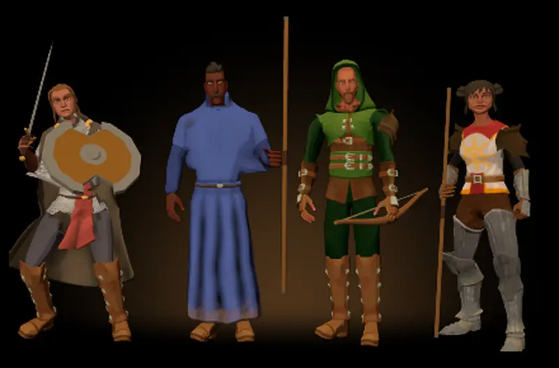

# 867 · Hauptmenü: passen die vier Helden mit eigener Haltung?
Tom · 12.11., 23:10 · G Stil · aus deinem Wort 21:55 („867 Haltungen A und dunkelhaariges Jägerkind“)
Kurz: Vorlage 3: jeder Held hat eine eigene ruhige Haltung, Waffe und Schild sind in der Hand zu sehen, die äußeren stehen schräg zur Mitte, das Jägerkind hat dunkles Haar. Passt das?

Geprüft an: [Lauf 403](https://github.com/tramour-cmyk/androidapp_rpg_bornim/actions/runs/43310455270), [Commit 9e7818b](https://github.com/tramour-cmyk/androidapp_rpg_bornim/commit/9e7818b3b20cee3d0439449b9481414a0a3b9a81) (Zweig `claude/tom-867-vorlage2`), Hauptmenü am Bauserver mit den gekauften Figuren wie im Spiel, Ausschnitt doppelt vergrößert

**Frage:** Du wolltest um 21:55 je Held eine eigene Haltung mit sichtbarer Waffe und ein dunkelhaariges Jägerkind. Passt das Bild so, dass ich es ins Hauptmenü einbaue?

**Votum:** „867 A“: passt; ich baue die Haltungen in den Bau ein (Kaufpaket wie die Kampfbewegungen) und das Bild ins Hauptmenü, fährt im nächsten Build.

**Berührt:** Erschaffung (Haarfarbe der Vorgaben jetzt beim Namen: Jägerkind braun statt rot oder grau, Herumtreiber und Kräutersammler als Zwerg rot statt grau, als Elf kupfer statt weißgrau); 431 (Körperbau je Volk, nach dem Umzug); 870.13 (Fußzeile „SRD 5.1 · CC BY 4.0“, Umzug).

**Begründung:** Deine Worte 21:40: „pro Char eine andere Haltung, in der Waffe und Schild gesehen werden. Oder seitlich hinstellen mit Blick zum Spieler“; 21:55 „867 Haltungen A und dunkelhaariges Jägerkind“.

**Sachverhalt:**
- Haltungen aus den gekauften Protofactor-Sätzen, auf unser Gerüst übertragen wie die Kampfbewegungen: Wachsoldatin „Atmen“ aus Sword & Shield (Schwert oben, Schild vorn), Zauberlehrling „Stehen“ aus dem Zauberer-Satz (Stab in der Hand), Jägerkind „Atmen mit Bogen“ aus Bow & Arrow. Die Klosterschülerin stützt sich auf ihren Stab (unser Wanderstab), damit sie anders steht als der Zauberlehrling.
- Drehung: außen 30 Grad zur Mitte (vorher 18), innen 10 (vorher 6); Hals und Kopf drehen zum Spieler zurück.
- Haar: Die Vorgaben nennen die Farbe jetzt beim Namen; ein Prüfschritt hält fest, dass keine Herkunft bei irgendeinem Volk Grau oder Weißgrau bekommt.
- **Mir ist aufgefallen:**
  - Das Jägerkind trägt die Kapuze; zu sehen ist nur der Bart, der im warmen Licht rotbraun wirkt (Braun des Zwergs, #5a3a24).
  - Die Klosterschülerin steht fast frontal, die Drehung um 30 Grad ist bei ihr kaum zu sehen.
  - Die Bilder aus vier Blickrichtungen sind im Lauf leer geblieben (falscher Ausschnitt im Bildwerkzeug); geprüft ist nur die Ansicht von vorn. Das behebe ich vor dem nächsten Lauf.
  - Zwerg und Elfe haben noch den Körper der Menschen (431, nach dem Umzug).

**Auswertung:**
- **A (Empfehlung):** passt, Einbau (Haltungen in den Bau, eine Zeile im Hauptmenü), im nächsten Sammelbuild; Blickrichtungen und Bart prüfst du dann am Gerät.
- **B:** du sagst, was anders sein soll (je Held: Haltung, Drehung, Haar); neue Vorlage, dann mit allen Blickrichtungen.
- **Stärkstes Gegenargument gegen A:** Die Ansichten von der Seite und von hinten sind nicht geprüft; eine Waffe, die dort schwebt, sähe man erst im Build. Antwort: im Hauptmenü stehen die Helden fest, man sieht sie nur von vorn.

**Folgerungen:** A: Tom baut ein, 867 wird im Build getestet. B: Tom baut um und legt neu vor.

Antwort: …
