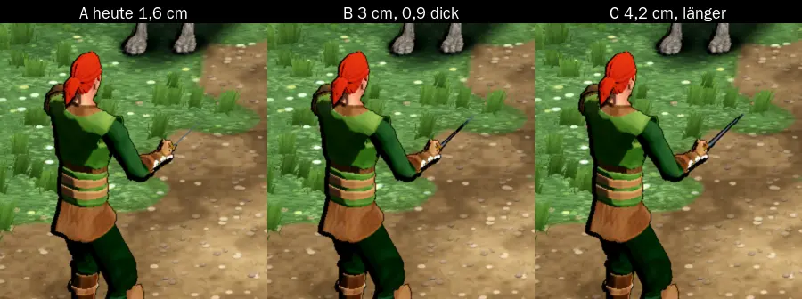

# 948 · Welche Dolchklinge soll der Held im Kampf tragen?
Jerry · 11.11., 13:56 · E Kampf · aus deinem Bild 13:33 (t276.12, Herumtreiber)
Kurz: Der Dolch war da, aber 1,6 cm breit und 0,4 cm dünn, im Kampfbild nur ein Strich; zwei breitere Fassungen zur Wahl.

Geprüft an: https://github.com/tramour-cmyk/androidapp_rpg_bornim/commit/0ba76d9b9 (Bild am Rechner, Code B1 mit den Kaufmodellen von Lauf 338, Test `waffe_948`)

**Frage:** Du hast beim Herumtreiber im Kampf nichts in der Hand gesehen. Der Dolch hängt an der Hand (Test: alle acht Herkünfte tragen ihre Waffe), aber seine Klinge ist so schmal wie im alten Spiel (1,6 cm breit, 0,4 cm dick) und von hinten nur ein Strich. Welche Klinge soll er haben?

**Votum:** „948 B“ (oder A, C)

**Berührt:** Kräutersammler (trägt auch den Dolch), Testmodus „andere Hand: Dolch“, der Dolch unterwegs am Gürtel (dasselbe Modell)

**Sachverhalt:**
- A heute: wie `Dress.kt` (Klinge 23 cm, 1,6 cm breit, 0,38 dick).
- B: nach der Regel, die wir für den Kobold-Dolch schon gefunden haben (Runde 3c: „nicht unter 3 cm an der Wurzel, dick 1 cm“): 25 cm, 3 cm breit, 0,9 dick, Parierstange steht vor.
- C: 28 cm, 4,2 cm breit, 1,3 dick, eher ein breites Messer.
- In allen drei Fassungen sieht die Kamera meist auf die Schneide, nicht auf die Fläche: so hält die Faust jede Klinge (Schneide nach vorn). Darum wirkt auch C schmal.

**Auswertung:**
- **B (Empfehlung):** sichtbar, bleibt ein Dolch; dieselbe Regel wie beim Kobold. Kosten: ein Modell, kein Code.
- **C:** am deutlichsten, wirkt aber eher wie ein Messer oder Kurzschwert.
- **A:** bleibt unsichtbar.
- **Stärkstes Gegenargument gegen B:** von hinten bleibt es eine dunkle Linie; deutlicher würde nur eine andere Haltung (Fläche zur Kamera), die bei jeder Klinge anders aussähe.

**Folgerungen:** Nach deinem Wort baue ich das Modell in `waffen.py` und lasse den Test in jedem Lauf mitlaufen; es kommt mit dem nächsten gemeinsamen Build.

Antwort: …
