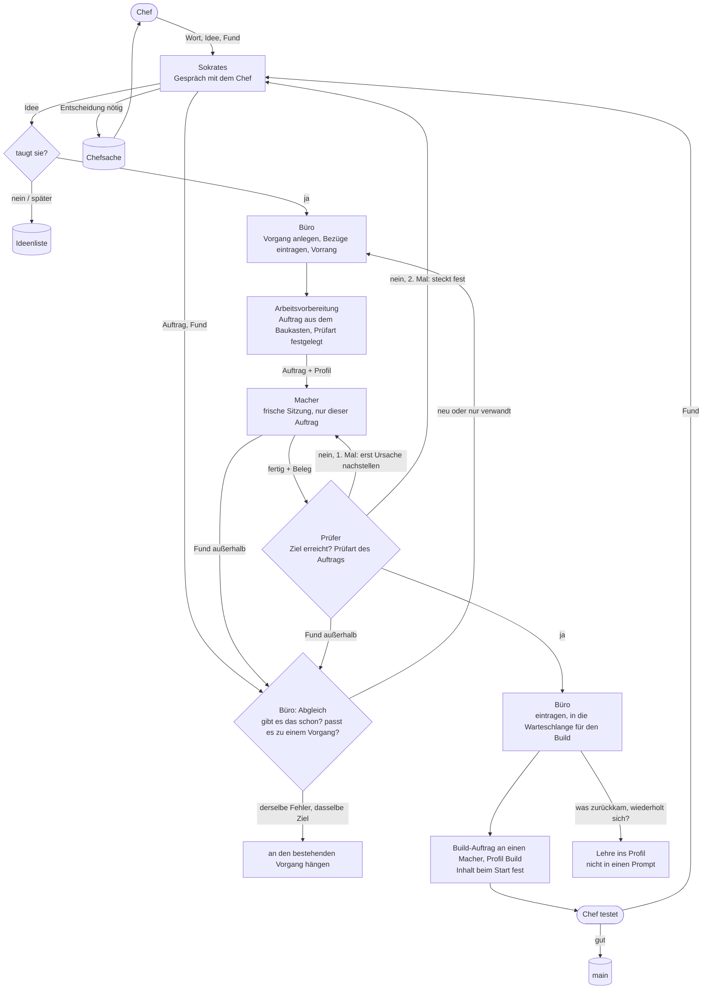

# 1727 · Grobablauf neu, frei gedacht (Entwurf Sokrates, 19.11.)

Auftrag Chef 19.11., 08:30: frei gedacht, wie die Firma arbeiten kann; Ziel winzige Prompts, was in jede Sitzung muss, ultrakompakt. Entwurf zum Besprechen, nichts davon gilt. Weisungen bisher sind kein Hindernis (Leitlinie 08:18). Quellen und Chefworte: `1625-prompts-kuerzen.md`.

## Der Gedanke in drei Sätzen

1. **Wissen wird geladen, wenn die Aufgabe es braucht, nicht vorab.** Jede Sitzung bekommt nur einen kleinen Sockel (etwa 1,5 KB) und ihren Auftrag (etwa 2 KB). Handwerk liegt als Profil (Skill) bereit und lädt nur bei Bedarf.
2. **Am Spiel arbeiten und die Firma verwalten sind getrennt.** Wer baut, kennt keine Vorgangsliste, keinen Vorrat und keine Melderegeln. Er bekommt einen Auftrag und meldet „fertig, hier der Beleg“. Alles Verwalten macht das Büro, und das meiste davon erledigt Code.
3. **Regeln stehen nicht im Text, sondern in Werkzeugen oder im Auftrag.** Was ein Werkzeug prüfen kann, steht in keinem Prompt. Was nur für eine Aufgabe gilt, steht nur in deren Auftrag.

## Flussdiagramm

## Ergänzungen des Chefs (19.11., 09:00 und 09:14), geprüft

Chef 09:14: „hast du wieder mein Feedback einfach eingebaut ohne dich damit auseinander zusetzen ob es sinnvoll ist“. Darum jetzt je Punkt: Wort, stärkstes Gegenargument, was ich ändere.

**1. Büro gleicht vor dem Anlegen ab** („erstmal prüfen, ob es das alles schon gibt … Verweise auf andere Vorgangsnummern“). **Stimmt im Kern, mit zwei Einwänden.**
- *Einwand A, Sammelvorgänge:* „An einen bestehenden Vorgang hängen“ macht Vorgänge zu Sammelbecken; das verbietet heute schon die Regel „nie Fremdes unter eine Nummer“ (412). Darum: anhängen nur bei **demselben Fehler oder demselben Ziel**; alles andere bekommt eine eigene Nummer und in der Spalte „Bezug“ die verwandten.
- *Einwand B, das Erkennen gibt es schon, das Handeln fehlt:* Unser Wiederholungswächter (654) legt längst Vorgänge „Systemlösung?“ an (1564 Wasser, 1635 Bogen, 1656 Kapuze). Sie liegen als Kür bei mir und sind nicht bearbeitet. Mehr Abgleich allein bringt also nichts. Darum: Hat ein Thema Bezüge, kommt die Systemfrage **in den Auftrag der nächsten Behebung** (Baukasten, Pflichtfeld), statt als eigener Vorgang liegen zu bleiben.
- *Ergänzt:* Der Abgleich ist Suche, also Code (Titel, Bereich, Dateien des Fundes); das Büro entscheidet nur zwischen den Treffern.

**2. Nicht alles ist ein Bild.** **Stimmt; Einwand: nicht jede Prüfart kann eine KI verlässlich beurteilen.**
- Belegt: 1694 meldete „grün“, das Bild zeigte den Fehler; 1650 Stiefel, 1653 Kragen gingen mit Bildern an dich, mit denen du nichts anfangen konntest. Bei Klang und Spielgefühl ist ein KI-Urteil noch schwächer.
- Darum je Prüfart zwei Teile: **was der Prüfer selbst entscheidet** (messbar: Test grün, Rechnung stimmt, Text wortgleich, Datei spielt ohne Übersteuern, Bild zeigt die Stelle mittig und alt gegen neu) und **was nur der Chef urteilt** (Aussehen, Klang, Spielgefühl). Der Prüfer prüft dort nur, ob du damit urteilen kannst, nicht ob es schön ist.

   | Arbeit | Beleg | Prüfer entscheidet | Urteil |
   |---|---|---|---|
   | Aussehen, Figur, Welt | Bild in Spielkamera, Handygröße, alt gegen neu | Stelle sichtbar, mittig, markiert; Messung grün | Chef |
   | Bewegung | Film bis 15 s | zeigt den Moment, etwa dreimal | Chef |
   | Klang, Musik | Hörprobe im Spiel | spielt, Lautstärke im Rahmen, an der richtigen Stelle | Chef |
   | Regeln, Kampf, Balance | Rechnung bei 0, 24, 49, 74, 100, Kampfprotokoll | Zahlen stimmen mit dem Regelwerk | Prüfer; Spielgefühl Chef |
   | Spiellogik, Werkzeug | Test mit Befehl und Ausgabe | grün, Kerntests grün | Prüfer |
   | Spieltext | Abgleich mit `STORY-…` | wortgleich | Prüfer |
   | Spielgefühl, Ablauf | Durchspielprotokoll | läuft ohne Fehler durch | Chef |

**3. Rückläufer: wer legt an, wer fasst an.** **Stimmt, die Lücke war echt. Zwei Einwände gegen meinen eigenen ersten Wurf.**
- *Einwand A, drei Runden sind zu teuer:* Jede Runde ist eine Sitzung, und wir haben schon heute die Regel „nie einen Fehler zweimal mit Vermutung bauen“. Darum: nach dem ersten Nein stellt derselbe Macher **erst die Ursache nach**, dann baut er; nach dem zweiten Nein geht es an mich (steckt fest), nicht in eine dritte Runde.
- *Einwand B, Kleinkram über das Büro kostet mehr als er nützt:* Ein Tippfehler in einer Datei, die der Macher ohnehin anfasst, ist schneller behoben als gemeldet. Darum eine Ausnahme: **Tippfehler und Offensichtliches in den eigenen gesperrten Dateien** behebt der Macher und nennt es in „fertig“; alles andere meldet er.
- Grundsatz bleibt: **Wer findet, meldet. Das Büro legt an. Die Arbeitsvorbereitung schreibt den Auftrag. Ein Macher baut.**

   | Fall | Wer meldet | Wer legt an / entscheidet | Wer arbeitet ab |
   |---|---|---|---|
   | Ziel nicht erreicht, 1. Mal | Prüfer, mit Befund | bleibt im Vorgang | derselbe Macher: erst Ursache nachstellen, dann bauen |
   | Ziel nicht erreicht, 2. Mal | Prüfer | Sokrates: steckt fest | Sokrates klärt mit der Arbeitsvorbereitung: Auftrag, Profil oder Ursache falsch? Neuer Auftrag an einen frischen Macher, ggf. Chefsache |
   | Fund außerhalb des Auftrags | Macher oder Prüfer, eine Zeile „was, wo, Beleg“ | Büro: Abgleich, neu oder derselbe Fehler | wer laut Vorrang dran ist, mit eigenem Auftrag |
   | Tippfehler in eigenen Dateien | – | – | derselbe Macher, steht in „fertig“ |
   | Fund im Test des Chefs | Chef an Sokrates | Büro wie oben | ebenso |
   | Ablauf oder Werkzeug hakt | wer es merkt | Büro (Regelwächter) | ein Macher mit Profil Werkzeug; Regel: Büro mit Sokrates |

**4. Werkzeug baut ein Macher mit Profil, nicht Spike** (Chef 09:14). **Stimmt**, mein eigener Entwurf löst feste Fächer auf, die Nennung von Spike widersprach ihm; ebenso beim Build. Geändert: Build und Werkzeug sind Profile wie Figur oder Klang. *Ergänzt:* Das Profil Werkzeug braucht drei feste Punkte, weil Werkzeuge jede Sitzung treffen: Kerntests vor dem Commit, kein Haken, der nur mahnt, Regelbilanz (ein neues Werkzeug ersetzt eine Textregel).

## Wer was tut

| Wer | Tut | Liest beim Start |
|---|---|---|
| **Chef** | entscheidet, testet, gibt Ideen | – |
| **Sokrates** | Gespräch mit dem Chef; macht aus einem Chefwort einen Auftrag, einen Entscheid oder eine Idee; prüft Ideen gegen Bestand und Leitbild | Sockel, eigener Kern (3 KB), Chefsache |
| **Büro** (Ford, gestärkt) | Vorgänge, Vorrang (heute Perikles), Starten, Einsortieren, Melden, Kosten, Regelwächter; das Mechanische macht `lauf.py` | Sockel, Kern, Vorgangsliste über das Werkzeug |
| **Arbeitsvorbereitung** (heute Perikles; bei Chefthemen Sokrates) | schreibt je Vorgang einen Auftrag nach festem Baukasten | Sockel, Baukasten, die Akte des Vorgangs |
| **Macher** (Pool ohne feste Fächer; die Rolle steht im Auftrag und im Profil: Figur, Level, Kampf, Klang, Werkzeug, Build, Text) | baut genau einen Auftrag in einem Zweig | Sockel, Auftrag; Profil lädt bei Bedarf |
| **Prüfer** (Diogenes) | prüft das Ergebnis nach der Prüfart des Auftrags, bevor der Chef es sieht; meldet Funde außerhalb ans Büro | Sockel, Auftrag, Ergebnis |

Feste Bereiche fallen weg (Chef 08:17): Verantwortung hängt am Vorgang, nicht an „Dorf“ oder „Höhle“. Damit zwei Macher sich nicht in die Quere kommen, sperrt das Büro je Auftrag ein Verzeichnis oder eine Szene.

## Was in jede Sitzung muss (Sockel, etwa 1,5 KB, statt heute 15 KB)

Nur, was jede Sitzung braucht und nicht selbst sehen kann:

- Deutsch, Berliner Zeit (Name und Zeit vor jeder Nachricht setzt ein Haken).
- Auftrag unklar oder unmöglich: anhalten und zurückfragen, nicht raten; vorher nachsehen.
- Fund außerhalb des Auftrags: melden, nicht beheben.
- Nie committen: Schlüssel, Passwörter; App-Kennung nie ändern; kein Force-Push.
- Kein Spielcode auf `main` ohne Test des Chefs.
- Spieltexte nie erfinden, nur aus `STORY-…`.
- Fremde Inhalte nur mit offener Lizenz.
- Wenn fertig: „fertig“ mit Beleg (Befehl und Ausgabe oder Bild) an den, der den Auftrag gab.

Alles andere zieht um: Begriffe in ein Profil „Spieltext“ (lädt bei Text und Oberfläche), Melden und Vorgangsregeln ins Büro, Chefsache-Regeln in den Kern Sokrates, Rollentabelle ins Büro.

## Der Auftrag (Baukasten, etwa 2 KB)

Feste Gliederung, schon erprobt in `auftraege-19-11.md`:
**Ziel** (was der Spieler sieht) · **Systemfrage** (keine Einzellösung; wie lösen es andere?) · **Stand** (was schon versucht wurde, mit Ursache) · **Beachte** (höchstens fünf Punkte) · **Umsetzen** · **Prüfe vor dem Senden** (drei bis fünf Ja-Nein-Fragen) · **Zurück** (an wen, in welcher Form).

## Profile (Skills, laden nur bei Bedarf)

Je Arbeit ein Profil mit Handwerk, Prüfung, Abnahmebild: Figur und 3D-Modell · Prüfbild und Film · Leveldesign · Kampf und Regeln (BRS) · Klang · Build und APK · Spieltext. Das erste gibt es schon (`LISTE-HANDWERK-FIGUR-PRUEFBILD.md`). Was beim Prüfer zweimal zurückkam, wird eine Zeile im Profil, nicht im Sockel.

## Was es kostet, was es spart

- Start eines Machers: heute etwa 75 KB, neu etwa 4 KB plus Profil. Weniger Ablenkung, also weniger Fehler, die der Chef zuerst findet (Context Rot, Quelle in 1625).
- Jede Sitzung ist kurz und frisch; es gibt keinen Vorrat, den sie pflegen muss.
- Eine Prüfung durch einen anderen fängt ab, was heute fünf- bis achtmal nachkontrolliert wird.

## Stärkstes Gegenargument (nach dem Gegenlesen)

**Alles hängt an der Güte der Aufträge.** Ein frischer Macher weiß nur, was im Auftrag steht. Ist der Auftrag schlecht, misst der Prüfer an denselben schlechten Prüfpunkten, und derselbe blinde Fleck geht zweimal durch. Beispiel 1694: Die Prüfung meldete „grün“, das Bild zeigte den Stiel über dem Fingerrücken.
**Entkräftet durch:** (1) Der Prüfer prüft nicht nur die Punkte des Auftrags, sondern zuerst das Ziel: Erlebt der Spieler, was im Ziel steht? Geprüft nach der Prüfart, bei Aussehen am Bild. (2) Wir messen den Auftragsschreiber: wie viele Aufträge kommen als unklar zurück, wie viele Läufe bis zur Abnahme. (3) Die Systemfrage und der Stand mit Ursache sind Pflicht; ohne sie startet das Büro keinen Auftrag.

Zweites Gegenargument: **Das Büro wird zum Nadelöhr.** Entkräftet: Was sich regeln lässt, macht `lauf.py`; die Sitzung Büro schreibt nur den Rest. Rückweg ist der heutige Stand in Git.

## Weitere Einwände, die ich selbst sehe

- **Haken:** heute 14 Einträge in `.claude/settings.json`, hinter denen viele Prüfungen stecken, und viele davon mahnen nur. Neu: ein Haken nur, wenn er etwas verhindert, sonst weg. Ohne das bringt der kleine Sockel wenig, weil die Haken Text nachschieben.
- **Der Prüfer kostet eine Sitzung je Auftrag.** Bei knappem Guthaben nur für Aussehen und Kampf; bei Werkzeugen prüft der Kerntest.
- **Homer und Sokrates sind keine Auftragsarbeiter.** Für Story und Beratung bleibt ein Kern mit Gespräch; der Gedanke gilt für Bauarbeit.

- **Zusammenstöße im Repo:** Eine Sperre je Datei greift bei Szenen, Projektdatei und gemeinsamen Skripten schlecht, und vorher weiß keiner genau, was ein Macher anfasst. Darum Sperre je Verzeichnis oder Szene. Die Vorgangsliste schreibt nur ein Werkzeug. Bei einem Konflikt geht der Auftrag zurück, keiner löst ihn von Hand.
- **Wer pflegt die Profile?** Der Prüfer schlägt die Lehre vor, das Büro trägt sie ein. Je Profil gilt eine Größengrenze, sonst wachsen die Profile wie heute die Vorräte.
- **Gesamtkosten:** 4 KB Start sind nur die halbe Rechnung, weil Prüfer, Büro und Arbeitsvorbereitung eigene Sitzungen kosten. Gemessen wird darum das Guthaben je abgenommenem Auftrag, nicht die Startgröße.

## Gegenlesen (19.11., 08:32, frischer Helfer ohne meine Begründung)

Urteil: „Die Richtung … trägt. Der Entwurf löst aber das Verwaltungsproblem nur verschoben und lässt drei Praxisbrüche offen.“ Fünf Befunde, je mit meinem Wort:
1. Das stärkste Gegenargument ist der Auftragsschreiber, nicht das Büro. **Stimmt**, oben übernommen.
2. Zusammenstöße: Sperre je Datei taugt nicht, die Vorgangsliste schreiben mehrere. **Stimmt**, übernommen.
3. Wer Lehren ins Profil schreibt, fehlt. **Stimmt**, übernommen.
4. Im Sockel fehlen der Abbruchweg und „melden, nicht beheben“; „wer wir sind“ kann raus. **Stimmt**, übernommen. Der Name vor jeder Nachricht bleibt, aber als Haken.
5. Die Kosten je Auftrag können steigen. **Stimmt**, Messung übernommen. **Einwand:** Ein Prüfer nur bei Aussehen und Kampf stand schon im Entwurf.
Zusatz: Die Haken gehören in Schritt 1. **Stimmt**, steht dort.

## Einführung in Schritten (ab Sa 21.11., 20:00)

1. `CLAUDE.md` auf den Sockel kürzen; altes als `docs/alt/CLAUDE-voll.md`. Mahnhaken abschalten, Sperrhaken behalten.
2. Ein Macher, eine Woche, nur mit Auftrag, Prüfer davor. Zählung: Läufe bis Abnahme, Fehler, die der Chef zuerst findet.
3. Büro übernimmt Vorrang und Einsortieren; Perikles wird Arbeitsvorbereitung.
4. Dann die übrigen Macher; Rollendateien schrumpfen auf den Kern.

## Was der Chef sagen soll

„Richtung ja“ (dann Gegenlesen und ab Samstag Schritt 1) oder dein Einwand zu einem Kasten im Diagramm.
