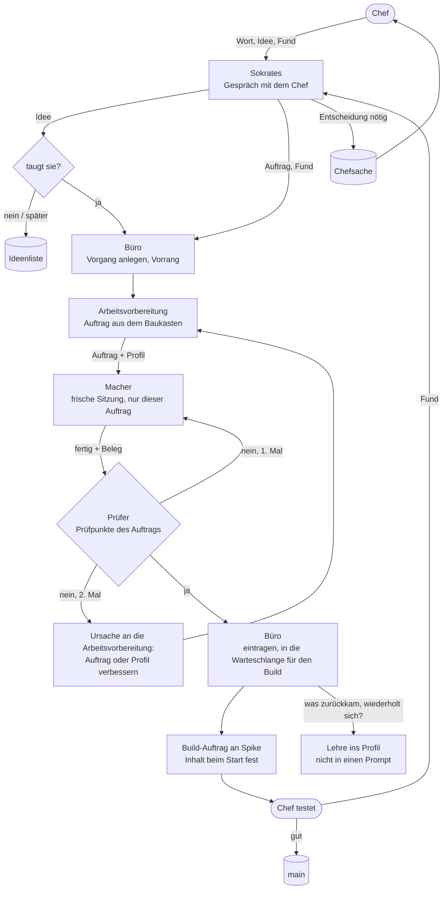

# 1727 · Grobablauf neu, frei gedacht (Entwurf Sokrates, 19.11.)

Auftrag Chef 19.11., 08:30: frei gedacht, wie die Firma arbeiten kann; Ziel winzige Prompts, was in jede Sitzung muss, ultrakompakt. Entwurf zum Besprechen, nichts davon gilt. Weisungen bisher sind kein Hindernis (Leitlinie 08:18). Quellen und Chefworte: `1625-prompts-kuerzen.md`.

## Der Gedanke in drei Sätzen

1. **Wissen wird geladen, wenn die Aufgabe es braucht, nicht vorab.** Jede Sitzung bekommt nur einen kleinen Sockel (etwa 1,5 KB) und ihren Auftrag (etwa 2 KB). Handwerk liegt als Profil (Skill) bereit und lädt nur bei Bedarf.
2. **Am Spiel arbeiten und die Firma verwalten sind getrennt.** Wer baut, kennt keine Vorgangsliste, keinen Vorrat und keine Melderegeln. Er bekommt einen Auftrag und meldet „fertig, hier der Beleg“. Alles Verwalten macht das Büro, und das meiste davon erledigt Code.
3. **Regeln stehen nicht im Text, sondern in Werkzeugen oder im Auftrag.** Was ein Werkzeug prüfen kann, steht in keinem Prompt. Was nur für eine Aufgabe gilt, steht nur in deren Auftrag.

## Flussdiagramm

## Wer was tut

| Wer | Tut | Liest beim Start |
|---|---|---|
| **Chef** | entscheidet, testet, gibt Ideen | – |
| **Sokrates** | Gespräch mit dem Chef; macht aus einem Chefwort einen Auftrag, einen Entscheid oder eine Idee; prüft Ideen gegen Bestand und Leitbild | Sockel, eigener Kern (3 KB), Chefsache |
| **Büro** (Ford, gestärkt) | Vorgänge, Vorrang (heute Perikles), Starten, Einsortieren, Melden, Kosten, Regelwächter; das Mechanische macht `lauf.py` | Sockel, Kern, Vorgangsliste über das Werkzeug |
| **Arbeitsvorbereitung** (heute Perikles; bei Chefthemen Sokrates) | schreibt je Vorgang einen Auftrag nach festem Baukasten | Sockel, Baukasten, die Akte des Vorgangs |
| **Macher** (Pool, Namen bleiben: Tom, Jerry, Homer, Spike) | baut genau einen Auftrag in einem Zweig | Sockel, Auftrag; Profil lädt bei Bedarf |
| **Prüfer** (Diogenes) | prüft das Ergebnis gegen die Prüfpunkte des Auftrags, bevor der Chef es sieht | Sockel, Auftrag, Ergebnis |

Feste Bereiche fallen weg (Chef 08:17): Verantwortung hängt am Vorgang, nicht an „Dorf“ oder „Höhle“. Damit zwei Macher sich nicht in die Quere kommen, sperrt das Büro je Auftrag die Dateien, die er anfasst.

## Was in jede Sitzung muss (Sockel, etwa 1,5 KB, statt heute 15 KB)

Nur, was jede Sitzung braucht und nicht selbst sehen kann:

- Wer wir sind (zwei Zeilen), Ziel Kapitel 1, Qualität vor Eile.
- Deutsch, Berliner Zeit, Name und Zeit vor jeder Nachricht.
- Nie committen: Schlüssel, Passwörter; App-Kennung nie ändern; kein Force-Push.
- Kein Spielcode auf `main` ohne Test des Chefs.
- Spieltexte nie erfinden, nur aus `STORY-…`.
- Fremde Inhalte nur mit offener Lizenz.
- Wenn fertig: „fertig“ mit Beleg (Befehl und Ausgabe oder Bild) an den, der den Auftrag gab.

Alles andere zieht um: Begriffe in ein Profil „Spieltext“ (lädt bei Text und Oberfläche), Melden und Vorgangsregeln ins Büro, Chefsache-Regeln in den Kern Sokrates, Rollentabelle ins Büro.

## Der Auftrag (Baukasten, etwa 2 KB)

Feste Gliederung, schon erprobt in `auftraege-19-11.md`:
**Ziel** (was der Spieler sieht) · **Systemfrage** (keine Einzellösung; wie lösen es andere?) · **Stand** (was schon versucht wurde, mit Ursache) · **Beachte** (höchstens fünf Punkte) · **Umsetzen** · **Prüfe vor dem Senden** (drei bis fünf Ja-Nein-Fragen) · **Zurück** (an wen, in welcher Form).

## Profile (Skills, laden nur bei Bedarf)

Je Arbeit ein Profil mit Handwerk, Prüfung, Abnahmebild: Figur und 3D-Modell · Prüfbild und Film · Leveldesign · Kampf und Regeln (BRS) · Klang · Build und APK · Spieltext. Das erste gibt es schon (`LISTE-HANDWERK-FIGUR-PRUEFBILD.md`). Was beim Prüfer zweimal zurückkam, wird eine Zeile im Profil, nicht im Sockel.

## Was es kostet, was es spart

- Start eines Machers: heute etwa 75 KB, neu etwa 4 KB plus Profil. Weniger Ablenkung, also weniger Fehler, die der Chef zuerst findet (Context Rot, Quelle in 1625).
- Jede Sitzung ist kurz und frisch; es gibt keinen Vorrat, den sie pflegen muss.
- Eine Prüfung durch einen anderen fängt ab, was heute fünf- bis achtmal nachkontrolliert wird.

## Stärkstes Gegenargument

**Das Büro wird zum Nadelöhr, und frische Sitzungen verlieren Erfahrung.** Ein Macher, der den Auftrag nur kennt, weiß nicht, was gestern schiefging, und das Büro muss alles weiterreichen. Fällt das Büro aus, steht alles.
**Entkräftet durch:** (1) Erfahrung lebt in Stand und Profil, nicht im Kopf einer Sitzung; der Prüfer schreibt jede Wiederholung dorthin. (2) Das Büro entscheidet fast nichts selbst, was sich regeln lässt, macht `lauf.py`; die Sitzung Büro schreibt nur den Rest. (3) Probe Schritt für Schritt, Rückweg ist der heutige Stand in Git.

## Weitere Einwände, die ich selbst sehe

- **Haken:** heute 14 Einträge in `.claude/settings.json`, hinter denen viele Prüfungen stecken, und viele davon mahnen nur. Neu: ein Haken nur, wenn er etwas verhindert, sonst weg. Ohne das bringt der kleine Sockel wenig, weil die Haken Text nachschieben.
- **Der Prüfer kostet eine Sitzung je Auftrag.** Bei knappem Guthaben nur für Aussehen und Kampf; bei Werkzeugen prüft der Kerntest.
- **Homer und Sokrates sind keine Auftragsarbeiter.** Für Story und Beratung bleibt ein Kern mit Gespräch; der Gedanke gilt für Bauarbeit.

## Einführung in Schritten (ab Sa 21.11., 20:00)

1. `CLAUDE.md` auf den Sockel kürzen; altes als `docs/alt/CLAUDE-voll.md`. Mahnhaken abschalten, Sperrhaken behalten.
2. Ein Macher, eine Woche, nur mit Auftrag (Spike oder Tom), Prüfer davor. Zählung: Läufe bis Abnahme, Fehler, die der Chef zuerst findet.
3. Büro übernimmt Vorrang und Einsortieren; Perikles wird Arbeitsvorbereitung.
4. Dann die übrigen Macher; Rollendateien schrumpfen auf den Kern.

## Was der Chef sagen soll

„Richtung ja“ (dann Gegenlesen und ab Samstag Schritt 1) oder dein Einwand zu einem Kasten im Diagramm.
