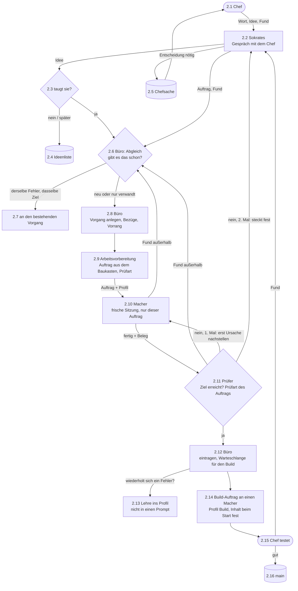

# 1727 · Grobablauf neu, frei gedacht (Entwurf Sokrates, 19.11.)

Auftrag Chef 19.11., 08:30: frei gedacht, wie die Firma arbeiten kann; Ziel winzige Prompts, was in jede Sitzung muss, ultrakompakt. Entwurf zum Besprechen, nichts davon gilt. Weisungen bisher sind kein Hindernis (Leitlinie 08:18). Quellen und Chefworte: `1625-prompts-kuerzen.md`. Durchnummeriert auf Wunsch des Chefs (09:33): Abschnitt 1, Punkt 1.1, Kasten im Diagramm 2.1.

## 1 Der Gedanke in drei Sätzen

- **1.1 Wissen wird geladen, wenn die Aufgabe es braucht, nicht vorab.** Jede Sitzung bekommt nur einen winzigen Sockel (etwa 0,5 KB) und ihren Auftrag (höchstens 1,5 KB). Handwerk liegt als Profil (Skill) bereit und lädt nur bei Bedarf.
- **1.2 Am Spiel arbeiten und die Firma verwalten sind getrennt.** Wer baut, kennt keine Vorgangsliste, keinen Vorrat und keine Melderegeln. Er bekommt einen Auftrag und meldet „fertig, hier der Beleg“. Alles Verwalten macht das Büro, und das meiste davon erledigt Code.
- **1.3 Regeln stehen nicht im Text, sondern in Werkzeugen oder im Auftrag.** Was ein Werkzeug prüfen oder verhindern kann, steht in keinem Prompt. Was nur für eine Aufgabe gilt, steht nur in deren Auftrag.

## 2 Flussdiagramm

## 3 Ergänzungen des Chefs, geprüft

Chef 09:14: „hast du wieder mein Feedback einfach eingebaut ohne dich damit auseinander zusetzen ob es sinnvoll ist“. Darum je Punkt: Wort, stärkstes Gegenargument, was sich ändert.

**3.1 Büro gleicht vor dem Anlegen ab** (09:00: „erstmal prüfen, ob es das alles schon gibt … Verweise auf andere Vorgangsnummern“). **Stimmt im Kern, zwei Einwände.**
- 3.1.1 *Sammelvorgänge:* „An einen bestehenden Vorgang hängen“ macht Vorgänge zu Sammelbecken; das verbietet heute schon die Regel „nie Fremdes unter eine Nummer“ (412). Darum anhängen nur bei **demselben Fehler oder demselben Ziel**; alles andere bekommt eine eigene Nummer und in der Spalte „Bezug“ die verwandten.
- 3.1.2 *Das Erkennen gibt es schon, das Handeln fehlt:* Unser Wiederholungswächter (654) legt längst Vorgänge „Systemlösung?“ an (1564 Wasser, 1635 Bogen, 1656 Kapuze). Sie liegen als Kür bei mir und sind nicht bearbeitet. Darum kommt die Systemfrage bei Bezügen **in den Auftrag der nächsten Behebung** (Pflichtfeld), statt als eigener Vorgang liegen zu bleiben.
- 3.1.3 *Ergänzt:* Der Abgleich ist Suche, also Code (Titel, Bereich, Dateien des Fundes); das Büro entscheidet nur zwischen den Treffern.

**3.2 Nicht alles ist ein Bild** (09:00). **Stimmt; Einwand: Nicht jede Prüfart kann eine KI verlässlich beurteilen.**
- 3.2.1 Belegt: 1694 meldete „grün“, das Bild zeigte den Fehler; 1650 Stiefel, 1653 Kragen gingen mit Bildern an den Chef, mit denen er nichts anfangen konnte. Bei Klang und Spielgefühl ist ein KI-Urteil noch schwächer.
- 3.2.2 Darum je Prüfart zwei Teile: **was der Prüfer selbst entscheidet** (messbar) und **was nur der Chef urteilt** (Aussehen, Klang, Spielgefühl). Dort prüft der Prüfer nur, ob der Chef damit urteilen kann, nicht ob es schön ist.

   | Nr. | Arbeit | Beleg | Prüfer entscheidet | Urteil |
   |---|---|---|---|---|
   | 3.2.3 | Aussehen, Figur, Welt | Bild in Spielkamera, Handygröße, alt gegen neu | Stelle sichtbar, mittig, markiert; Messung grün | Chef |
   | 3.2.4 | Bewegung | Film bis 15 s | zeigt den Moment, etwa dreimal | Chef |
   | 3.2.5 | Klang, Musik | Hörprobe im Spiel | spielt, Lautstärke im Rahmen, an der richtigen Stelle | Chef |
   | 3.2.6 | Regeln, Kampf, Balance | Rechnung bei 0, 24, 49, 74, 100, Kampfprotokoll | Zahlen stimmen mit dem Regelwerk | Prüfer; Spielgefühl Chef |
   | 3.2.7 | Spiellogik, Werkzeug | Test mit Befehl und Ausgabe | grün, Kerntests grün | Prüfer |
   | 3.2.8 | Spieltext | Abgleich mit `STORY-…` | wortgleich | Prüfer |
   | 3.2.9 | Spielgefühl, Ablauf | Durchspielprotokoll | läuft ohne Fehler durch | Chef |

**3.3 Rückläufer: wer legt an, wer fasst an** (09:00). **Stimmt, die Lücke war echt. Zwei Einwände gegen meinen ersten Wurf.**
- 3.3.1 *Drei Runden sind zu teuer:* Jede Runde ist eine Sitzung, und es gilt schon „nie einen Fehler zweimal mit Vermutung bauen“. Darum stellt derselbe Macher nach dem ersten Nein **erst die Ursache nach**, dann baut er; nach dem zweiten Nein geht es an Sokrates (steckt fest), keine dritte Runde.
- 3.3.2 *Kleinkram über das Büro kostet mehr als er nützt:* Ausnahme: **Tippfehler und Offensichtliches in den eigenen gesperrten Dateien** behebt der Macher und nennt es in „fertig“; alles andere meldet er.
- 3.3.3 Grundsatz: **Wer findet, meldet. Das Büro legt an. Die Arbeitsvorbereitung schreibt den Auftrag. Ein Macher baut.**

   | Nr. | Fall | Wer meldet | Wer legt an / entscheidet | Wer arbeitet ab |
   |---|---|---|---|---|
   | 3.3.4 | Ziel nicht erreicht, 1. Mal | Prüfer, mit Befund | bleibt im Vorgang | derselbe Macher: erst Ursache nachstellen, dann bauen |
   | 3.3.5 | Ziel nicht erreicht, 2. Mal | Prüfer | Sokrates: steckt fest | Sokrates klärt mit der Arbeitsvorbereitung: Auftrag, Profil oder Ursache falsch? Neuer Auftrag an einen frischen Macher, ggf. Chefsache |
   | 3.3.6 | Fund außerhalb des Auftrags | Macher oder Prüfer, eine Zeile „was, wo, Beleg“ | Büro: Abgleich (3.1) | wer laut Vorrang dran ist, mit eigenem Auftrag |
   | 3.3.7 | Tippfehler in eigenen Dateien | – | – | derselbe Macher, steht in „fertig“ |
   | 3.3.8 | Fund im Test des Chefs | Chef an Sokrates | Büro wie 3.3.6 | ebenso |
   | 3.3.9 | Ablauf oder Werkzeug hakt | wer es merkt | Büro (Regelwächter) | ein Macher mit Profil Werkzeug; Regel: Büro mit Sokrates |

**3.4 Werkzeug baut ein Macher mit Profil, nicht Spike** (09:14). **Stimmt**: Der Entwurf löst feste Fächer auf, die Nennung von Spike widersprach ihm; ebenso beim Build. Build und Werkzeug sind Profile wie Figur oder Klang. *Ergänzt:* Das Profil Werkzeug braucht drei feste Punkte, weil Werkzeuge jede Sitzung treffen: Kerntests vor dem Commit, kein Haken, der nur mahnt, Regelbilanz (ein neues Werkzeug ersetzt eine Textregel).

**3.5 Sind 4 KB für den Macher nicht zu groß?** (09:33: „Für Büro und Sokrates ggf. Ausnahme, aber generell?“). **Beim Sockel ja, beim Auftrag nein.**
- 3.5.1 *Sockel:* Von den acht Zeilen des ersten Wurfs kann ein Werkzeug fünf übernehmen oder ein Profil tragen (siehe 5). Es bleiben drei Zeilen, etwa 0,5 KB. Hier hattest du recht.
- 3.5.2 *Auftrag:* Er ist kein Ballast, sondern die Arbeit selbst: Ziel, Stand mit Ursache, Prüfpunkte. Kürzer heißt hier: der Macher sucht, was der Auftrag hätte sagen können, oder rät. Bei 1694 lag der Fehler genau im fehlenden Stand. Darum Grenze 1,5 KB als Zucht (höchstens fünf Punkte unter „Beachte“), aber kein Kürzen um jeden Preis.
- 3.5.3 *Stärkstes Gegenargument gegen mich:* Eine Grenze erzwingt Schärfe; ohne harte Zahl wachsen Aufträge wieder zu Abläufen. Entkräftet: Die Grenze steht im Baukasten, ein Werkzeug misst sie beim Start, und der Prüfer zählt, wie oft ein Auftrag als unklar zurückkommt (9.2).
- 3.5.4 *Zur Einordnung:* Claude Code lädt selbst schon einen Systemprompt und die Beschreibungen aller Werkzeuge, ein Vielfaches unserer Kilobytes, und während der Arbeit liest der Macher Code und Bilder. Was schadet, sind nicht die Bytes allein, sondern Unpassendes und Widersprüche (Quelle „Context Rot“ in 1625). Darum zählt: jede Zeile im Sockel wird in jeder Sitzung gebraucht, jede Zeile im Auftrag für genau diese Aufgabe.
- 3.5.5 *Büro und Sokrates:* Ja, Ausnahme: Sockel plus Kern von je höchstens 3 KB, weil sie Abläufe halten bzw. mit dem Chef sprechen. Auch dort lädt der Rest bei Anlass.
- 3.5.6 *Neu je Sitzung:* Macher etwa 2 KB (0,5 Sockel + höchstens 1,5 Auftrag), dazu ein Profil bei Bedarf; Prüfer ebenso; Büro, Sokrates, Arbeitsvorbereitung bis 3,5 KB. Heute: Macher etwa 75 KB.

## 4 Wer was tut

| Nr. | Wer | Tut | Liest beim Start |
|---|---|---|---|
| 4.1 | **Chef** | entscheidet, testet, gibt Ideen | – |
| 4.2 | **Sokrates** | Gespräch mit dem Chef; macht aus einem Chefwort einen Auftrag, einen Entscheid oder eine Idee; prüft Ideen gegen Bestand und Leitbild; löst Festgefahrenes (3.3.5) | Sockel, Kern (bis 3 KB) |
| 4.3 | **Büro** (Ford, gestärkt) | Abgleich, Vorgänge, Vorrang (heute Perikles), Starten, Einsortieren, Melden, Kosten, Regelwächter; das Mechanische macht `lauf.py` | Sockel, Kern (bis 3 KB) |
| 4.4 | **Arbeitsvorbereitung** (heute Perikles; bei Chefthemen Sokrates) | schreibt je Vorgang einen Auftrag nach dem Baukasten (6) | Sockel, Baukasten, Akte des Vorgangs |
| 4.5 | **Macher** (Pool ohne feste Fächer; die Rolle steht im Auftrag und im Profil: Figur, Level, Kampf, Klang, Werkzeug, Build, Text) | baut genau einen Auftrag in einem Zweig | Sockel, Auftrag; Profil bei Bedarf |
| 4.6 | **Prüfer** (Diogenes) | prüft nach der Prüfart des Auftrags (3.2), bevor der Chef es sieht; meldet Funde außerhalb ans Büro | Sockel, Auftrag, Ergebnis |

- 4.7 Feste Bereiche fallen weg (Chef 08:17): Verantwortung hängt am Vorgang, nicht an „Dorf“ oder „Höhle“. Damit zwei Macher sich nicht in die Quere kommen, sperrt das Büro je Auftrag ein Verzeichnis oder eine Szene.

## 5 Was in jede Sitzung muss (Sockel, etwa 0,5 KB, heute 15 KB)

Nur, was jede Sitzung braucht, nicht selbst sehen kann und kein Werkzeug erzwingen kann:

- 5.1 Deutsch, Berliner Zeit.
- 5.2 Auftrag unklar oder unmöglich: anhalten und zurückfragen, nicht raten; vorher nachsehen.
- 5.3 Fund außerhalb des Auftrags: melden, nicht beheben (außer 3.3.7).

Wohin der Rest zieht:

| Nr. | Bisher im Text | Neu |
|---|---|---|
| 5.4 | Name und Zeit vor jeder Nachricht | Haken setzt ihn |
| 5.5 | Nie Schlüssel, Passwörter committen; App-Kennung; kein Force-Push | Sperrhaken (verhindert, mahnt nicht) |
| 5.6 | Kein Spielcode auf `main` ohne Test des Chefs | Schutz von `main` auf GitHub plus Sperrhaken |
| 5.7 | Spieltexte nie erfinden; Begriffe | Profil Spieltext |
| 5.8 | Fremde Inhalte nur mit offener Lizenz | Profil Fremde Inhalte (lädt beim Einbinden von Dateien) |
| 5.9 | „Fertig“ mit Beleg | Feld „Zurück“ in jedem Auftrag |
| 5.10 | Melden, Vorgänge, Chefsache, Rollen | Kern Büro bzw. Sokrates |

## 6 Der Auftrag (Baukasten, höchstens 1,5 KB)

Feste Gliederung, erprobt in `auftraege-19-11.md`:
- 6.1 **Ziel:** was der Spieler sieht, hört oder erlebt.
- 6.2 **Systemfrage:** keine Einzellösung; wie lösen es andere? Pflicht bei Bezügen (3.1.2).
- 6.3 **Stand:** was schon versucht wurde, mit Ursache.
- 6.4 **Beachte:** höchstens fünf Punkte.
- 6.5 **Umsetzen.**
- 6.6 **Prüfart und Prüfe vor dem Senden:** drei bis fünf Ja-Nein-Fragen (3.2).
- 6.7 **Zurück:** an wen, in welcher Form, mit Beleg.

## 7 Profile (Skills, laden nur bei Bedarf)

- 7.1 Je Arbeit ein Profil mit Handwerk, Prüfung, Abnahmebeleg: Figur und 3D-Modell · Prüfbild und Film · Leveldesign · Kampf und Regeln · Klang · Werkzeug · Build und APK · Spieltext · Fremde Inhalte.
- 7.2 Das erste gibt es schon (`LISTE-HANDWERK-FIGUR-PRUEFBILD.md`).
- 7.3 Was beim Prüfer zweimal zurückkam, wird eine Zeile im Profil, nicht im Sockel. Der Prüfer schlägt sie vor, das Büro trägt sie ein; je Profil eine Größengrenze.

## 8 Was es kostet, was es spart

- 8.1 Start eines Machers: heute etwa 75 KB, neu etwa 2 KB plus Profil. Weniger Ablenkung, also weniger Fehler, die der Chef zuerst findet.
- 8.2 Jede Sitzung ist kurz und frisch; es gibt keinen Vorrat, den sie pflegen muss.
- 8.3 Eine Prüfung durch einen anderen fängt ab, was heute fünf- bis achtmal nachkontrolliert wird.
- 8.4 Gegenrechnung: Prüfer, Büro und Arbeitsvorbereitung kosten eigene Sitzungen. Gemessen wird darum das Guthaben je abgenommenem Auftrag, nicht die Startgröße.

## 9 Stärkstes Gegenargument

- 9.1 **Alles hängt an der Güte der Aufträge.** Ein frischer Macher weiß nur, was im Auftrag steht. Ist der Auftrag schlecht, misst der Prüfer an denselben schlechten Prüfpunkten, und derselbe blinde Fleck geht zweimal durch (1694: Prüfung „grün“, Bild falsch).
- 9.2 **Entkräftet durch:** (1) Der Prüfer prüft zuerst das Ziel, dann die Punkte des Auftrags, nach der Prüfart (3.2). (2) Wir messen den Auftragsschreiber: wie viele Aufträge kommen als unklar zurück, wie viele Läufe bis zur Abnahme. (3) Systemfrage und Stand mit Ursache sind Pflicht; ohne sie startet das Büro keinen Auftrag.
- 9.3 Zweites Gegenargument: **Das Büro wird zum Nadelöhr.** Entkräftet: Was sich regeln lässt, macht `lauf.py`; die Sitzung Büro schreibt nur den Rest. Rückweg ist der heutige Stand in Git.

## 10 Weitere Einwände

- 10.1 **Haken:** heute 14 Einträge in `.claude/settings.json`, hinter denen viele Prüfungen stecken, viele mahnen nur. Neu: ein Haken nur, wenn er etwas verhindert. Ohne das bringt der kleine Sockel wenig, weil die Haken Text nachschieben.
- 10.2 **Der Prüfer kostet eine Sitzung je Auftrag.** Bei knappem Guthaben nur für Aussehen und Kampf; bei Werkzeugen prüft der Kerntest.
- 10.3 **Homer und Sokrates sind keine Auftragsarbeiter.** Für Story und Beratung bleibt ein Kern mit Gespräch; der Gedanke gilt für Bauarbeit.
- 10.4 **Zusammenstöße im Repo:** Sperre je Verzeichnis oder Szene; die Vorgangsliste schreibt nur ein Werkzeug; bei einem Konflikt geht der Auftrag zurück, keiner löst ihn von Hand.
- 10.5 **Rückläufer zählen:** Wie oft ein Vorgang beim Prüfer scheiterte (3.3.4, 3.3.5), zählt ein Werkzeug, nicht eine Sitzung.

## 11 Gegenlesen (19.11., 08:32, frischer Helfer ohne meine Begründung)

Urteil: „Die Richtung … trägt. Der Entwurf löst aber das Verwaltungsproblem nur verschoben und lässt drei Praxisbrüche offen.“ Fünf Befunde, je mit meinem Wort:
- 11.1 Das stärkste Gegenargument ist der Auftragsschreiber, nicht das Büro. **Stimmt**, in 9.
- 11.2 Zusammenstöße: Sperre je Datei taugt nicht, die Vorgangsliste schreiben mehrere. **Stimmt**, in 10.4.
- 11.3 Wer Lehren ins Profil schreibt, fehlt. **Stimmt**, in 7.3.
- 11.4 Im Sockel fehlen der Abbruchweg und „melden, nicht beheben“; „wer wir sind“ kann raus. **Stimmt**, in 5.
- 11.5 Die Kosten je Auftrag können steigen. **Stimmt**, in 8.4. **Einwand:** Ein Prüfer nur bei Aussehen und Kampf stand schon im Entwurf.
- 11.6 Zusatz: Die Haken gehören in Schritt 1. **Stimmt**, in 12.1.

## 12 Einführung in Schritten (ab Sa 21.11., 20:00)

- 12.1 `CLAUDE.md` auf den Sockel kürzen; altes als `docs/alt/CLAUDE-voll.md`. Mahnhaken abschalten, Sperrhaken für 5.5 und 5.6 behalten.
- 12.2 Ein Macher, eine Woche, nur mit Auftrag, Prüfer davor. Zählung: Läufe bis Abnahme, Fehler, die der Chef zuerst findet, Guthaben je Auftrag.
- 12.3 Büro übernimmt Abgleich, Vorrang und Einsortieren; Perikles wird Arbeitsvorbereitung.
- 12.4 Dann die übrigen Macher; Rollendateien schrumpfen auf den Kern.

## 13 Was der Chef sagen soll

„Richtung ja“ (dann ab Samstag 12.1) oder dein Einwand mit Nummer.
