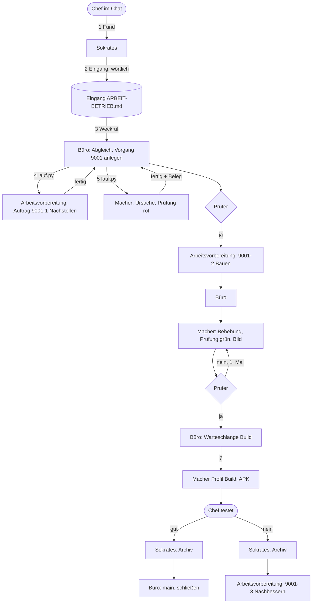

# 1727 · Durchlauf: „Der Zwerg steht in der Schänke auf dem Tisch“ (fiktiv)

Auftrag Chef 19.11., 20:37: „spiel mal den Ablauf durch, Flussdiagramm technisch. Wer wen wo darüber informiert, wer was anlegt, was das für ein Vorgang wird, was da für Aufträge generiert werden, wann das weitergeht.“ Gespielt von Sokrates nach `1727-gesamtbild.md` (0a, Kerne Büro und Arbeitsvorbereitung) am 19.11., 20:40. Vorgangsnummer 9001 ist erfunden.

| Schritt | wer | tut | wo | wann |
|---|---|---|---|---|
| 1 | Chef → Sokrates | „Der Zwerg steht in der Schänke auf dem Tisch“ | Chat | sofort |
| 2 | Sokrates | Wortlaut mit Zeit als „Von Chef (19.11., 20:37): …“ in den Eingang; im Chat eine Zeile „eingetragen“. Fehlt Wichtiges (welcher Build, Bild?), einmal nachfragen. | `ARBEIT-BETRIEB.md` „Eingang“ | in derselben Antwort |
| 3 | Büro | Abgleich `vorgang.py Schänke`, `… Tisch`, `… Höhe`: nicht sicher derselbe wie ein alter → **Vorgang 9001** „Zwerg steht in der Schänke auf dem Tisch“, Block Dorf und Innenräume, Bereich E Welt, Muss (Fund des Chefs), Bezug auf ähnliche Nummern; Chefwort in die Vorgangsdatei | Vorgangsliste, `vorgang/9001.md` | nächster Weckruf (bis 1 h) |
| 4 | Büro startet Arbeitsvorbereitung | Ursache unbekannt → **Auftrag 9001-1 Nachstellen**: Schänke laden, Fußhöhe des Zwergs gegen den Boden messen; Prüfung „Füße auf dem Boden“ über alle Figuren in allen Innenräumen, die den Fehler rot zeigt; nicht bauen; Profil Welt; Zurück an das Büro | `vorgang/9001.md` oben | nächster Weckruf |
| 5 | Büro startet Macher | baut 9001-1 im Zweig `claude/9001-zwerg`, meldet Ursache mit Bild, Commit, Prüfung rot | Zweig; Rückmeldung ans Büro | nächster Weckruf |
| 5a | Büro → Prüfer | Beleg da? Prüffragen beantwortet? ja → Ergebnis in den Auftrag (Werkzeug), Stand „angenommen“ | `vorgang/9001.md` | nächster Weckruf |
| 6 | Arbeitsvorbereitung, dann Macher, dann Prüfer | **Auftrag 9001-2 Bauen**: Behebung für alle Figuren in allen Innenräumen, Prüfung grün, genau ein Bild alt gegen neu in Spielkamera, Handygröße. Prüfer ja → Warteschlange; nein beim ersten Mal → zurück an denselben Macher; beim zweiten Mal → Sokrates | wie oben | je ein Weckruf |
| 7 | Büro startet Macher mit Profil Build | Testbuild mit allem aus der Warteschlange; an den Chef per Telegram: Build-Link und Prüfpunkt „9001: Zwerg steht auf dem Boden, Schänke, Grafik Hoch“ | `claude/build-<n>`, Telegram | **offen, siehe Lücke 4** |
| 8 | Chef | testet; sagt Sokrates „9001 gut“ oder „steht immer noch“ | Chat | wann er will |
| 9a | Sokrates, Büro | gut: Wortlaut ins Vorgangsarchiv; Büro sieht es, Macher Build bringt es nach `main`; Büro schließt 9001 „erledigt“ | Archiv, `main` | nächster Weckruf |
| 9b | Sokrates, Büro, Arbeitsvorbereitung | nein: Wortlaut ins Archiv und in die Vorgangsdatei; Runde 1; **Auftrag 9001-3 Nachbessern** | wie oben | nächster Weckruf |

## Lücken, die der Durchlauf zeigt

1. **Vorgangsdatei erst mit Auftrag passt nicht:** In Schritt 3 gibt es noch keinen Auftrag, aber schon ein Chefwort, das in die Vorgangsdatei muss. Vorschlag: Die Datei entsteht mit dem ersten Chefwort oder dem ersten Auftrag; eine Idee ohne beides bleibt eine Zeile.
2. **Jeder Schritt wartet auf den Weckruf:** sechs Übergaben bis zum Build, je bis zu einer Stunde, also bis zu sechs Stunden, auch wenn jeder Einzelne in Minuten fertig ist. Vorschlag: Eine Rückmeldung weckt das Büro sofort (`send_message`), der Stundentakt ist nur das Netz darunter.
3. **Prüfer auch nach dem Nachstellen?** Ein Nachstellauftrag liefert eine Ursache, keinen Bau. Vorschlag: Der Prüfer prüft nur den Beleg (Prüfung zeigt den Fehler rot, Bild passt), ohne Eintauchen und Signatur.
4. **Wann ein Build gemacht wird, steht in keinem Kern:** nach Zahl der Vorgänge in der Warteschlange, täglich, oder wenn der Chef testen will? Grobablauf 3.19 ist dazu nicht als Einzelentscheid im Archiv. Frage an den Chef.
5. **Wer die Prüfpunkte für den Test des Chefs schreibt** (heute `ansehen/t<n>` nach `LISTE-CHECK-BUILD-TEST.md`): fehlt im Kern Büro. Vorschlag: die Prüffragen der Aufträge im Build, gesammelt vom Werkzeug, vom Büro gesendet.
